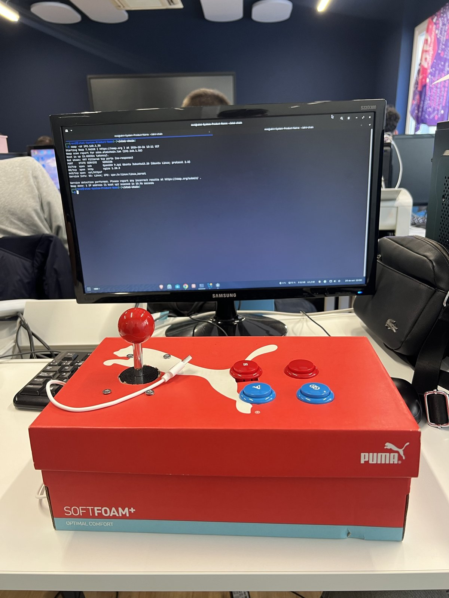

# Arcade stick con Arduino

Mando arcade con un joystick y 4 botones, controlado por un **Arduino Leonardo** que el ordenador reconoce como un **teclado USB**. No necesita drivers ni configuración, así que funciona en cualquier emulador y en cualquier sistema operativo. Las teclas se pueden cambiar en el código o en el propio emulador.

| Archivo | Qué es |
| --- | --- |
| [`mando_arcade/mando_arcade.ino`](mando_arcade/mando_arcade.ino) | Código del Arduino |
| [`img/montaje_desde_arriba.png`](img/montaje_desde_arriba.png) | Esquema de conexiones |
| [`img/mando_terminado.jpg`](img/mando_terminado.jpg) | Foto del mando terminado |
| [`img/mando_fisico.jpg`](img/mando_fisico.jpg) | Foto del montaje por dentro (prototipo en caja de cartón) |
| `capturas/` | Evidencias de las pruebas (fotos y vídeos) |

## 1. Material y presupuesto

| Pieza | Cantidad | Para qué | Precio (presupuesto) |
| --- | --- | --- | --- |
| Arduino Leonardo (ATmega32U4) | 1 | Lee los botones y hace de teclado USB | 25,40 € |
| Kit arcade de 1 jugador: joystick de 4 direcciones (5 hilos), pulsadores y cableado | 1 | Joystick y botones B1 a B4 | 33,05 € |
| Protoboard | 1 | Solo como punto común de GND | Material del aula |
| Cables dupont macho | ≈ 15 | Conexiones | Material del aula |
| Cable micro-USB | 1 | Conexión y alimentación desde el PC | Material del aula |
| **Total** | | | **58,45 €** |

Los precios son los del [presupuesto](../docs/presupuesto/fichas_hw_sw.md#7-máquina-recreativa-y-arcade-stick). En el aula se montó con un Leonardo de Keyestudio (compatible) y el material disponible.

## 2. Por qué un microcontrolador, y por qué como teclado

### 2.1 Tecnología habilitadora: sistemas embebidos frente a alternativas comerciales

El arcade stick es un pequeño **sistema embebido**: un microcontrolador que lee sensores (los pulsadores) y se comunica con otro equipo por USB, como un dispositivo IoT sencillo.

| Opción | Ventajas | Inconvenientes | ¿Cumple el enunciado? |
| --- | --- | --- | --- |
| Mando USB comercial | Plug and play | No tiene joystick arcade; no se puede reprogramar | No: el input no es personalizable |
| *Encoder* USB del kit (*zero delay*) | Incluido en el kit, sin programar | Asignación de botones fija por el fabricante; no se puede cambiar su firmware ni añadir funciones | Solo en parte |
| **Arduino Leonardo** (elegido) | USB nativo (HID): se reconoce sin drivers. Se programa en C++ con el IDE de Arduino. Las teclas están en una tabla del código | Hay que cablearlo y programarlo | **Sí**: personalizable, documentado y versionado |
| Arduino Uno | Muy común en clase | Sin USB nativo: no puede hacer de teclado sin cambiar el firmware del chip USB | No sin modificarlo |

Por eso se sustituyó el *encoder* del kit por el Leonardo: el enunciado pide un controlador **compatible con cualquier emulador y con el input personalizable**, y el *encoder* no se puede personalizar.

### 2.2 Por qué como teclado

- **Leonardo (chip ATmega32U4):** tiene USB nativo, así que puede presentarse al ordenador como un dispositivo de entrada (HID). Un Arduino Uno no puede hacerlo sin cambiar su firmware.
- **Como teclado, y no como mando:** la biblioteca `Keyboard.h` viene incluida en el IDE de Arduino, sin instalar nada. Todos los sistemas y todos los emuladores aceptan un teclado sin drivers. Para un mando arcade, que solo tiene entradas digitales (pulsado o no), un teclado no pierde nada respecto a un mando USB.

### 2.3 Input personalizable

1. **Sin reprogramar:** en el emulador, cada uno asigna las teclas a lo que quiera, por ejemplo en MAME con *Tab → Input (este juego)* o en RetroArch con *Ajustes → Entrada*.
2. **Código parametrizado:** todas las teclas están en una sola tabla, `teclas[]`, y los pines en `pines[]`. Cambiar un control es cambiar un valor de la tabla, sin tocar la lógica.

## 3. Conexiones

| Entrada | Pin del Leonardo | Tecla que envía |
| --- | --- | --- |
| Joystick arriba | 3 | Flecha arriba |
| Joystick abajo | 4 | Flecha abajo |
| Joystick izquierda | 5 | Flecha izquierda |
| Joystick derecha | 2 | Flecha derecha |
| Botón 1 (rojo) | 9 | `Ctrl` izquierdo: botón 1 de MAME |
| Botón 2 (rojo) | 8 | `Alt` izquierdo: botón 2 de MAME |
| Botón 3 (azul) | 7 | `5`: **moneda** |
| Botón 4 (azul) | 6 | `1`: **start**. Mantenido 2 s, `Esc`: salir al menú |

Son las teclas que MAME usa **por defecto**, así que el mando funciona en cualquier juego sin configurar nada. La **doble dirección** (diagonales) funciona porque el código mantiene pulsadas dos flechas a la vez.

- Cada entrada va a **su pin** por un lado y a **GND** por el otro. Todas las GND se juntan en la columna (−) de la protoboard, y un único cable negro la une al GND del Leonardo.
- No se usan resistencias ni 5V: el código activa la resistencia interna de cada pin (`INPUT_PULLUP`).
- En el joystick, qué hilo es GND y qué dirección es cada uno se comprobó con el propio sketch.

## 4. Cómo funciona el código

1. **`INPUT_PULLUP`:** sin pulsar, el pin lee `HIGH`. Al pulsar, el botón une el pin con GND y lee `LOW`.
2. **Bucle:** recorre las 8 entradas sin parar. Si una cambia de estado, envía `Keyboard.press()` al pulsar y `Keyboard.release()` al soltar. Así se pueden mantener pulsadas varias a la vez (por ejemplo, diagonal + botón).
3. **Antirrebote de 10 ms:** un pulsador mecánico «rebota» y da varios cambios en milisegundos. Solo se acepta un cambio si han pasado 10 ms desde el anterior.
4. **`delay(2000)` al arrancar:** deja 2 segundos antes de empezar a enviar teclas, para poder volver a subir el sketch si algo falla (un Leonardo que envía teclas sin parar es difícil de reprogramar).
5. **Salir manteniendo START:** al pulsar B4 se apunta la hora (`millis()`). Si sigue pulsado 2 segundos, el código suelta el `1` y envía un `Esc` una sola vez. Así un solo botón hace dos funciones, sin añadir hardware.

## 5. Pasos para reproducirlo

1. Monta las conexiones de la tabla del apartado 3.
2. En el IDE de Arduino: *Herramientas → Placa → Arduino Leonardo* y elige su puerto.
3. Abre `mando_arcade/mando_arcade.ino` y súbelo.
4. Pruébalo en cualquier programa: cada botón tiene que escribir su tecla.
5. **En la recreativa (VirtualBox):** con la VM apagada, *Configuración → USB → USB 1.1 (OHCI)* y añade un filtro para el dispositivo *Arduino Leonardo*. Al arrancar, la VM lo recibe como teclado. Con USB 1.1 basta, porque un teclado es un dispositivo de baja velocidad.
6. **En MAME:** no hay que configurar nada. Las flechas mueven al jugador, B1 y B2 son los botones de acción, B3 mete una moneda, B4 es *start* y, manteniéndolo 2 segundos, se sale del juego al menú. Si se quiere otra distribución, se cambia en *Tab → Input (este juego)* o en la tabla `teclas[]` del código.

## 6. Seguridad y mínimo privilegio

- Es un dispositivo de clase **HID estándar**: no instala drivers ni necesita permisos de administrador en el equipo.
- En la recreativa, MAME lo usa con el usuario `recreativa`, sin root.
- Solo envía las 8 teclas de su tabla. No puede ejecutar nada por su cuenta.

## 7. Pruebas

| # | Prueba | Resultado esperado | Estado | Evidencia |
| --- | --- | --- | --- | --- |
| 1 | Revisión del montaje y funcionamiento por el profesor | Funciona | ✅ Validado por el profesor | — |
| 2 | Probador de teclado en el navegador: pulsar las 8 entradas | Cada entrada marca su tecla | ✅ 26/10, con la versión anterior del código (Z, X, C y V): se marcan las 4 flechas y los 4 botones | [vídeo](capturas/stick_01_probador_teclado.mp4) |
| 3 | Diagonal + botón a la vez (doble dirección) | Se marcan las tres teclas a la vez | ⏳ | `capturas/stick_06_diagonal.png` |
| 4 | Jugar a Gridlee en la VM recreativa (instantánea `03 - optimizada`) | El juego responde al joystick y a los botones | ✅ Validado por el profesor en clase |  |
| 5 | Otro programa: el juego del dinosaurio de Chrome (`chrome://dino`) | Responde igual, sin configurar drivers | ✅ 26/10: joystick arriba salta y abajo se agacha | [vídeo](capturas/stick_04_chrome_dino.mp4) |
| 6 | Remapear un botón en MAME (*Tab → Input*) | El botón hace la nueva acción | Opcional | — |
| 7 | **Moneda, start y salir** en Gridlee: B3 mete crédito, B4 empieza la partida y mantener B4 2 s vuelve al menú | Funciona sin configurar MAME | ⏳ | `capturas/stick_07_moneda_start.mp4` |
| 8 | **Cada control por separado** (vídeo): las 4 direcciones, una diagonal, B1, B2, moneda, start y salir | Cada uno hace su acción | ⏳ | `capturas/stick_08_cada_control.mp4` |
| 9 | **Otro emulador:** RetroArch (u otro), sin configurar drivers | El joystick y los botones responden | ⏳ | `capturas/stick_09_retroarch.png` |

## 8. Preguntas que pueden hacer en la defensa

- **¿Por qué un Arduino y no el *encoder* USB del kit?** Porque el *encoder* tiene la asignación fija de fábrica y no se puede reprogramar. El enunciado pide input personalizable.
- **¿Es IoT?** Es un sistema embebido: un microcontrolador que lee sensores y se comunica con otro equipo. Es la misma base que un dispositivo IoT, aunque aquí la comunicación es por USB y no por red.
- **¿Por qué no un Arduino Uno?** Porque no tiene USB nativo y no puede hacerse pasar por teclado sin cambiar su firmware.
- **¿Por qué no hay resistencias?** Porque se usan las internas del chip con `INPUT_PULLUP`.
- **¿Por qué pulsado es `LOW`?** Porque el botón une el pin con GND, y sin pulsar la resistencia interna lo mantiene en `HIGH`.
- **¿Qué es el antirrebote?** Ignorar los cambios de menos de 10 ms que produce el contacto mecánico al pulsar.
- **¿Cómo cambio un botón?** En la tabla `teclas[]` del código o en el menú de entradas del emulador.
