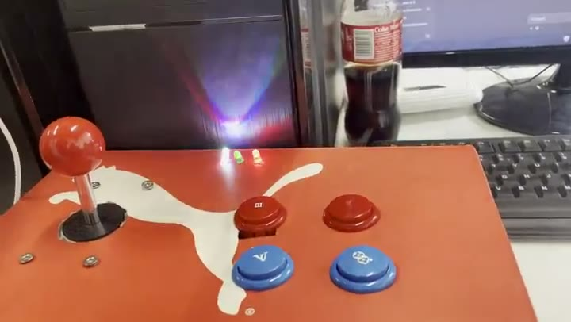
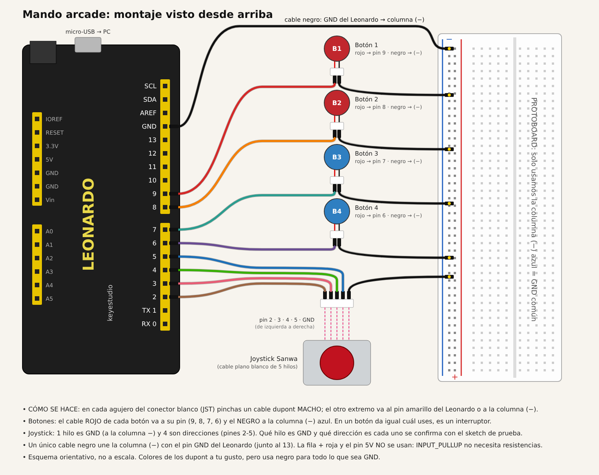
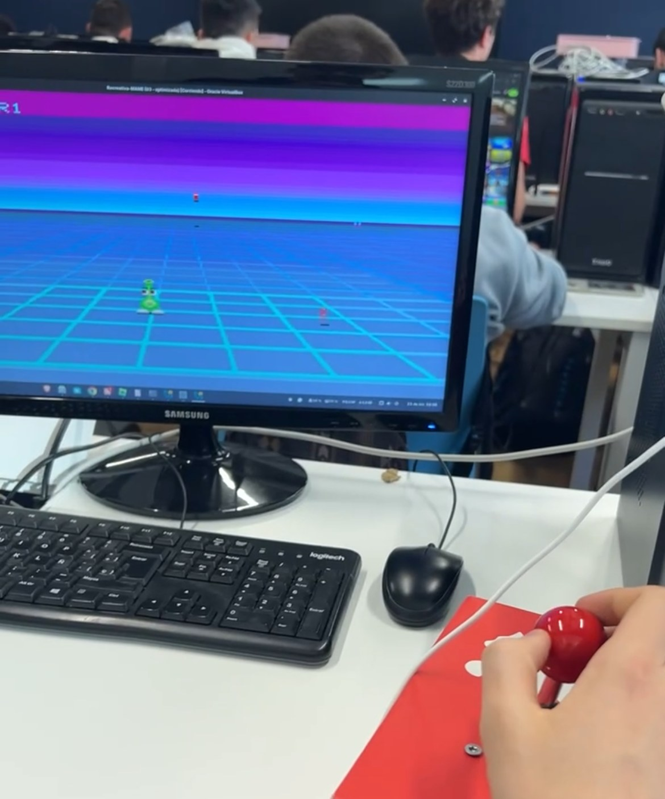

# Arcade stick con Arduino

Mando arcade controlado por un **Arduino Leonardo** que el ordenador reconoce como un **teclado USB**. No necesita drivers ni configuración, así que funciona en cualquier emulador y en cualquier sistema operativo. Las teclas se pueden cambiar en el código o en el propio emulador.

La **versión final** tiene:

- un joystick de 4 direcciones y 4 botones (B1 a B4);
- un botón **START** en el lateral de la caja;
- tres luces en la tapa: un **LED RGB** (izquierda), un **LED verde** (centro) y un **LED rojo** (derecha);
- un **altavoz**, que toca una melodía al conectar el mando y da un pitido distinto con cada botón.

| Archivo | Qué es |
| --- | --- |
| [`mejora-leds-altavoz/mando_arcade_leds/mando_arcade_leds.ino`](mejora-leds-altavoz/mando_arcade_leds/mando_arcade_leds.ino) | **Código de la versión final** (el que lleva el mando) |
| [`mejora-leds-altavoz/img/montaje_leds_altavoz_boton.png`](mejora-leds-altavoz/img/montaje_leds_altavoz_boton.png) | Esquema de conexiones de las luces, el altavoz y el botón START |
| [`img/montaje_desde_arriba.png`](img/montaje_desde_arriba.png) | Esquema de conexiones del joystick y los botones |
| [`img/mando_final_luces.jpg`](img/mando_final_luces.jpg) | Foto del mando final con las luces encendidas |
| [`img/mando_terminado.jpg`](img/mando_terminado.jpg) · [`img/mando_fisico.jpg`](img/mando_fisico.jpg) | Fotos del mando por fuera y del montaje por dentro |
| [`mejora-leds-altavoz/capturas/prueba_luces_start.mp4`](mejora-leds-altavoz/capturas/prueba_luces_start.mp4) | Vídeo de la prueba de las luces y el START |
| `capturas/` | Vídeos y fotos de las pruebas del joystick y los botones |
| [`mando_arcade/mando_arcade.ino`](mando_arcade/mando_arcade.ino) | Versión 1: solo joystick y botones (ver apartado 11) |
| [`mejora-leds-altavoz/README.md`](mejora-leds-altavoz/README.md) | Diario de la mejora del 3 y 4 de noviembre |

## 1. Qué hace

| Control | Pin | Tecla que envía | Para qué (en MAME) | Además |
| --- | --- | --- | --- | --- |
| Joystick ↑ ↓ ← → | 3, 4, 5, 2 | Flechas | Mover | — |
| B1 (rojo) | 9 | Ctrl izquierdo | Disparar | Pitido |
| B2 (rojo) | 8 | `5` | Moneda | Pitido |
| B3 (azul) | 7 | `P` | Pausa | Pitido |
| B4 (azul) | 6 | `Esc` | Salir | Pitido |
| **START** (lateral) | A0 | `1` | *Start* | Pitido y luces |

- **Al conectar el USB:** se encienden las tres luces y suena una melodía corta. Sirve para comprobar que todo funciona y, de paso, da 2 segundos de margen para volver a subir el sketch.
- **Primera pulsación de START:** envía la tecla `1` y activa el modo fiesta: el LED RGB cambia de color en bucle y el verde se queda encendido.
- **Segunda pulsación de START:** se apagan el RGB y el verde, y el rojo se enciende durante 1 segundo.

## 2. Material y presupuesto

| Pieza | Cantidad | Para qué | Precio (presupuesto) |
| --- | --- | --- | --- |
| Arduino Leonardo (ATmega32U4) | 1 | Lee los botones y hace de teclado USB | 25,40 € |
| Kit arcade de 1 jugador: joystick de 4 direcciones (5 hilos), pulsadores y cableado | 1 | Joystick y botones B1 a B4 | 33,05 € |
| LED RGB de cátodo común (4 patas) | 1 | Colores en bucle | Material del aula |
| LED verde y LED rojo de 5 mm | 1 + 1 | Mando encendido / aviso de apagado | Material del aula |
| Altavoz de placa base (conector SPEAKER) | 1 | Melodía y pitidos | Material del aula |
| Pulsador | 1 | START en el lateral | Material del aula |
| Resistencias de 220 Ω | 6 | Una por cada color del RGB, una por LED y una para el altavoz | Material del aula |
| Protoboard, cables dupont y cable micro-USB | — | Conexiones y GND común | Material del aula |
| **Total** | | | **58,45 €** |

Los precios son los del [presupuesto](../docs/presupuesto/fichas_hw_sw.md#7-máquina-recreativa-y-arcade-stick). En el aula se montó con un Leonardo de Keyestudio (compatible) y el material disponible.

## 3. Por qué un Leonardo y por qué como teclado

### 3.1 Frente a las alternativas comerciales

El arcade stick es un pequeño **sistema embebido**: un microcontrolador que lee los pulsadores, se comunica con el PC por USB y controla luces y sonido.

| Opción | Ventajas | Inconvenientes | ¿Cumple el enunciado? |
| --- | --- | --- | --- |
| Mando USB comercial | Se enchufa y funciona | No tiene joystick arcade y no se puede reprogramar | No: el input no es personalizable |
| *Encoder* USB del kit (*zero delay*) | Viene en el kit y no hay que programarlo | La asignación de botones la fija el fabricante, y no puede manejar luces ni sonido | Solo en parte |
| Raspberry Pi | Muy potente | Es un ordenador entero: más caro, tarda en arrancar y es demasiado para leer 9 entradas | Sí, pero sobredimensionado |
| **Arduino Leonardo** (elegido) | USB nativo (HID), sin drivers. Barato (≈ 25 €). Las teclas están en una tabla del código. Le sobran pines para luces y altavoz | Hay que cablearlo y programarlo | **Sí**: personalizable, documentado y versionado |
| Arduino Uno | Muy común en clase | Sin USB nativo: no puede hacer de teclado sin cambiar el firmware | No sin modificarlo |

La justificación completa está en el [documento de digitalización](../docs/digitalizacion/digitalizacion.md) (tecnologías habilitadoras: IoT y sistemas embebidos).

### 3.2 Por qué como teclado

- **Leonardo (chip ATmega32U4):** tiene USB nativo, así que puede presentarse al ordenador como un dispositivo de entrada (HID). Un Arduino Uno no puede hacerlo sin cambiar su firmware.
- **Como teclado, y no como mando:** la biblioteca `Keyboard.h` viene incluida en el IDE de Arduino. Todos los sistemas y todos los emuladores aceptan un teclado sin drivers. Para un mando arcade, que solo tiene entradas digitales (pulsado o no), un teclado no pierde nada respecto a un mando USB.

### 3.3 Input personalizable

1. **Sin reprogramar:** en el emulador, cada uno asigna las teclas a lo que quiera, por ejemplo en MAME con *Tab → Input (este juego)* o en RetroArch con *Ajustes → Entrada*.
2. **En el código:** todas las teclas están en una sola tabla, `teclas[]`, y los pines en `pines[]`. Cambiar un control es cambiar un valor de la tabla, sin tocar la lógica.

## 4. Conexiones

### 4.1 Joystick y botones

- Cada entrada va a **su pin** (tabla del apartado 1) por un lado y a **GND** por el otro. Todas las GND se juntan en la línea (−) de la protoboard, y un único cable negro la une al GND del Leonardo.
- No hacen falta resistencias ni 5V: el código activa la resistencia interna de cada pin (`INPUT_PULLUP`). El botón START, en A0, funciona igual.
- En el joystick, qué hilo es GND y qué dirección es cada uno se comprobó con el propio sketch.

### 4.2 Luces, altavoz y botón START

| Elemento | Pin | Detalle |
| --- | --- | --- |
| LED RGB rojo / verde / azul | 10 / 11 / 12 | Cada uno con su resistencia. La pata larga (común) va a (−) |
| LED verde | 1 | Pin → resistencia → pata larga (+). La pata corta va a (−) |
| LED rojo | 0 | Pin → resistencia → pata larga (+). La pata corta va a (−) |
| Altavoz | 13 | Pin → resistencia → hilo rojo. El hilo negro va a (−) |
| Botón START | A0 | Un hilo a A0 y el otro a (−) |

- Los LED, el altavoz y el botón van fijados en la tapa. En la protoboard solo están las resistencias: cada pin entra por la fila j, la resistencia salta el canal central (de la fila f a la e) y de la fila a sale el cable hacia la tapa.
- **Por qué la resistencia:** un LED casi no tiene resistencia propia. Sin ella, el pin daría más de los 40 mA que aguanta. Con 220 Ω pasan unos 14 mA.
- **La pata larga cambia de sitio:** en los LED de un color, la larga es el (+) y va hacia el pin. En el RGB de cátodo común, la larga es la común y va a (−).

## 5. Cómo funciona el código

1. **`INPUT_PULLUP`:** sin pulsar, el pin lee `HIGH`. Al pulsar, el botón une el pin con GND y lee `LOW`.
2. **Bucle:** recorre las 9 entradas sin parar. Si una cambia de estado, envía `Keyboard.press()` al pulsar y `Keyboard.release()` al soltar. Así se pueden mantener varias a la vez (por ejemplo, diagonal + disparo).
3. **Antirrebote de 10 ms:** un pulsador mecánico «rebota» y da varios cambios en milisegundos. Solo se acepta un cambio si han pasado 10 ms desde el anterior.
4. **Luces y sonido sin `delay()`:** el RGB, el LED rojo y los pitidos se controlan con `millis()`, así que el joystick y los botones siguen respondiendo mientras el RGB cambia de color.
5. **Ajustes al principio del código:** `ANODO_COMUN = true` si el RGB es de ánodo común; `ZUMBADOR_ACTIVO = true` si se usa un zumbador activo en lugar del altavoz; `SONIDO = false` para silenciar los pitidos.

## 6. Pasos para reproducirlo

1. Monta las conexiones del apartado 4.
2. En el IDE de Arduino: *Herramientas → Placa → Arduino Leonardo* y elige su puerto.
3. Abre `mejora-leds-altavoz/mando_arcade_leds/mando_arcade_leds.ino` y súbelo.
4. Al terminar de subirse, se encienden las tres luces y suena la melodía.
5. Pruébalo en cualquier programa: cada control tiene que escribir su tecla y el START tiene que encender las luces.
6. **En la recreativa (VirtualBox):** con la VM apagada, *Configuración → USB → USB 1.1 (OHCI)* y añade un filtro para el dispositivo *Arduino Leonardo*. Al arrancar, la VM lo recibe como teclado. Con USB 1.1 basta, porque un teclado es un dispositivo de baja velocidad.
7. **En MAME:** las teclas ya son las de MAME (flechas, Ctrl, `5`, `1`, `P` y `Esc`), así que se juega sin configurar nada. Para cambiar un control: *Tab → Input (este juego)*.

## 7. Seguridad y mínimo privilegio

- Es un dispositivo de clase **HID estándar**: no instala drivers ni necesita permisos de administrador en el equipo.
- En la recreativa, MAME lo usa con el usuario `recreativa`, sin root.
- Solo envía las 9 teclas de su tabla. No puede ejecutar nada por su cuenta.

## 8. Pruebas

| # | Prueba | Resultado esperado | Estado | Evidencia |
| --- | --- | --- | --- | --- |
| 1 | Revisión del montaje y funcionamiento por el profesor | Funciona | ✅ Validado por el profesor | — |
| 2 | Probador de teclado en el navegador: pulsar todas las entradas | Cada entrada marca su tecla | ✅ 26/10 (versión 1): se marcan las 4 flechas y Z, X, C y V | [vídeo](capturas/stick_01_probador_teclado.mp4) |
| 3 | Jugar a Gridlee en la VM recreativa (instantánea `03 - optimizada`) | El juego responde al joystick y a los botones | ✅ Validado por el profesor en clase |  |
| 4 | Otro programa: el juego del dinosaurio de Chrome (`chrome://dino`) | Responde igual, sin configurar drivers | ✅ 26/10: arriba salta y abajo se agacha | [vídeo](capturas/stick_04_chrome_dino.mp4) |
| 5 | **Cada control por separado:** las 4 direcciones y B1 a B4 en un probador de teclado | Cada uno marca su tecla | ✅ 04/11: cada control se ilumina en el probador | [vídeo](capturas/stick_07_cada_control.mp4) |
| 6 | **Otro emulador: RetroArch** (versión web), sin configurar drivers | El joystick y los botones responden en un juego | ✅ 04/11: se juega a un *shooter* en primera persona moviéndose y disparando con el stick | [vídeo](capturas/stick_08_retroarch.mp4) |
| 7 | Conectar el USB (versión final) | Se encienden las 3 luces y suena la melodía | ✅ 04/11 | — |
| 8 | Pulsar START | El RGB cambia de colores y el verde se enciende | ✅ 04/11 | [vídeo](mejora-leds-altavoz/capturas/prueba_luces_start.mp4) |
| 9 | Pulsar START otra vez | Se apagan el RGB y el verde, y el rojo se enciende 1 s | ✅ 04/11 | [vídeo](mejora-leds-altavoz/capturas/prueba_luces_start.mp4) |

## 9. Problemas encontrados y soluciones

| Problema | Causa | Solución |
| --- | --- | --- |
| `Keyboard` subrayado en rojo al compilar | Placa no seleccionada como Leonardo o biblioteca sin instalar | *Herramientas → Placa → Arduino Leonardo* e instalar `Keyboard` desde el gestor de bibliotecas |
| Error `butterfly_recv(...) failed` al subir | El Leonardo no entra a tiempo en el cargador; en Ubuntu, ModemManager ocupa el puerto `ttyACM` | Pulsar RESET dos veces al ver «Uploading…», revisar el puerto y `sudo systemctl stop ModemManager` |
| Del joystick solo funcionaba «derecha» | El hilo GND del joystick estaba en el pin 2 y una dirección en la línea (−) | Intercambiar esos dos cables |
| Arriba e izquierda cambiadas | Los microinterruptores del joystick están girados respecto a la palanca | Intercambiar 3 y 5 en `pines[]`, sin tocar cables |
| En Gridlee ningún botón disparaba (versión 1) | MAME dispara con Ctrl izquierdo y los botones enviaban `Z`, `X`, `C`, `V` | En la versión final, B1 envía `KEY_LEFT_CTRL` |
| Dos LED RGB en A0-A5 no se encendían | Lo más probable, la línea (−) partida de la protoboard o la pata común en otra fila | Se cambiaron por un LED verde (pin 1) y uno rojo (pin 0) |
| El altavoz no sonaba | Sus dos hilos estaban en la línea (+) | Hilo negro a la línea (−) |
| El altavoz suena bajo | Un pin de Arduino da poca corriente | Tonos agudos. Para más volumen: un transistor BC547/2N2222 o un zumbador activo |
| El botón START, en el pin 0, chocaba con el LED rojo | Hacía falta el pin 0 para el LED | Se movió a A0 |

## 10. Preguntas que pueden hacer en la defensa

- **¿Por qué no un Arduino Uno?** Porque no tiene USB nativo y no puede hacerse pasar por teclado sin cambiar su firmware.
- **¿Por qué los botones no llevan resistencia y los LED sí?** Los botones usan la resistencia interna del chip (`INPUT_PULLUP`). Los LED necesitan una externa para limitar la corriente a unos 14 mA.
- **¿Por qué pulsado es `LOW`?** Porque el botón une el pin con GND, y sin pulsar la resistencia interna lo mantiene en `HIGH`.
- **¿Qué es el antirrebote?** Ignorar los cambios de menos de 10 ms que produce el contacto mecánico al pulsar.
- **¿Por qué `millis()` y no `delay()`?** Porque `delay()` para el programa: mientras el RGB cambiara de color, el mando no leería los botones.
- **¿Cómo cambio un botón?** En la tabla `teclas[]` del código o en el menú de entradas del emulador.

## 11. Versión 1 (historial)

La primera versión, del 26 de octubre, solo tenía el joystick y los 4 botones, que enviaban `Z`, `X`, `C` y `V`. Su código sigue en [`mando_arcade/mando_arcade.ino`](mando_arcade/mando_arcade.ino) y con ella se hicieron las pruebas 2 y 4. El 3 y el 4 de noviembre se añadieron las luces, el altavoz y el botón START, y se cambiaron las teclas a las de MAME: es la versión final, descrita arriba. El diario de esa mejora está en [`mejora-leds-altavoz/README.md`](mejora-leds-altavoz/README.md).
