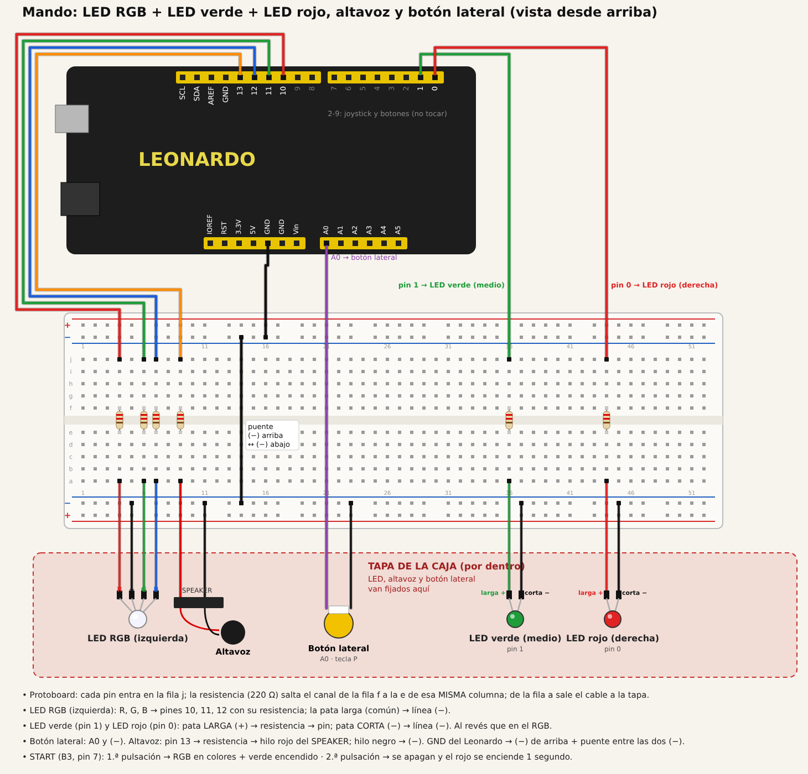

# Mejora del arcade stick: luces, altavoz y botón START lateral

Ampliación del [arcade stick](../README.md) hecha el 3 y el 4 de noviembre de 2026. Todo se monta en la tapa de la caja:

- un LED RGB a la izquierda
- un LED verde en el medio
- un LED rojo a la derecha
- un altavoz de placa base
- un botón nuevo en el lateral, que hace de **START**

| Archivo | Qué es |
| --- | --- |
| [`mando_arcade_leds/mando_arcade_leds.ino`](mando_arcade_leds/mando_arcade_leds.ino) | Código del Arduino con la mejora |
| [`img/montaje_leds_altavoz_boton.png`](img/montaje_leds_altavoz_boton.png) | Esquema de conexiones visto desde arriba |
| [`capturas/prueba_luces_start.mp4`](capturas/prueba_luces_start.mp4) | Vídeo de la prueba |

## 1. Qué hace

- **Al conectar el USB:** se encienden las tres luces y suena una melodía corta. Sirve para comprobar que todo funciona y, de paso, da margen para resubir el sketch.
- **Primera pulsación del botón lateral (START):** envía la tecla `1` (*start* en MAME) y activa el modo fiesta. El LED RGB cambia de color en bucle y el LED verde se queda encendido.
- **Segunda pulsación:** se apagan el RGB y el verde, y el LED rojo se enciende durante 1 segundo.
- **Botones B1-B4 y botón lateral:** al pulsarlos, el altavoz da un pitido agudo distinto para cada uno.

Teclas en esta versión, pensadas para Gridlee en MAME:

| Control | Pin | Tecla |
| --- | --- | --- |
| Joystick ↑ ↓ ← → | 3, 4, 5, 2 | Flechas |
| B1 | 9 | Ctrl izquierdo (disparar) |
| B2 | 8 | `5` (moneda) |
| B3 | 7 | `P` (pausa) |
| B4 | 6 | `Esc` (salir) |
| Botón lateral | A0 | `1` (*start*) + luces |

## 2. Material añadido

| Pieza | Cantidad | Para qué |
| --- | --- | --- |
| LED RGB de cátodo común (4 patas) | 1 | Colores en bucle |
| LED verde de 5 mm | 1 | Indica mando "encendido" |
| LED rojo de 5 mm | 1 | Aviso de apagado (1 s) |
| Altavoz de placa base (conector SPEAKER) | 1 | Melodía de arranque y pitidos |
| Pulsador | 1 | START en el lateral de la caja |
| Resistencias de 220 Ω | 6 | Una por cada color del RGB, una por LED y una para el altavoz (mínimo 150 Ω) |
| Cables dupont | ≈ 14 | De la protoboard a la tapa |

## 3. Conexiones

Los LED, el altavoz y el botón van fijados en la tapa. En la protoboard solo están las resistencias:

- Cada pin entra por la fila j.
- La resistencia salta el canal central, de la fila f a la e, en la misma columna.
- De la fila a sale el cable hacia la tapa.

| Elemento | Pin | Detalle |
| --- | --- | --- |
| LED RGB rojo / verde / azul | 10 / 11 / 12 | Cada uno con su resistencia. La pata larga (común) va a (−) |
| LED verde | 1 | Pin → resistencia → pata larga (+). La pata corta va a (−) |
| LED rojo | 0 | Pin → resistencia → pata larga (+). La pata corta va a (−) |
| Altavoz | 13 | Pin → resistencia → hilo rojo. El hilo negro va a (−) |
| Botón lateral | A0 | Un hilo a A0 y el otro a (−) |
| GND | GND | A la línea (−) de arriba, con un puente a la línea (−) de abajo |

- **Resistencia en los LED:** un LED casi no tiene resistencia propia. Sin ella, el pin daría más de los 40 mA que aguanta. Con 220 Ω pasan unos 14 mA.
- **La pata larga cambia de sitio:** en los LED de un solo color, la pata larga es el (+) y va hacia el pin. En el RGB de cátodo común, la larga es la común y va a (−).
- **El botón lateral no necesita 5V:** igual que los demás botones, usa `INPUT_PULLUP`. A0 funciona como entrada digital normal.

## 4. Cómo funciona el código

- Los LED y el altavoz se controlan con `millis()` y no con `delay()`, para que el joystick y los botones sigan respondiendo mientras el RGB cambia de color.
- `ANODO_COMUN = true` sirve si el RGB es de ánodo común, con la pata larga a 5V.
- `ZUMBADOR_ACTIVO = true` sirve si el altavoz es un zumbador activo, que pita solo con dejarle 5V.
- `SONIDO = false` silencia los pitidos de los botones.

## 5. Pruebas

| # | Prueba | Resultado esperado | Estado | Evidencia |
| --- | --- | --- | --- | --- |
| 1 | Conectar el USB | Se encienden las 3 luces y suena la melodía | ✅ 04/11 | — |
| 2 | Pulsar el botón lateral | El RGB cambia de colores y el verde se enciende | ✅ 04/11 | [vídeo](capturas/prueba_luces_start.mp4) |
| 3 | Pulsar otra vez el botón lateral | Se apagan el RGB y el verde, y el rojo se enciende 1 s | ✅ 04/11 | [vídeo](capturas/prueba_luces_start.mp4) |

## 6. Problemas y soluciones

| Problema | Causa | Solución |
| --- | --- | --- |
| Los dos LED RGB conectados a A0-A5 no se encendían | Sin confirmar. Lo más probable es la línea (−) partida de la protoboard o la pata común en otra fila | Se quitaron y se pusieron un LED verde (pin 1) y uno rojo (pin 0) |
| El altavoz no sonaba | Sus dos hilos estaban en la línea (+) | Hilo negro a la línea (−) |
| El altavoz suena bajo | Un pin de Arduino da poca corriente y el altavoz es pequeño | Tonos agudos y resistencia de 150 Ω. Para más volumen: un transistor BC547/2N2222 o un zumbador activo |
| El botón lateral, en el pin 0, chocaba con el LED rojo | Hacía falta el pin 0 para el LED | Se movió a A0 |
