# Base de datos de los locales (carpeta `bd/`)

Base de datos PostgreSQL de la cadena de restaurantes Almi-Chain: locales, mesas, empleados, platos, ingredientes, proveedores, clientes, ventas, inventario y reservas. Convive con Odoo (ver [Relación con Odoo](#relación-con-odoo)).

- **Gestor:** PostgreSQL 16
- **Herramienta gráfica usada para el diseño físico:** pgAdmin 4 (el diagrama del modelo físico se genera con Graphviz desde el catálogo de la base de datos, para que salgan todas las relaciones)
- **Normalización:** 3FN (justificada en el documento del modelo relacional)

## Contenido de la carpeta

Los scripts `.sql` están en `scripts/Scripts_postgre/`.

| Fichero | Qué es | Quién lo ejecuta |
|---|---|---|
| `00_reset.sql` | Borra las 17 tablas **y sus datos**. Solo para desarrollo y pruebas | `almichain_owner` |
| `01_roles_y_bd.sql` | Crea el rol dueño y la base de datos | Administrador (`postgres`) |
| `02_tablas.sql` | Crea las 17 tablas con claves primarias, claves externas y restricciones (DDL) | `almichain_owner` |
| `03_permisos.sql` | Crea el rol de uso diario y le da solo permisos de datos | Administrador (`postgres`) |
| `04_datos.sql` | Datos de ejemplo (ficticios). **Vacía las tablas al empezar** | `almichain_owner` |
| `05_consultas.sql` | Las 11 consultas útiles para el restaurante | `almichain_app` |
| `er-conceptual.png`, `er-entidades-relaciones.drawio` | Diagrama E/R conceptual y su fuente editable | |
| `er-fisico.png`, `er-fisico.dot` | Modelo físico con las 17 tablas y sus relaciones, generado desde el catálogo de PostgreSQL. Se regenera con `dot -Tpng er-fisico.dot -o er-fisico.png` | |

Documentación asociada (en esta misma carpeta): requisitos, atributos y claves, modelo relacional con la normalización y capturas de las pruebas (`capturas/`).

## Orden de ejecución

Desde la carpeta donde están los scripts. Las contraseñas **no están en ningún fichero**: se asignan a mano con `\password` y se guardan en un gestor de contraseñas.

```bash
# 1. Rol dueño y base de datos
sudo -u postgres psql < 01_roles_y_bd.sql
sudo -u postgres psql -c "\password almichain_owner"

# 2. Tablas
psql -h localhost -U almichain_owner -d almichain -f 02_tablas.sql

# 3. Rol de uso diario y permisos
sudo -u postgres psql -d almichain < 03_permisos.sql
sudo -u postgres psql -c "\password almichain_app"

# 4. Datos de ejemplo
psql -v ON_ERROR_STOP=1 -h localhost -U almichain_owner -d almichain -f 04_datos.sql

# 5. Consultas
psql -h localhost -U almichain_app -d almichain -f 05_consultas.sql
```

Comprobación rápida (con `almichain_app`): `SELECT count(*) FROM lineas_ventas;` debe devolver **32**.

Para repetir todo desde cero: `00_reset.sql`, `02_tablas.sql`, `03_permisos.sql` (`DROP TABLE` elimina también los permisos; el aviso `role "almichain_app" already exists` es inofensivo y los `GRANT` sí se aplican) y `04_datos.sql`.

> Los nombres `almichain`, `almichain_owner` y `almichain_app` son los del entorno de pruebas. Si en otro servidor cambian, basta con sustituirlos en los scripts.

## Seguridad (mínimo privilegio)

- **Dos roles.** `almichain_owner` es dueño de las tablas y solo se usa para modificar la estructura. `almichain_app` solo puede `SELECT`, `INSERT`, `UPDATE` y `DELETE`.
- **Sin superusuario** ni permisos de crear bases de datos o roles en ninguno de los dos.
- **Acceso cerrado por defecto:** `REVOKE ALL ... FROM PUBLIC` sobre la base de datos; solo entran los roles autorizados.
- **Prueba:** con `almichain_app`, la lectura funciona y `DROP TABLE` / `CREATE TABLE` fallan (`must be owner of table`, `permission denied for schema public`).
- **Conexiones cifradas:** `psql` negocia TLS 1.3 al conectar por `localhost`.
- **Sin secretos en el repositorio:** ni contraseñas ni claves.

## Modelo de datos

17 tablas:

- **Propias:** `locales`, `telefonos_local`, `mesas`, `categorias`, `proveedores`, `historial_precios`.
- **Espejo de Odoo** (llevan `odoo_id`): `platos`, `productos`, `clientes`, `empleados`, `ventas`, `lineas_ventas`.
- **Relaciones N:M** (PK compuesta): `recetas`, `suministras`, `inventarios`, `reservas`.
- **Relación ternaria** (proveedor, producto y local): `pedidos_suministro`.

Decisiones de diseño que cumplen la 3FN:

- `ventas` no guarda el local (se deduce por la mesa) ni el total (se calcula con `SUM(cantidad * precio_unitario)` de sus líneas).
- `lineas_ventas.precio_unitario` guarda el precio **en el momento de la venta**, distinto del precio actual del plato.
- `UNIQUE (local_id, numero)` en `mesas`: el número no se repite dentro del mismo local. La barra de cada local es la mesa 0.
- `UNIQUE (mesa_id, fecha, hora)` en `reservas`: una mesa no se puede reservar dos veces a la misma hora.
- `stock_minimo` está en `inventarios` (varía por local) y no en `productos`.
- **Relación ternaria `pedidos_suministro`:** qué proveedor sirve qué producto a qué local y cuándo. Su PK es (`proveedor_id`, `producto_id`, `local_id`, `fecha`) y la clave externa (`producto_id`, `proveedor_id`) apunta a `suministras`, así que solo se puede pedir a un proveedor un producto que suministre.
- **Historial de precios `historial_precios`:** guarda cada precio de un plato con su periodo (`fecha_desde` y `fecha_hasta`, vacía si es el vigente). `platos.precio` es el precio actual.
- **Atributo multivaluado:** un local puede tener varios teléfonos, por eso están en la tabla `telefonos_local` y no en `locales`.
- **Atributo compuesto:** la dirección del local se guarda partida en `calle`, `numero`, `codigo_postal` y `ciudad`.
- **Atributo derivado:** el total de una venta no se guarda; se calcula con las líneas.

Diagramas (el E/R conceptual se puede editar abriendo [er-entidades-relaciones.drawio](er-entidades-relaciones.drawio) en draw.io):

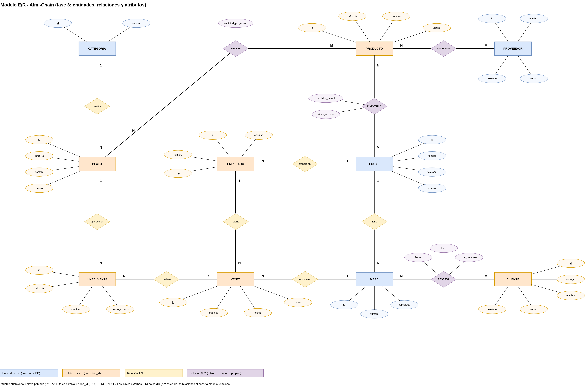

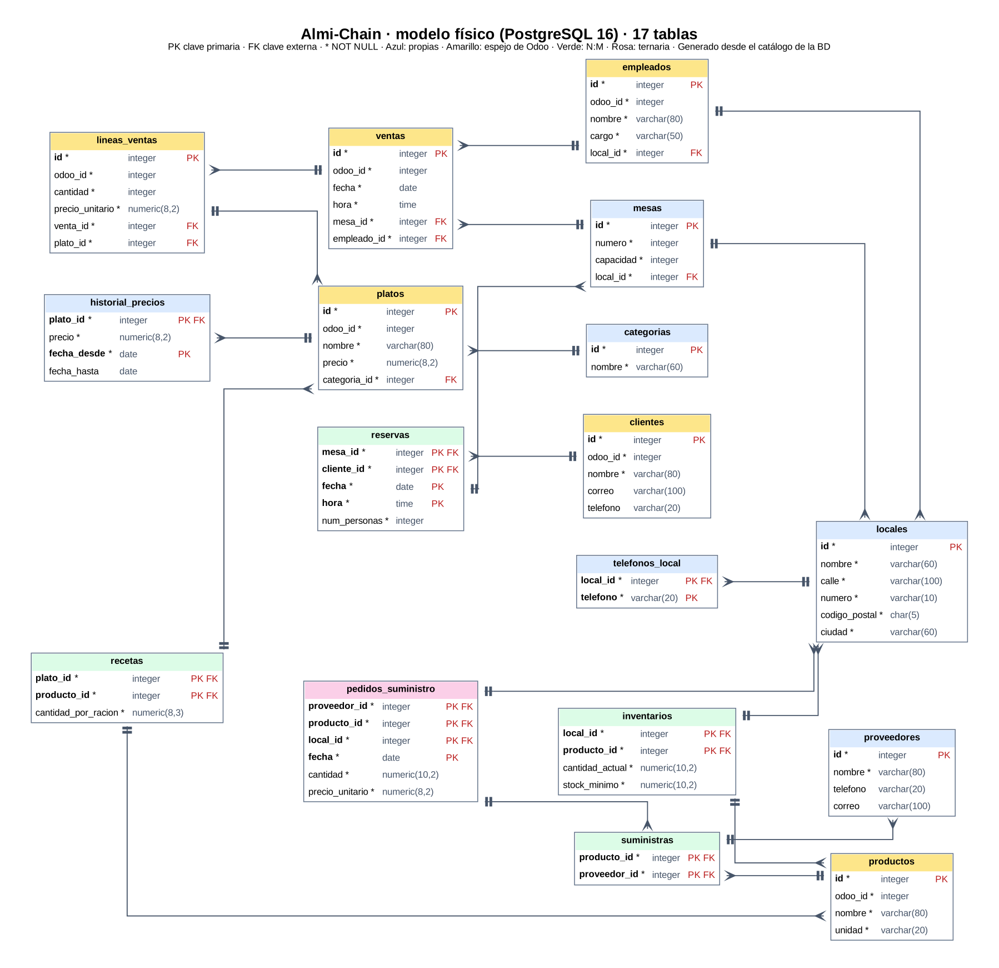

## Relación con Odoo

Odoo y esta base de datos son **dos bases de datos separadas**. Odoo gestiona facturación, CRM, empleados, inventario, marketing y TPV; esta base de datos añade lo que Odoo no tiene en su configuración (locales, mesas, reservas, recetas, proveedores y el stock mínimo por local).

La unión es la columna `odoo_id` de las tablas espejo: guarda el identificador numérico que ese elemento tiene en Odoo (`UNIQUE NOT NULL`). Las tablas propias se enlazan con ellas mediante claves externas normales, y así PostgreSQL puede comprobar la integridad.

- Los `odoo_id` de platos, ingredientes, clientes y empleados son los reales de Odoo, obtenidos exportando el campo *ID* en CSV.
- Los de `ventas` y `lineas_ventas` son ficticios: todavía no hay ventas reales en Odoo.
- **Es una conexión por diseño y por carga de datos, no una integración en vivo.** Si un precio cambia en Odoo, esta base de datos no se entera hasta que se vuelvan a cargar los datos. En un entorno real habría que automatizarlo (un script programado o la API de Odoo).

## Consultas

Resultados esperados con los datos de ejemplo:

| # | Consulta | Resultado esperado |
|---|---|---|
| 1 | Ventas e ingresos por local y día | 9 filas. El 1 de octubre en Almi Centro: 2 ventas y 89,00 |
| 2 | Platos más vendidos | Caña de cerveza 18, Tortilla 9, Bacalao 8 |
| 3 | Ingresos por plato | Bacalao 145,00, Tortilla 70,50, Arroz meloso 69,00... Café 9,00 |
| 4 | Ventas e ingresos por mes | Septiembre: 3 ventas, 138,20. Octubre: 7 ventas, 272,90 |
| 5 | Empleados por local | Almi Centro 3, Almi Casco Viejo 2 |
| 6 | Ventas e ingresos de cada empleado | Jon 149,00, Maite 106,80, Unai 83,70, Ainhoa 71,60, Iker 0 |
| 7 | Productos con poco stock | 5 filas |
| 8 | Proveedores de un producto | Aceite de oliva: 2 proveedores |
| 9 | Stock de un producto por local | Bacalao: Almi Centro 3,00 y Almi Casco Viejo 6,00 |
| 10 | Precio de un plato en una fecha concreta (`historial_precios`) | Tortilla de patata el 15/09/2026: 7,50 (vigente del 01/01 al 30/09) |
| 11 | Pedidos a cada proveedor por local (`pedidos_suministro`) | 5 filas. Almi Centro, Bodega y Cafés Norte: 2 pedidos, 103,40 |

Capturas de las 11 consultas, ejecutadas con el rol `almichain_app`:

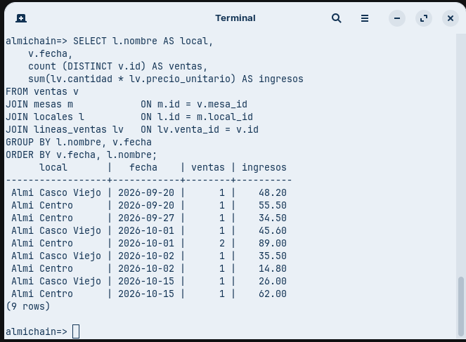

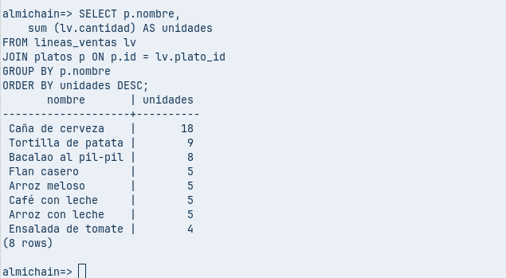

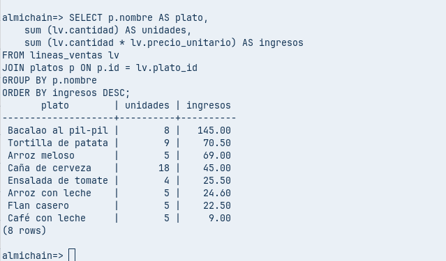

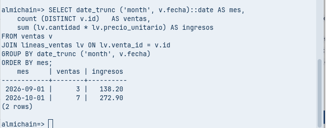

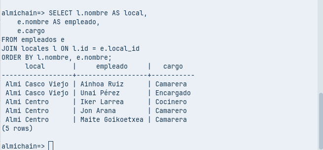

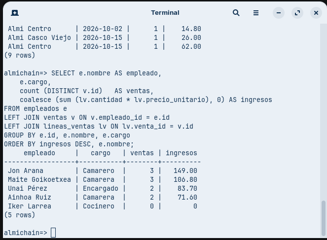

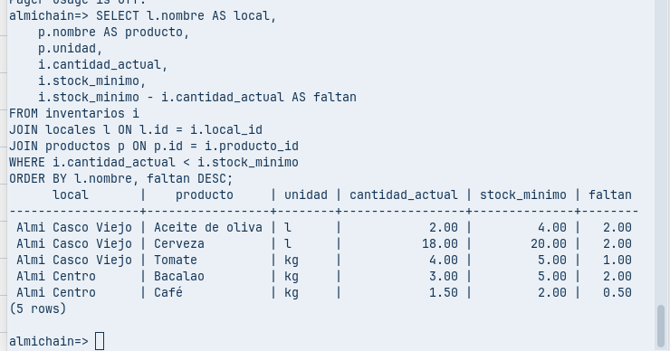

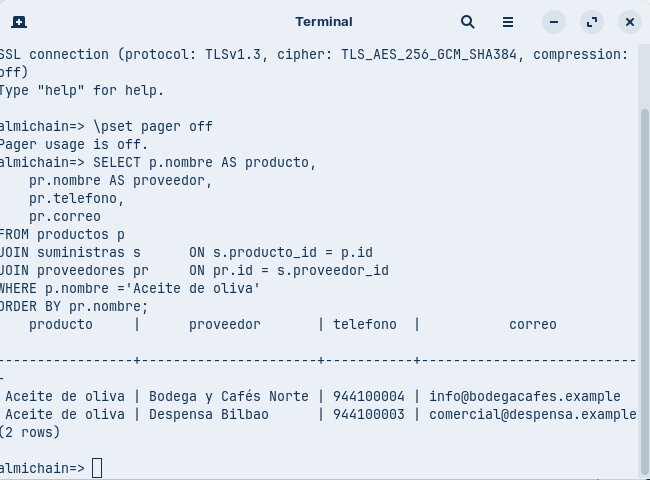

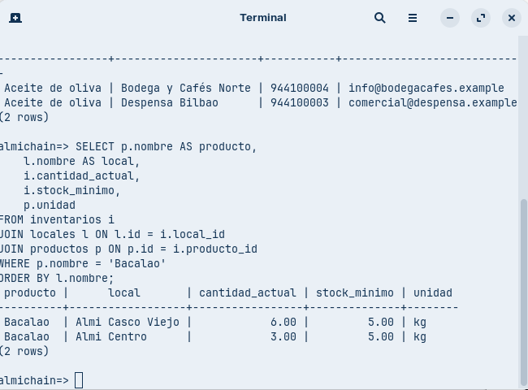

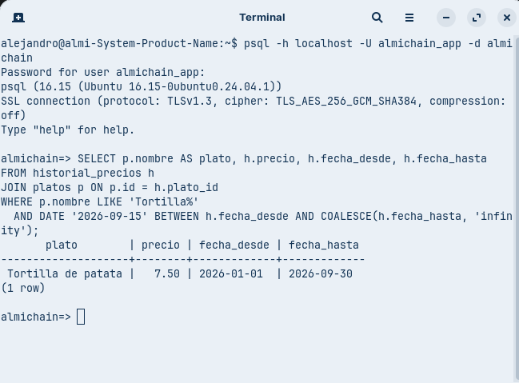

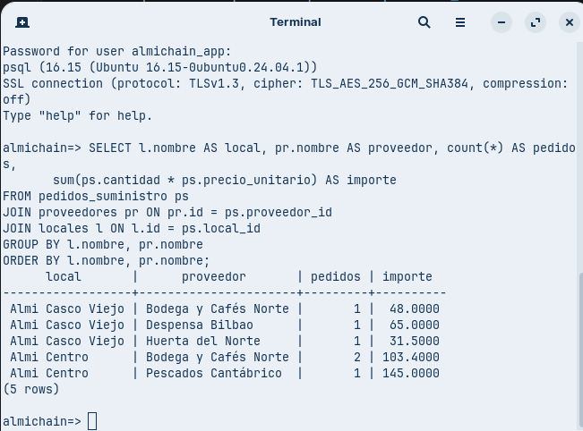

## Documentación

- [Requisitos](00-requisitos.pdf)
- [Atributos y claves](01-atributos-claves.pdf)
- [Modelo relacional y normalización](02-modelo-relacional.pdf)
- [Justificación de Odoo y PostgreSQL](Justificacion_Odoo_PostgreSQL.pdf)
