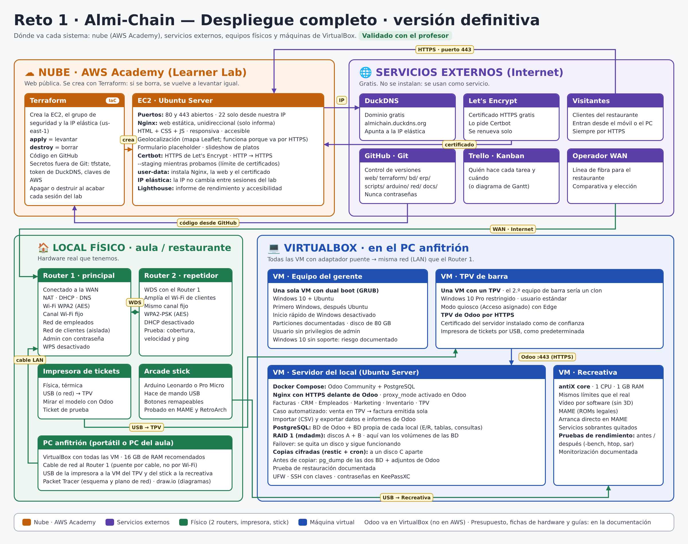

# Almi-Chain · Documento final del Reto 1

| Ciclo | Equipo | Entrega |
|---|---|---|
| ASIR 1º · Centro de Estudios ALMI | Jon, Sendoa, Yeray, Iñigo, Alejandro y Jose | 13/11/2026 |

> **Esqueleto (Jose).** Cada apartado indica su responsable y el documento del repositorio de donde sale. Para cerrar el documento, cada responsable escribe el resumen de su apartado (3–5 líneas) en el hueco marcado con *Resumen pendiente* y comprueba que los enlaces y las capturas funcionan. Los pasos detallados no se copian aquí: se enlazan, para no tener dos versiones distintas.

## Índice

1. [Introducción y arquitectura](#1-introducción-y-arquitectura)
2. [Organización del equipo](#2-organización-del-equipo)
3. [Necesidades de comunicación](#3-necesidades-de-comunicación)
4. [Equipos: presupuesto y fichas de hardware y software](#4-equipos-presupuesto-y-fichas-de-hardware-y-software)
5. [Sistemas operativos y cuentas de usuario](#5-sistemas-operativos-y-cuentas-de-usuario)
6. [Red: WAN, plano, Wi-Fi y repetidor](#6-red-wan-plano-wi-fi-y-repetidor)
7. [Máquina recreativa](#7-máquina-recreativa)
8. [Arcade stick con Arduino](#8-arcade-stick-con-arduino)
9. [Página web y hosting en AWS](#9-página-web-y-hosting-en-aws)
10. [ERP + TPV y factura automática](#10-erp--tpv-y-factura-automática)
11. [Base de datos](#11-base-de-datos)
12. [Disco redundante y copias de seguridad](#12-disco-redundante-y-copias-de-seguridad)
13. [Digitalización](#13-digitalización)
14. [Revisión de seguridad y pruebas](#14-revisión-de-seguridad-y-pruebas)
15. [Conclusiones](#15-conclusiones)
16. [Anexos](#16-anexos)

---

## 1. Introducción y arquitectura

**Responsable:** todos · **Fuente:** [`README.md`](../README.md)

Una cadena de restaurantes nos encarga su informática: equipos del gerente y de barra, máquina recreativa, red con Wi-Fi para clientes, web en la nube, ERP con TPV, base de datos de los locales y plan de copias de seguridad.

El esquema reparte la solución en cuatro zonas. **En la nube (AWS Academy)** está la web pública, en un servidor EC2 que se crea con Terraform y se sirve por HTTPS con el dominio de DuckDNS. **En el local** están los dos routers (red de empleados y red de clientes aislada, con un repetidor para el Wi-Fi), la impresora de tickets y el arcade stick. **En VirtualBox** están el equipo del gerente (Windows 11 + Ubuntu), el TPV de barra en modo quiosco, la recreativa y el servidor del local con Odoo y PostgreSQL, RAID 1 y copias cifradas. El TPV y el gerente entran a Odoo por HTTPS dentro del local, las copias salen a un bucket S3 en AWS y los clientes llegan a la web desde internet. Los **servicios externos** (GitHub, Trello, DuckDNS, Let's Encrypt y el operador de fibra) se usan sin instalar nada.

## 2. Organización del equipo

**Responsable:** Yeray · **Fuente:** [`gestion/README.md`](../gestion/README.md)

- Contrato de equipo (Anexo I), documento de los 11 pasos (Anexo II), Gantt y Trello.
- Reparto de tareas: [`diagramas/reparto_y_gantt.png`](diagramas/reparto_y_gantt.png)
- Normas del repositorio: [`CONTRIBUTING.md`](../CONTRIBUTING.md)

Somos seis, con los roles del contrato de equipo (Anexo I), firmado por todos el 26/10: Jon coordina, Yeray es el secretario, Iñigo el portavoz, Jose lleva la documentación, y Sendoa y Alejandro son técnicos. Cada tarea tiene un responsable, un apoyo y una dificultad en puntos, y se planificó en un Gantt de tres semanas (del 26/10 al 13/11). El día a día se siguió en Trello. Todo el trabajo está en GitHub: cada cambio entra con una rama y una pull request revisada, así que queda registrado quién hizo cada cosa y cuándo. Los profesores han validado las tareas según se terminaban (ver la tabla de validaciones en [`gestion/`](../gestion/README.md#validaciones-del-profesor)). Cambios sobre el plan: repetidor en lugar de WDS, Windows 11 en el gerente y la factura automática, que pasó de Sendoa a Yeray e Iñigo. La metodología de los 11 pasos está en el Anexo II.

## 3. Necesidades de comunicación

**Responsable:** Iñigo · **Fuente:** [`necesidades/necesidades-comunicacion.md`](necesidades/necesidades-comunicacion.md)

El local tiene dos redes. En la de **empleados** (`10.13.10.0/24`, por cable y con IP fijas) están el servidor, los dos TPV, el PC del gerente y la recreativa. La Wi-Fi de **clientes** (`10.13.20.0/24`, por DHCP) va aparte, con el router principal y el repetidor. La impresora de tickets va por USB al TPV, sin red, y la web está en AWS, fuera del local. Para cada equipo se indica con quién habla, por qué puerto y si va cifrado: los TPV y el gerente usan Odoo por HTTPS (443), el técnico administra por SSH solo con clave, y los clientes solo salen a internet. También se define el tráfico que **no** debe existir: de la Wi-Fi de clientes a la red de empleados, PostgreSQL y Odoo accesibles desde fuera del servidor, y SSH desde la red de clientes. El riesgo principal es que la recreativa, de uso público, comparte red con los TPV, y se mitiga dejándola sin ningún servicio escuchando.

## 4. Equipos: presupuesto y fichas de hardware y software

**Responsable:** Jose · **Fuente:** [`presupuesto/fichas_hw_sw.md`](presupuesto/fichas_hw_sw.md) · Excel: [`presupuesto/presupuesto_local_plano.xlsx`](presupuesto/presupuesto_local_plano.xlsx)

Para cada equipo (gerente, TPV, impresora de tickets, servidor, red, rack y cableado, recreativa y arcade stick) se indica el modelo, las características, el software, el precio real con su enlace y fecha, y por qué se ha elegido. Todo el software es libre o viene incluido con el equipo. En vez de Windows 10, que ya no tiene soporte, se usa Windows 11. El presupuesto da los precios sin IVA, con el 21 % de IVA aparte, y separa la compra inicial de los gastos mensuales (fibra y AWS).

## 5. Sistemas operativos y cuentas de usuario

### 5.1 Equipo del gerente (dual boot)

**Responsable:** Sendoa · **Fuente:** [`sistemas/gerente-dualboot/README.md`](../sistemas/gerente-dualboot/README.md)

El equipo del gerente es una VM de VirtualBox con firmware **EFI, TPM 2.0 y arranque seguro**, 6 GB de RAM, 2 núcleos y un disco de 120 GB. Lleva **Windows 11 Pro** y **Ubuntu 26.04 LTS** en el mismo disco, y al encender **GRUB** deja elegir el sistema. Se usa Windows 11 en lugar de Windows 10 porque este ya no tiene parches de seguridad (validado por el profesor). Los dos sistemas están **cifrados**: BitLocker con contraseña de arranque en Windows y LUKS2 en Ubuntu. En cada uno hay un usuario `tecnico` que administra y un usuario `gerente` **sin permisos de administrador** (estándar en Windows y sin `sudo` en Ubuntu), con el UAC al máximo. El sistema está **endurecido**: se han desactivado los servicios que el gerente no usa (compartir carpetas, Escritorio remoto, UPnP, avahi…), el cortafuegos bloquea todo lo que entra en los dos sistemas y no queda ningún servicio accesible desde la red. En Windows, los servicios en marcha bajan de 98 a 79. Las cinco incidencias (instalación colgada, Windows que no arrancaba, errores de lectura de la ISO, la VM que arrancaba directamente en Windows y la entrada de Ubuntu perdida en el arranque UEFI) están documentadas con su causa, su solución y capturas. Las contraseñas y la clave de recuperación de BitLocker solo están en KeePassXC.

### 5.2 TPV de barra e impresora de tickets

**Responsables:** Iñigo (TPV) y Jon (impresora) · **Fuentes:** [`sistemas/tpv-barra/README.md`](../sistemas/tpv-barra/README.md) y [`sistemas/tpv-barra/tpv-quiosco.md`](../sistemas/tpv-barra/tpv-quiosco.md)

**TPV (Iñigo).** En el aula, el TPV es una VM con Windows 10 Pro; en la compra real llevaría Windows 11 IoT Enterprise LTSC. El cajero entra con la cuenta `tpv`, que es **estándar** y queda encerrada en un **quiosco de Edge** (acceso asignado de Windows): a pantalla completa, sin barra de direcciones ni pestañas, y abriendo solo el punto de venta de Odoo. Odoo va por **HTTPS** con el certificado de nuestra CA instalado como de confianza, así que no sale ningún aviso. En Odoo, el cajero solo tiene permiso de punto de venta: si intenta crear un producto, Odoo se lo deniega. En la prueba de restricción, ninguna de las siete combinaciones probadas (tecla Windows, Alt+Tab, Alt+F4, Ctrl+Shift+Esc, entre otras) saca del quiosco. Se trabajó con instantáneas, porque la primera vez no se pudo salir del quiosco y hubo que rehacer la VM.

**Impresora de tickets (Jon).** La impresora va por USB a la VM del TPV. Con el controlador USB 3.0 de VirtualBox, Windows daba el error *Código 10*, y se resolvió pasando a **USB 1.1 (OHCI)**. El driver lo instala solo el administrador, nunca el usuario `tpv`, y la impresora queda como **predeterminada**. En Odoo está activada la **impresión automática del recibo**: al validar el pago, el ticket se imprime solo, con el logo de Almi-Chain y el IVA al 10 %. El profesor la validó el 27/10 como impresión y factura automáticas, y está grabada en vídeo. En el aula se usa la Samsung ML-2165 (láser A4), y en la compra real dos Epson TM-T20III térmicas de 80 mm, que se configuran igual.

## 6. Red: WAN, plano, Wi-Fi y repetidor

**Responsables:** Yeray (WAN), Jon (Packet Tracer), Iñigo y Yeray (routers)

| Parte | Fuente |
|---|---|
| Comparativa y contratación de la línea WAN | [`redes/routers/wan/README.md`](../redes/routers/wan/README.md) |
| Esquema de conectividad, plano y Packet Tracer | [`redes/README.md`](../redes/README.md) |
| Router y repetidor Wi-Fi (en lugar de WDS) | [`redes/routers/router-y-repetidor.md`](../redes/routers/router-y-repetidor.md) |

**Línea WAN (Yeray).** Se compararon Movistar, Vodafone y MásMóvil para empresas, y se eligió **Vodafone con fibra de 1 Gb simétrica**. El primer año cuesta casi lo mismo que MásMóvil, y a partir del mes 13 es la más barata (35 €/mes con IVA), con la instalación sin coste y un router Wi-Fi 6 incluido. Que sea simétrica importa porque cada noche se suben las copias de seguridad a AWS. La permanencia es de 12 meses. No se contrata IP fija porque ningún servicio del local se ofrece a internet: la web está en AWS.

**Diseño de la red en Packet Tracer (Jon).** El local tiene un router propio (R1) detrás de la fibra y **dos redes separadas**: la de **empleados** (`10.13.10.0/24`, por cable: servidor, TPV, gerente y recreativa) y la Wi-Fi de **clientes** (`10.13.20.0/24`). R1 hace NAT, reparte IP por DHCP y tiene una **ACL** que deja a los clientes salir a internet pero no entrar en la red de empleados. El router solo se administra por **SSH v2** y solo desde la red de empleados. Los switches no se administran en remoto y sus puertos libres están apagados. La Wi-Fi usa **WPA2-PSK con AES**, con el mismo SSID y canal en el punto de acceso principal y en el repetidor. Las IP están configuradas en cada equipo del proyecto. La profesora lo validó el 26/10. En la prueba de aislamiento, el móvil de clientes no llega al servidor (100 % de pérdida) y sí sale a internet.

*Pendiente (Iñigo y Yeray): routers físicos del aula, repetidor en lugar de WDS y prueba de aislamiento (ver `router-y-repetidor.md`).*

## 7. Máquina recreativa

**Responsable:** Jon · **Fuentes:** [`recreativa/README.md`](../recreativa/README.md) y [`recreativa/medidas/resultados.md`](../recreativa/medidas/resultados.md)

La recreativa es una máquina virtual con los mismos límites que el equipo real: **1 núcleo, 1 GB de RAM y sin swap**. Lleva **antiX 26.1 core** (5 servicios y unos 160 MB de RAM al arrancar) y **MAME 0.276**, con una ROM legal y gratuita (Gridlee). Al encenderla entra sola en el menú de MAME a pantalla completa, sin escritorio ni contraseña, y ese menú hace de front-end para elegir juego. La optimización ajusta MAME a un solo núcleo (vídeo por software, salto de fotogramas y sonido más ligero), quita consolas sobrantes y acorta el arranque. Jugando, usa un **20,3 % de CPU** y MAME ocupa **364 MB**. Para el mínimo privilegio, el usuario que juega no tiene `sudo`, se administra con otro usuario y SSH no admite root. Las incidencias (instalador, SSH y permisos de antiX) están documentadas con sus capturas.

## 8. Arcade stick con Arduino

**Responsable:** Jon · **Fuente:** [`arcade-stick/README.md`](../arcade-stick/README.md)

El arcade stick usa un **Arduino Leonardo**, que tiene USB nativo y el ordenador reconoce como un **teclado USB, sin drivers**. Por eso funciona en MAME y en cualquier otro programa. Se eligió frente al *encoder* USB del kit porque el *encoder* tiene la asignación de botones fija, y el enunciado pide input personalizable. El código usa las resistencias internas (`INPUT_PULLUP`), tiene antirrebote de 10 ms y guarda todas las teclas en una sola tabla, así que cambiar un control es cambiar un valor. Además, se puede remapear desde el propio emulador sin reprogramar. Los botones envían las teclas por defecto de MAME (acción, moneda y start), y mantener start 2 segundos vuelve al menú. Cuesta 58,45 € entre el Arduino y el kit.

## 9. Página web y hosting en AWS

**Responsables:** Jose (bocetos y web) y Jon (AWS)

| Parte | Fuente |
|---|---|
| Bocetos (diseño conceptual) | [`bocetos/bocetos.md`](bocetos/bocetos.md) |
| Web: diseño, código, accesibilidad y pruebas | [`web/guia_web.md`](web/guia_web.md) |
| Despliegue en AWS con Terraform, Nginx, HTTPS y DuckDNS | [`infra/despliegue_aws.md`](infra/despliegue_aws.md) y [`infra/terraform/README.md`](../infra/terraform/README.md) |

Antes de programar la web se hicieron 19 bocetos, que se valoraron con cinco criterios. Ganó el concepto **Latón** (fondo negro y detalles dorados), con un 8,8 sobre 10. La web es unidireccional: solo informa. Es responsiva y accesible, y tiene un slideshow de platos, un mapa de los locales con Leaflet y geolocalización, y un formulario de muestra que no envía datos. Está publicada en https://almichain.duckdns.org con HTTPS. En el validador del W3C da 0 errores y 0 avisos, y en Lighthouse saca entre 99 y 100.

El despliegue es **infraestructura como código**: un solo `terraform apply` crea en AWS una **EC2 t3.micro** con Ubuntu, su grupo de seguridad (80 y 443 abiertos, y el 22 solo desde la IP del administrador) y una **IP elástica**, para que la dirección no cambie entre sesiones del laboratorio. Al arrancar, el script de `user-data` instala **Nginx** con compresión y cabeceras de seguridad, da de alta el dominio gratuito en **DuckDNS** y saca el certificado de **Let's Encrypt** con **Certbot**, con redirección de HTTP a HTTPS y renovación automática. Se comprobó que es reproducible destruyéndolo todo y volviéndolo a crear: la web volvió a estar en marcha, con un certificado nuevo, en 1 minuto y 45 segundos. Ninguna credencial está en el repositorio: el token y el estado de Terraform se quedan fuera de Git.

## 10. ERP + TPV y factura automática

**Responsables:** Sendoa (servidor), Alejandro (configuración de Odoo) e Iñigo y Yeray (factura automática) · **Fuente:** [`erp/README.md`](../erp/README.md)

**Configuración de Odoo (Alejandro).** Usamos **Odoo 19 Community** con seis ámbitos: Facturación, CRM, Empleados, Marketing, Inventario y TPV. La carta, los ingredientes, los clientes y los empleados se cargaron desde ficheros CSV con **ID externo**, así que volver a importar actualiza los registros en lugar de duplicarlos, y antes de importar se pulsa «Probar», que avisa de los errores. También se exportaron datos a CSV y XLSX. Hay tres usuarios por rol: **Gerente Almi** (facturación, marketing y empleados) y **Barra 1** y **Barra 2**, que solo pueden usar el TPV (sin Ventas, Contabilidad ni Contactos, y sin poder exportar), para cumplir el mínimo privilegio. El CRM tiene un flujo de cuatro etapas (Nuevo, Calificado, Propuesta y Ganado) con cuatro oportunidades de ejemplo, y en Marketing hay una lista de correo de clientes y una campaña en borrador, sin enviar. Las contraseñas se asignan a mano y no están en el repositorio. Las capturas de cada paso están en [`erp/capturas/`](../erp/capturas).

**Servidor (Sendoa).** Es una VM con Ubuntu Server 24.04 LTS que ejecuta con **Docker Compose** tres contenedores: Odoo 19, PostgreSQL 16 y Nginx. Solo **Nginx** se publica (puertos 80 y 443): redirige de HTTP a HTTPS y usa el certificado de nuestra CA. Odoo y PostgreSQL no tienen ningún puerto abierto, y se comprobó con `nmap`. El cortafuegos (UFW) solo deja pasar 22, 80 y 443 desde la red local; SSH solo admite claves, y el gestor de bases de datos de Odoo está desactivado. Los datos están en un RAID 1 y se copian cada noche (apartado 12). Se instala con cinco scripts numerados, así que se puede repetir desde cero.

**Factura automática (Iñigo y Yeray).** Al validar el pago en el TPV, Odoo imprime el ticket solo, con el logo de Almi-Chain y el IVA al 10 %. El profesor lo validó como factura automática. Como mejora, queda documentado el código de una regla de Odoo para emitir también la factura con número.

## 11. Base de datos

**Responsable:** Alejandro · **Fuente:** [`bd/README.md`](../bd/README.md)

La base de datos de los locales es independiente de la de Odoo y guarda lo que Odoo no cubre en nuestra configuración: locales, mesas, reservas, recetas, proveedores y el stock mínimo por local. Partimos de un **modelo E/R** con atributos derivado (el total de una venta), multivaluado (los teléfonos de un local) y compuesto (la dirección), una **relación ternaria** entre proveedor, producto y local (`pedidos_suministro`) y un **historial de precios** de los platos. Se pasó a un modelo relacional de **17 tablas en 3FN**, con la normalización justificada paso a paso. Las tablas «espejo» (platos, clientes, empleados, ventas...) llevan una columna `odoo_id` con el identificador real de Odoo, así que la unión es por diseño y por carga de datos, no una sincronización en vivo. Los scripts SQL (reset, roles, tablas, permisos, datos y consultas) se ejecutan en orden, con **dos roles de mínimo privilegio**: `almichain_owner`, que solo modifica la estructura, y `almichain_app`, que solo lee y escribe datos; no son superusuarios y las contraseñas no están en ningún fichero. Las conexiones van cifradas con TLS 1.3. Con los datos de ejemplo se probaron **11 consultas** (ventas por local y día, platos más vendidos, precio de un plato en una fecha, pedidos por proveedor y local...) con el rol `almichain_app`, y las capturas están en [`bd/capturas/`](../bd/capturas). Además, la [justificación de Odoo y PostgreSQL](../bd/Justificacion_Odoo_PostgreSQL.pdf) explica por qué se eligieron.

## 12. Disco redundante y copias de seguridad

**Responsable:** Sendoa · **Fuentes:** [`backups/README.md`](../backups/README.md) y [`infra/terraform-copias/README.md`](../infra/terraform-copias/README.md)

Las bases de datos del servidor (la de Odoo y la del local) y los adjuntos de Odoo están en un **RAID 1** con `mdadm` sobre dos discos. En la prueba de fallo se marcó un disco como roto: el RAID siguió funcionando con el otro, **Odoo siguió vendiendo** y, al reponer el disco, se reconstruyó solo en menos de 2 minutos. Como un RAID no protege de un borrado, además hay un **plan de copias** con **restic**: copia cifrada (AES-256), incremental y comprobada con `restic check`, en un tercer disco solo para root. La lanza **cron** a las 02:30 y también 5 minutos después de cada arranque, porque el servidor del aula no está encendido de noche (incidencia documentada). Guarda 7 copias diarias, 4 semanales y 6 mensuales. Para cumplir la regla **3-2-1**, otra tarea lleva las copias a un bucket de **AWS S3** creado con Terraform, cifrado y con otra clave. Las copias se han **verificado restaurándolas** en una base de datos aparte, tanto desde el disco local como desde S3, y los pedidos del TPV, los contactos, los productos y los adjuntos coincidían con los de producción. Las claves de restic solo están en el servidor (solo root) y en KeePassXC.

## 13. Digitalización

**Responsable:** Jose · **Fuente:** [`digitalizacion/digitalizacion.md`](digitalizacion/digitalizacion.md)

La solución usa varias tecnologías habilitadoras digitales: un ERP (Odoo), análisis de datos (PostgreSQL), la nube (AWS), IoT con Arduino y ciberseguridad. Con ellas el restaurante cobra antes, controla el stock al momento, se da a conocer en internet y protege su información frente a averías y cortes de luz.

Cada tecnología se eligió comparándola con otras opciones: AWS frente a Azure, Google Cloud y un hosting compartido; Odoo frente a SAP Business One, Holded y un TPV suelto; PostgreSQL frente a MySQL y SQL Server; y Arduino Leonardo frente a un encoder USB comercial y una Raspberry Pi. Los motivos principales son el coste (software libre y Learner Lab gratis), que Odoo solo funciona con PostgreSQL y que el Leonardo se reconoce como teclado USB sin drivers.

## 14. Revisión de seguridad y pruebas

**Responsables:** Iñigo y todos

Resumen de las pruebas de cada parte. El detalle, los comandos y las capturas están en la guía enlazada en cada fila.

### 14.1 Pruebas de funcionamiento

| Parte | Qué se prueba | Resultado esperado | Resultado | Evidencia |
| --- | --- | --- | --- | --- |
| Gerente | Arranque dual con GRUB, BitLocker y LUKS | Se elige el sistema y el disco pide su clave antes del inicio de sesión | ✅ | [dual boot §9](../sistemas/gerente-dualboot/README.md#9-resultado-final) |
| Gerente | Servicios y puertos hacia la red | Ningún puerto abierto hacia la red y cortafuegos activo, también tras reiniciar | ✅ 04/11 · de 1 puerto a 0 | [dual boot §11.1](../sistemas/gerente-dualboot/README.md#111-servicios-reducidos-y-cortafuegos-04112026) |
| TPV | IP fija, quiosco de Edge y Odoo por HTTPS sin avisos | Edge abre solo el punto de venta y el certificado es de confianza | ✅ | [TPV, pruebas 1–3](../sistemas/tpv-barra/README.md#pruebas) |
| TPV | Salir del quiosco con atajos de teclado | No se puede salir | ✅ 06/11 · ninguna de las 7 combinaciones saca del quiosco | [TPV, prueba 4](../sistemas/tpv-barra/README.md#pruebas) |
| Impresora | Venta en el TPV → ticket impreso solo, y legible | Se imprime al validar el pago; se leen €, ¿? y el QR | ✅ 27/10 · validado por el profesor | [TPV, pruebas 5–8](../sistemas/tpv-barra/README.md#pruebas) |
| Recreativa | Rendimiento con 1 núcleo y 1 GB | Juego fluido sin swap | ✅ CPU 20,3 %, MAME 364 MB, `mame -bench` 1353–1613 % · validado por el profesor | [medidas](../recreativa/medidas/resultados.md) |
| Arcade stick | Cada control, y en MAME, Chrome y RetroArch sin drivers | Cada entrada marca su tecla y los juegos responden | ✅ validado por el profesor | [arcade stick §7](../arcade-stick/README.md#7-pruebas) |
| Red (Packet Tracer) | Aislamiento: el móvil de clientes hace ping al servidor | Falla | ✅ 05/11 · 100 % de pérdida · proyecto validado por la profesora el 26/10 | [redes §6, pruebas 3 y 9](../redes/README.md#6-pruebas) |
| Red (routers del aula) | Móvil por el repetidor: conexión, internet y aislamiento | Navega y no llega a los equipos del aula | ⏳ Routers reconfigurados el 12/11; pendientes las capturas nuevas | [routers](../redes/routers/router-y-repetidor.md#6-prueba-de-aislamiento) |
| Web | Responsiva (1440, 768 y 390 px), menú, slideshow, formulario y geolocalización | Funciona en las tres anchuras | ✅ | [web §6](web/guia_web.md#6-pruebas-y-evidencias) |
| Web | Validador W3C y Lighthouse de la web publicada | 0 errores y ≥ 90 | ✅ 0 errores · 99–100 | [web §6](web/guia_web.md#6-pruebas-y-evidencias) |
| AWS | HTTPS, cabeceras de seguridad y reproducibilidad (`destroy` + `apply`) | Candado válido y la web vuelve igual | ✅ vuelve en 1 min 45 s | [AWS §6](infra/despliegue_aws.md#6-pruebas-y-evidencias) |
| Servidor | Contenedores, puertos, UFW, `nmap`, HTTPS y gestor de BD desactivado | Solo 22, 80 y 443 hacia la LAN; PostgreSQL y Odoo sin publicar | ✅ 26/10 | [ERP, pruebas 1–6](../erp/README.md#pruebas) |
| ERP | Venta en el TPV → factura automática | El ticket sale solo con logo e IVA 10 % | ✅ validado por el profesor | [ERP, prueba 9](../erp/README.md#pruebas) |
| ERP | Importar CSV y exportar a XLSX; CRM, Marketing y usuarios por rol | Sin errores | ✅ 06/11 | [ERP, prueba 10 y configuración](../erp/README.md#pruebas) |
| Base de datos | Scripts 00–05 y las 11 consultas | Sin errores y los resultados esperados | ✅ 17 tablas, 32 líneas de venta | [BD, consultas](../bd/README.md#consultas) |
| RAID 1 | Fallo de un disco | Odoo sigue funcionando y el RAID se reconstruye | ✅ 26/10 · en menos de 2 min | [copias, pruebas 11–12](../backups/README.md#3-pruebas) |
| Copias | Copia automática con cron y restauración | «Copia terminada» y `RESTAURACIÓN CORRECTA` | ✅ 27/10 y 03/11 | [copias, pruebas 13–14](../backups/README.md#3-pruebas) |
| Copia en S3 | Copia remota, restauración desde S3 y fallo sin credenciales | Restaura desde la nube y avisa si el lab está apagado | ✅ 29/10 | [copias, pruebas 16–19](../backups/README.md#pruebas) |

### 14.2 Mínimo privilegio en cada parte

| Parte | Cuenta de uso diario | Quién administra | Comprobado |
| --- | --- | --- | --- |
| Gerente | `gerente`: estándar en Windows y sin `sudo` en Ubuntu | `tecnico` | UAC pide las credenciales del técnico |
| TPV | `tpv`: estándar y encerrado en el quiosco | Administrador local | El cajero de Odoo no puede crear productos |
| Recreativa | `recreativa`: sin `sudo` | `adminrec` | SSH rechaza a `recreativa` y a root |
| Servidor | Servicios en contenedores | `adminsrv` con clave SSH, fuera del grupo `docker` | Root y contraseña rechazados por SSH |
| Odoo | Barra 1 y Barra 2: solo punto de venta | Gerente y administrador | Permisos en la ficha de cada usuario |
| PostgreSQL | `almichain_app`: solo leer y escribir datos | `almichain_owner` | `DROP TABLE` y `CREATE TABLE` fallan con `almichain_app` |
| Secretos | Ninguna contraseña ni clave en el repositorio | KeePassXC y `/root/secretos` (solo root) | Revisado en cada guía |

## 15. Conclusiones

**Qué ha funcionado.** Hemos montado entera la informática de un restaurante: equipos, red, web en la nube, ERP con TPV, base de datos y copias de seguridad. Cada parte tiene su guía en el repositorio y se puede volver a montar desde cero. Todo el software es libre o gratuito, así que el restaurante solo paga el hardware, la fibra y el servidor de AWS. Además, cada parte se ha probado y las evidencias están en las guías. Por ejemplo, la web da 0 errores en el W3C y entre 99 y 100 en Lighthouse, y el servidor sigue funcionando al quitarle un disco del RAID.

**Problemas y cómo se resolvieron.** Los fallos que fueron saliendo se apuntaron en cada guía, con la causa y la solución. Por ejemplo, el servidor de Odoo aceptaba contraseñas por SSH porque el script de seguridad se ejecutó antes de copiar la clave, y se corrigió dejando solo el acceso con clave. Las copias automáticas no se hacían porque la máquina virtual del servidor está apagada por la noche, a la hora programada, y se resolvió haciendo también una copia unos minutos después de cada arranque. También hubo que adaptarse a cambios de planteamiento, como pasar de Windows 10 a Windows 11 en el equipo del gerente al quedarse Windows 10 sin soporte. Trabajar con GitHub y con ramas y Pull Requests nos ayudó a no pisarnos el trabajo entre seis personas.

**Qué mejoraríamos.** En un restaurante real, el servidor estaría encendido siempre, con su SAI, para que las copias se hagan a su hora. También tendríamos un dominio propio en lugar de DuckDNS y una cuenta normal de AWS en lugar del Learner Lab, que se apaga al cerrar la sesión. Y la web, que ahora solo informa, podría tener reservas de verdad conectadas con Odoo.

## 16. Anexos

- Anexo I: contrato de equipo, firmado por los seis → [`gestion/anexos/Anexo_I_Contrato_de_Equipo.pdf`](../gestion/anexos/Anexo_I_Contrato_de_Equipo.pdf)
- Anexo II: documento de los 11 pasos → [`gestion/anexos/Anexo_II_11_pasos.xlsx`](../gestion/anexos/Anexo_II_11_pasos.xlsx)
- Reparto y Gantt → [`diagramas/reparto_y_gantt.png`](diagramas/reparto_y_gantt.png)
