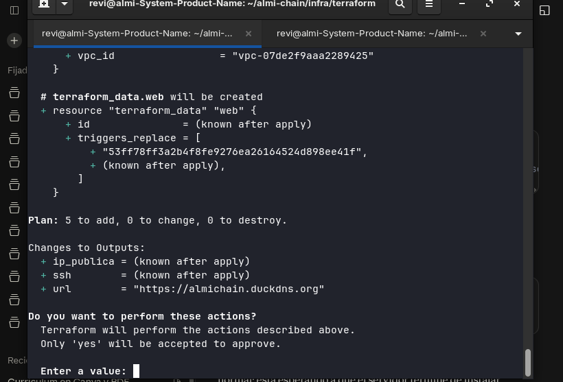
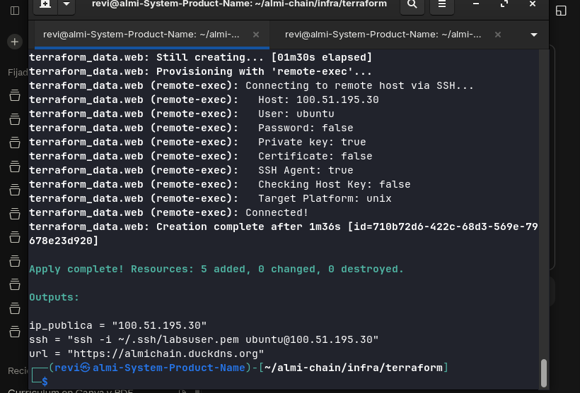
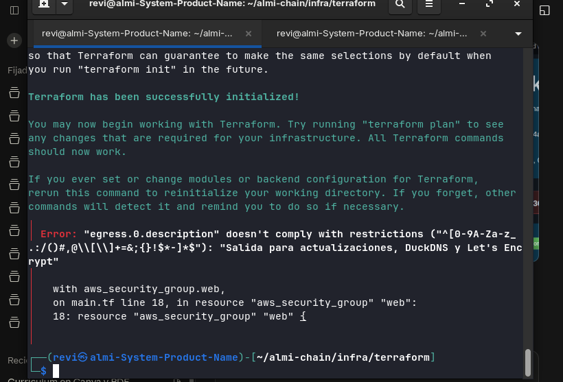

# Despliegue de la web en AWS con Terraform

Responsable: Jon · Código: [`infra/terraform/`](../../infra/terraform) · Web desplegada: [`web/`](../../web)

Este documento explica **qué se ha montado, por qué y cómo comprobarlo**. Los pasos exactos para repetirlo desde cero están en [`infra/terraform/README.md`](../../infra/terraform/README.md).

## 1. Qué pide el reto

> «La página debe servirse de forma segura, por HTTPS y con dominio propio, y estar alojada en la nube con un despliegue reproducible, a poder ser automatizado mediante scripts o infraestructura como código.»

| Requisito | Cómo se cumple |
| --- | --- |
| Alojada en la nube (AWS) | Instancia EC2 en AWS Academy Learner Lab, región `us-east-1` |
| Dominio propio | `almichain.duckdns.org` (DuckDNS, gratuito) |
| HTTPS | Certificado de Let's Encrypt con Certbot; HTTP redirige a HTTPS |
| Despliegue reproducible | Terraform: un `terraform apply` crea todo y publica la web |
| Seguridad por defecto | Cortafuegos mínimo, SSH solo desde una IP, disco cifrado, secretos fuera de Git |

## 2. Arquitectura

```
Visitante ──HTTPS (443)──► almichain.duckdns.org
                                  │  DuckDNS apunta a la IP elástica
                                  ▼
                          Elastic IP (fija)
                                  │
                ┌─────────────────┴─────────────────┐
                │ EC2 t3.micro · Ubuntu 24.04       │
                │ Nginx · Certbot · cron (DuckDNS)  │
                └───────────────────────────────────┘
      Security Group: 80 y 443 abiertos · 22 solo IP del administrador
```

Diagrama de despliegue completo (con la parte local y VirtualBox): [`docs/diagramas/`](../diagramas).

## 3. Qué crea Terraform (5 recursos)

| Recurso | Para qué |
| --- | --- |
| `aws_security_group.web` | Cortafuegos. HTTP y HTTPS para todos; SSH solo desde `admin_cidr` |
| `aws_instance.web` | Servidor Ubuntu 24.04 `t3.micro`, disco de 8 GB cifrado, IMDSv2 obligatorio |
| `aws_eip.web` | IP fija, para que DuckDNS no cambie aunque la instancia se pare |
| `aws_eip_association.web` | Une la IP elástica al servidor |
| `terraform_data.web` | Sube la carpeta `web/` al servidor. Se repite sola en cada `apply` si cambia algún archivo |

Al **primer arranque** (`user_data.sh.tftpl`) el servidor se configura solo:

1. Instala Nginx, Certbot y herramientas.
2. Guarda el token de DuckDNS en `/etc/duckdns/token` (solo lo lee root) y lo actualiza cada 5 minutos con cron.
3. Configura Nginx con compresión, caché de 30 días y las cabeceras de seguridad de [`web/README.md`](../../web/README.md).
4. Espera a que el dominio apunte a la IP del servidor y saca el certificado HTTPS.
5. Activa la renovación automática del certificado (`certbot.timer`).

## 4. Decisiones y por qué

| Decisión | Motivo |
| --- | --- |
| **EC2 + Nginx**, no S3 | El enunciado admite «S3, máquinas EC2». Con EC2 se controla Nginx, las cabeceras de seguridad y el certificado de Let's Encrypt, y se demuestra más administración de sistemas |
| **Elastic IP** | Sin ella, la IP cambia cada vez que el laboratorio para la instancia y habría que reconfigurar el dominio |
| **DuckDNS + Let's Encrypt** | Gratuitos. Route 53 obliga a pagar un dominio y ACM necesita un balanceador de carga o CloudFront, que gastan el crédito del laboratorio |
| **`t3.micro`** | Una web estática no necesita más. Es lo más barato que admite el laboratorio |
| **Ubuntu 24.04 LTS oficial** | Soporte hasta 2029. La imagen se busca automáticamente (la más reciente de Canonical) |
| **Terraform** | Es lo que pidió el profesor. Nota: desde 2023 no es software libre; OpenTofu es un reemplazo compatible |
| **SSH solo desde nuestra IP** | Mínimos privilegios: el servidor no ofrece administración remota a todo internet. Terraform rechaza `0.0.0.0/0` |

## 5. Seguridad

- **Secretos fuera de Git.** El token de DuckDNS va en `terraform.tfvars` y las credenciales de AWS en `~/.aws/credentials`. El `.gitignore` excluye `*.tfvars`, `*.tfstate` y `*.pem`; en el repositorio solo está `example.tfvars`, con valores falsos.
- **Estado de Terraform.** El `terraform.tfstate` puede contener el token en texto plano, así que **no se sube a Git**.
- **Cortafuegos mínimo.** Solo 80, 443 y 22 (restringido).
- **Disco cifrado** (EBS) e **IMDSv2 obligatorio**, para que un fallo en la web no permita robar credenciales de la instancia.
- **Cabeceras de seguridad** en Nginx: `Content-Security-Policy`, `Strict-Transport-Security`, `X-Content-Type-Options`, `Referrer-Policy` y `Permissions-Policy`. No se muestra la versión de Nginx (`server_tokens off`).
- **Web unidireccional.** El formulario es de muestra y la CSP lleva `form-action 'none'`.

## 6. Pruebas y evidencias

| Prueba | Resultado | Evidencia |
| --- | --- | --- |
| `terraform plan` | 5 recursos a crear, 0 a cambiar, 0 a destruir. El SSH se limita a una IP `/32` |  |
| `terraform apply` | `Apply complete! Resources: 5 added`. Salidas: IP pública, URL y comando SSH |  |
| La web carga por `https://almichain.duckdns.org` con las fotos reales | ✅ 22/10 | [`docs/web/capturas/aws_01…05`](../web/capturas) |
| Revisión por el profesor | ✅ 22/10: lo vio funcionando y le pareció correcto | — |
| Cabeceras de seguridad, certificado y puertos (`curl -I`, `openssl`, `nmap`) | ⏳ pendiente de capturar con el laboratorio encendido | Comandos en [`infra/terraform/README.md`](../../infra/terraform/README.md) |
| Reproducibilidad (`destroy` y `apply`) | ⏳ opcional, pendiente | — |

### Incidencia durante el despliegue

El primer `terraform plan` falló: AWS no admite apóstrofos en las descripciones de las reglas del cortafuegos, y la descripción decía «Let's Encrypt». Se corrigió quitando el apóstrofo ([commit `fix(infra)`](https://github.com/JRevii/almi-chain/commits/main)) y el segundo intento salió bien. Terraform detectó el error **antes** de crear nada, así que no se creó ningún recurso a medias.



## 7. Costes y límites del laboratorio

| Concepto | Coste aproximado |
| --- | --- |
| Servidor `t3.micro` encendido | ~0,01 $/hora |
| IP elástica y disco, aunque el laboratorio esté cerrado | ~0,14 $/día |
| Presupuesto del Learner Lab | 50 $ |

- Al cerrar el laboratorio, la instancia se para sola. Al iniciarlo de nuevo, hay que **arrancarla en EC2** y la web vuelve con el mismo dominio.
- Las credenciales del laboratorio **caducan en cada sesión**: hay que volver a copiarlas antes de usar Terraform.
- Si cambia la IP desde la que se administra, hay que actualizar `admin_cidr` y volver a hacer `terraform apply`.
- Para borrar todo: `terraform destroy`, y comprobar en la consola que no queda ninguna IP elástica sin asociar.

## 8. Qué se guarda y dónde

| Qué | Dónde | ¿En Git? |
| --- | --- | --- |
| Código de Terraform y plantilla `example.tfvars` | `infra/terraform/` | Sí |
| Web | `web/` | Sí |
| Este documento y las capturas | `docs/infra/` | Sí |
| `terraform.tfvars` (token de DuckDNS, tu IP) | Solo en el equipo de quien despliega | **No** |
| `terraform.tfstate` | Solo en el equipo de quien despliega. Copia de seguridad cifrada fuera de Git | **No** |
| Credenciales de AWS y `labsuser.pem` | Las genera el laboratorio en cada sesión | **No** |

Si se pierde el `terraform.tfstate`, Terraform no sabe qué ha creado y habría que borrar a mano en la consola de EC2 la instancia, la IP elástica, el disco y el grupo de seguridad `almichain-web-sg`.

## 9. Preguntas que pueden hacer en la defensa

- **¿Por qué EC2 y no S3?** Por el control sobre Nginx, las cabeceras y el certificado (ver sección 4).
- **¿Qué pasa si se borra la instancia?** Se vuelve a levantar igual con `terraform apply`, con el mismo dominio y la web publicada.
- **¿Dónde está el token de DuckDNS?** En `terraform.tfvars`, que no se sube a Git, y en el servidor, en un archivo que solo lee root.
- **¿Cómo se renueva el certificado?** Los certificados de Let's Encrypt duran 90 días. Certbot instala un temporizador (`certbot.timer`) que lo renueva solo cuando quedan menos de 30.
- **¿Cómo se actualiza la web?** Se cambia `web/`, se hace pull request y se ejecuta `terraform apply`, que solo vuelve a subir la web.
- **¿Qué falló y cómo se arregló?** La incidencia de la sección 6.
