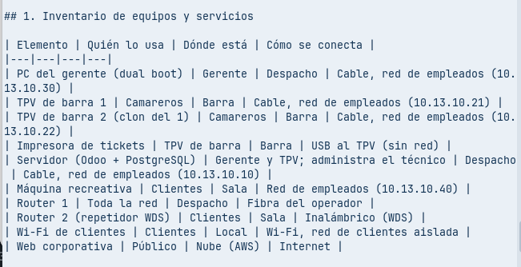
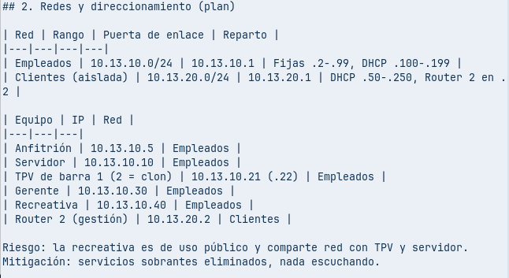
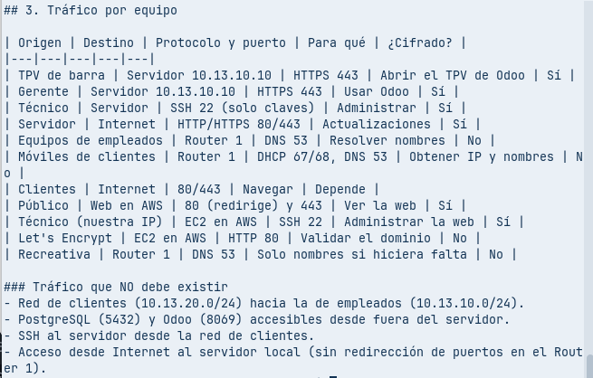

# Necesidades de comunicación

## 1. Inventario de equipos y servicios

| Elemento | Quién lo usa | Dónde está | Cómo se conecta |
|---|---|---|---|
| PC del gerente (dual boot) | Gerente | Despacho | Cable, red de empleados (10.13.10.30) |
| TPV de barra 1 | Camareros | Barra | Cable, red de empleados (10.13.10.21) |
| TPV de barra 2 (clon del 1) | Camareros | Barra | Cable, red de empleados (10.13.10.22) |
| Impresora de tickets | TPV de barra | Barra | USB al TPV (sin red) |
| Servidor (Odoo + PostgreSQL) | Gerente y TPV; administra el técnico | Despacho | Cable, red de empleados (10.13.10.10) |
| Máquina recreativa | Clientes | Sala | Red de empleados (10.13.10.40) |
| Router 1 | Toda la red | Despacho | Fibra del operador |
| Router 2 (repetidor) | Clientes | Sala | Inalámbrico (repetidor; ver [`repetidor-wifi.md`](../../redes/routers/repetidor/repetidor-wifi.md)) |
| Wi-Fi de clientes | Clientes | Local | Wi-Fi, red de clientes aislada |
| Web corporativa | Público | Nube (AWS) | Internet |

## 2. Redes y direccionamiento (plan)

| Red | Rango | Puerta de enlace | Reparto |
|---|---|---|---|
| Empleados | 10.13.10.0/24 | 10.13.10.1 | Fijas .2-.99, DHCP .100-.199 |
| Clientes (aislada) | 10.13.20.0/24 | 10.13.20.1 | DHCP .50-.250, Router 2 en .2 |

| Equipo | IP | Red |
|---|---|---|
| Anfitrión | 10.13.10.5 | Empleados |
| Servidor | 10.13.10.10 | Empleados |
| TPV de barra 1 (2 = clon) | 10.13.10.21 (.22) | Empleados |
| Gerente | 10.13.10.30 | Empleados |
| Recreativa | 10.13.10.40 | Empleados |
| Router 2 (gestión) | 10.13.20.2 | Clientes |

Riesgo: la recreativa es de uso público y comparte red con TPV y servidor.
Mitigación: servicios sobrantes eliminados, nada escuchando.

## 3. Tráfico por equipo

| Origen | Destino | Protocolo y puerto | Para qué | ¿Cifrado? |
|---|---|---|---|---|
| TPV de barra | Servidor 10.13.10.10 | HTTPS 443 | Abrir el TPV de Odoo | Sí |
| Gerente | Servidor 10.13.10.10 | HTTPS 443 | Usar Odoo | Sí |
| Técnico | Servidor | SSH 22 (solo claves) | Administrar | Sí |
| Servidor | Internet | HTTP/HTTPS 80/443 | Actualizaciones | Sí |
| Equipos de empleados | Router 1 | DNS 53 | Resolver nombres | No |
| Móviles de clientes | Router 1 | DHCP 67/68, DNS 53 | Obtener IP y nombres | No |
| Clientes | Internet | 80/443 | Navegar | Depende |
| Público | Web en AWS | 80 (redirige) y 443 | Ver la web | Sí |
| Técnico (nuestra IP) | EC2 en AWS | SSH 22 | Administrar la web | Sí |
| Let's Encrypt | EC2 en AWS | HTTP 80 | Validar el dominio | No |
| Recreativa | Router 1 | DNS 53 | Solo nombres si hiciera falta | No |

### Tráfico que NO debe existir
- Red de clientes (10.13.20.0/24) hacia la de empleados (10.13.10.0/24).
- PostgreSQL (5432) y Odoo (8069) accesibles desde fuera del servidor.
- SSH al servidor desde la red de clientes.
- Acceso desde Internet al servidor local (sin redirección de puertos en el Router 1).

