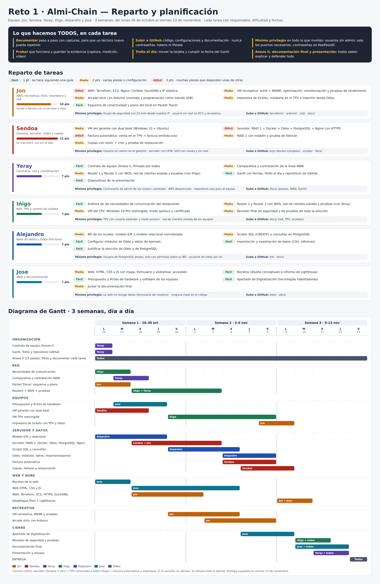

# Gestión del proyecto

Anexos I (contrato de equipo), II (11 pasos) y IX, enlace al tablero Kanban/Gantt y actas de reunión.

## Anexos

| Anexo | Documento | Estado |
| --- | --- | --- |
| I · Contrato de equipo | [`anexos/Anexo_I_Contrato_de_Equipo.pdf`](anexos/Anexo_I_Contrato_de_Equipo.pdf): roles, reparto de tareas (responsable y apoyo), normas, consecuencias y código de conducta | ✅ 26/10, firmado por los seis |
| II · Documento de 11 pasos | — | ⏳ |
| IX · Seguimiento (Gantt/Kanban) y control de versiones | Gantt planificado: [`../docs/diagramas/reparto_y_gantt.png`](../docs/diagramas/reparto_y_gantt.png) · tablero de Trello: [Lista de tareas](https://trello.com/b/6ad9c97e065249af633349a0/lista-de-tareas) · control de versiones: este repositorio (ramas y PR, ver [`CONTRIBUTING.md`](../CONTRIBUTING.md)) | ✅ 27/10 · [captura del tablero](capturas/trello_tablero.png) |

### Capturas del tablero de Trello

| Captura | Qué muestra |
| --- | --- |
| [trello_tablero](capturas/trello_tablero.png) · [02_trello_tablero](capturas/02_trello_tablero.png) | El tablero con sus listas |
| [03_trello_info_reglas](capturas/03_trello_info_reglas.png) | Tarjetas de información y reglas del equipo |
| [04_trello_tarjeta_wan](capturas/04_trello_tarjeta_wan.png) | Una tarjeta por dentro: la de la línea WAN |
| [05_trello_etiquetas](capturas/05_trello_etiquetas.png) | Etiquetas usadas |

## Planificación

El Gantt es la **planificación inicial** (26/10 – 13/11). Cambios respecto al plan: la factura automática la llevan Yeray e Iñigo (en el plan, Sendoa), y la fecha de entrega del contrato es el 09/11.

## Roles

| Persona | Rol | Área técnica |
| --- | --- | --- |
| Jon Revillas | Coordinador | Nube (AWS), recreativa, Arduino e impresora |
| Yeray Arratibel | Secretario | Gantt, Trello y línea WAN |
| Jose Rizo | Documentación | Web y presupuesto |
| Iñigo Basterrechea | Portavoz | Redes y TPV |
| Sendoa Guerrero | Técnico | Servidor, RAID y copias |
| Alex Marquez | Técnico | Base de datos y ERP |

## Cómo se lleva el seguimiento

1. **Planificar:** el Gantt reparte las tareas por persona y fecha, y el contrato (Anexo I) fija el responsable y el apoyo de cada una.
2. **Seguir el día a día:** cada tarea es una tarjeta de Trello que pasa de lista en lista hasta «Hecho».
3. **Entregar el trabajo:** cada cambio va en una rama de GitHub y entra en `main` con una Pull Request revisada ([`CONTRIBUTING.md`](../CONTRIBUTING.md)). El historial deja constancia de quién hizo cada cosa y cuándo.
4. **Documentar:** cada parte tiene su guía con pruebas y capturas, y el [documento final](../docs/documento_final.md) las resume.
