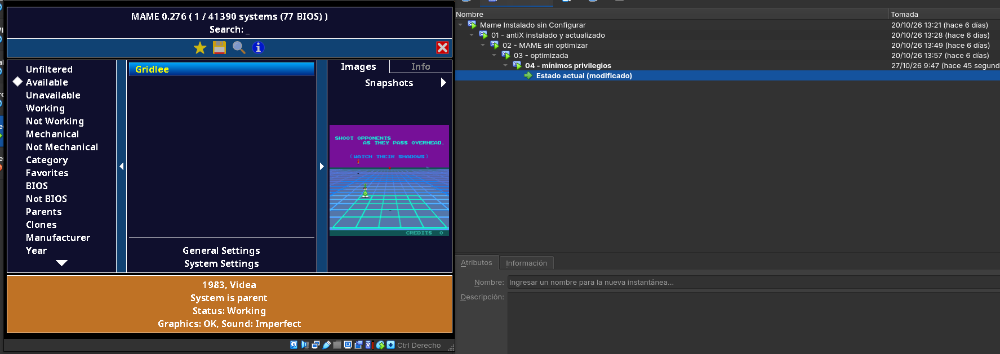

# Máquina recreativa (MAME)

Máquina virtual de VirtualBox que imita el equipo de la recreativa: **1 núcleo y 1 GB de RAM, sin swap**. Funciona con **antiX 26.1 core** y **MAME 0.276**. Al encenderla entra sola y abre el menú de MAME, sin escritorio y sin pedir contraseña.

**Resultado:** jugando a Gridlee usa un **20,3 % de CPU** y MAME ocupa **364 MB de RAM**. Ver [`medidas/resultados.md`](medidas/resultados.md).

## Contenido de la carpeta

| Ruta | Qué es |
| --- | --- |
| `scripts/01-base.sh` | Puesta a punto tras instalar antiX: sudo, actualización y zona horaria |
| `scripts/02-ssh.sh` | Instalación de SSH, con el arreglo del grupo `_ssh` |
| `scripts/03-mame.sh` | Xorg mínimo + MAME + carpeta de ROMs |
| `scripts/04-optimizar.sh` | Optimización: `mame.ini`, autologin, arranque directo, GRUB y limpieza |
| `scripts/05-seguridad.sh` | Mínimos privilegios: usuario `adminrec`, `recreativa` sin `sudo`, permisos de antiX recortados y SSH sin root (aplicado el 27/10) |
| `scripts/medir.sh` | Recoge las medidas de rendimiento en un `.txt` |
| `config/` | Ficheros de configuración que acaban en la VM |
| `medidas/` | Resultados de las pruebas de rendimiento |
| `capturas/` | Capturas del proceso (ver el apartado 7) |

> No se suben al repositorio contraseñas, ROMs ni el disco `.vdi`. La ROM de prueba (Gridlee) es legal y gratuita: se descarga de mamedev.org.

## 1. Máquina virtual

| Ajuste | Valor |
| --- | --- |
| Nombre | Recreativa-MAME |
| Tipo | Linux / Debian (64-bit) |
| CPU | 1 núcleo, límite de ejecución 100 % |
| RAM | 1024 MB |
| Disco | 10 GB VDI dinámico, una partición `sda1` ext4 con tabla MBR |
| Pantalla | VMSVGA, 16 MB, sin aceleración 3D |
| Red | NAT, reenvío **127.0.0.1:2222 → 22** para administrarla por SSH |
| USB | Controlador USB 1.1 (OHCI), para el arcade stick |
| Audio | ICH AC97 |

Instantáneas de VirtualBox, una por fase: `01 - antiX instalado y actualizado`, `02 - MAME sin optimizar` y `03 - optimizada`.

## 2. Instalación de antiX core

1. Arrancar la ISO de antiX 26.1 core y elegir **`antiX-26.1 x64-core (sysvinit)`**. El autoarranque se configura en `/etc/inittab`, que solo existe con sysvinit.
2. Entrar en el live como `root` y ejecutar `cli-installer`.
3. Responder así al instalador:
   - **Reparticionar:** sí. Aunque la pregunta sale en español, el instalador solo acepta `y`/`n` (con `s` dice «Inválido»).
   - **Tabla:** `dos` (MBR), porque la VM arranca en modo BIOS.
   - **Partición:** `sda1`, 10 GB, tipo Linux (83), marcada como arranque.
   - **Sistema de archivos:** ext4, sin `/home` aparte.
   - **GRUB:** en el **MBR** (opción 1). En la partición raíz, que es lo que viene por defecto, la VM no arranca.
   - **Idioma:** solo `es_ES.UTF-8`. **Teclado:** español.
   - **Equipo y usuario:** `recreativa`.
4. Al terminar, quitar la ISO (*Dispositivos → Unidades ópticas → Eliminar disco*) antes de reiniciar. Si no se quita, vuelve a arrancar el live.

## 3. Puesta a punto, SSH y MAME

Ejecutar los scripts por orden. El `01` va como root; el resto, como `recreativa`:

```bash
sh scripts/01-base.sh          # como root
sh scripts/02-ssh.sh
sh scripts/03-mame.sh
```

Para copiar la ROM desde el PC anfitrión:

```bash
scp -P 2222 gridlee.zip recreativa@127.0.0.1:~/mame/roms/
ssh -p 2222 recreativa@127.0.0.1
```

Para probar el juego: `startx /usr/games/mame gridlee`. Antes de optimizar, se toman las medidas «antes» con `sh scripts/medir.sh antes`.

## 4. Optimización

```bash
sh scripts/04-optimizar.sh
sudo reboot     # tiene que aparecer el menú de MAME directamente
```

| Cambio | Para qué |
| --- | --- |
| `video soft` | Dibujo por software: lo más estable sin aceleración 3D |
| `autoframeskip 1` | Si no llega a tiempo, salta fotogramas en vez de ir lento |
| `samplerate 22050` | Sonido más ligero para un solo núcleo |
| `skip_gameinfo 1` | Sin pantallas de aviso al cargar el juego |
| `window 0` | Pantalla completa |
| `joystick 1` | Mando activado, para el arcade stick |
| Autologin en tty1 (`/etc/inittab`) | Arranca sin pedir usuario ni contraseña |
| `.bash_profile` → `startx` → `.xinitrc` | Abre MAME directamente, sin escritorio |
| tty3 a tty6 desactivadas | 4 procesos menos; tty2 queda como consola de emergencia (`Ctrl+Alt+F2`) |
| `GRUB_TIMEOUT=1` | Arranque más rápido |
| Sin swap | Requisito del profesor; la RAM sobra (ver medidas) |

### Front-end gráfico: el menú de MAME

Como front-end se usa la **interfaz propia de MAME**, que arranca sola al encender. No se instala un front-end aparte (Attract-Mode, EmulationStation…) porque cada uno ocupa RAM y CPU, y con 1 núcleo y 1 GB lo que sobra se deja para el juego.

| Lo que pide un front-end | Cómo se cumple |
| --- | --- |
| Arranque directo, sin escritorio ni contraseña | Autologin en tty1 → `startx` → `.xinitrc` abre MAME |
| **Selección de juego** | Menú de MAME con la lista de juegos disponibles, filtros (*Available*, *Working*…) y búsqueda, manejable con el arcade stick |
| **Pantalla completa** | `window 0` en `mame.ini` |
| Información del juego | Panel lateral con la captura del juego, el año, el fabricante y el estado |
| Sin pantallas de aviso | `skip_gameinfo 1` |
| Volver al menú sin teclado | Mantener START 2 segundos en el arcade stick envía `Esc` (ver [`../arcade-stick/`](../arcade-stick/README.md)) |



## 5. Incidencias resueltas

| Incidencia | Causa | Solución |
| --- | --- | --- |
| El instalador rechaza la respuesta `s` | Solo acepta respuestas en inglés | Responder `y` |
| Al reiniciar vuelve a salir el live | La ISO seguía montada | Quitarla en *Dispositivos → Unidades ópticas* |
| `openssh-server` no se instala (error de `dpkg`) | El script de `openssh-client` no consigue crear el grupo `_ssh` | `sudo groupadd -r _ssh && sudo dpkg --configure -a` |
| SSH: `Connection refused` | La regla de reenvío aún no estaba activa | Activarla en *Red → Avanzadas → Reenvío de puertos* |
| Aviso `XDG_RUNTIME_DIR` | Lanzar MAME por SSH | Es inofensivo |

## 6. Seguridad (mínimos privilegios)

- MAME y la parte gráfica se ejecutan con el usuario `recreativa`, sin ser root (`xserver-xorg-legacy` + `config/Xwrapper.config`).
- SSH solo es accesible desde el propio anfitrión (reenvío NAT en 127.0.0.1), así que nadie de la red puede conectarse.
- Solo queda abierta una consola de emergencia (tty2), que pide usuario y contraseña.

**Aplicado el 27/10/2026** con [`scripts/05-seguridad.sh`](scripts/05-seguridad.sh) (instantánea `04 - mínimos privilegios`):

| Medida | Antes | Después | Captura |
| --- | --- | --- | --- |
| Administración | `recreativa` (el usuario que entra solo) tenía `sudo` | Usuario aparte `adminrec`, con `sudo` y contraseña en KeePassXC | [rec_24](capturas/rec_24_seguridad_paso1_adminrec.png) |
| Permisos sin contraseña de antiX | `/etc/sudoers.d/antixers` daba al grupo `users` 13 comandos como root sin contraseña, entre ellos el instalador (`minstall`), `fdisk` y la red (`ceni`) | Solo `halt`, `poweroff` y `reboot`. Comprobado con `visudo -c` | [rec_27](capturas/rec_27_sudo_solo_apagar_reiniciar.png) |
| SSH | Entraba `recreativa` | `PermitRootLogin no` y `AllowUsers adminrec`: `recreativa` recibe *Permission denied* | [rec_25](capturas/rec_25_seguridad_paso2_ssh.png) · [rec_26](capturas/rec_26_ssh_recreativa_rechazado.png) |
| Contraseña de root | La del instalador | Nueva, en KeePassXC | [rec_25](capturas/rec_25_seguridad_paso2_ssh.png) |
| Arranque | — | Sigue entrando sola en MAME tras reiniciar | [rec_28](capturas/rec_28_mame_e_instantanea_04.png) |

**Incidencia:** `Ctrl + Alt + F2` no cambia de consola dentro de VirtualBox, porque el anfitrión se queda la combinación. Se usa `Ctrl derecho + F2`, o se hace todo por SSH como se hizo aquí.

## 7. Capturas del proceso

| Paso | Captura |
| --- | --- |
| Menú de arranque de la ISO: `antiX-26.1 x64-core (sysvinit)` | [rec_01](capturas/rec_01_menu_iso.png) |
| Sesión live, como root, para lanzar `cli-installer` | [rec_02](capturas/rec_02_sesion_live.png) |
| Disco nuevo: reparticionar | [rec_03](capturas/rec_03_reparticionar.png) |
| Incidencia: la pregunta sale en español, pero solo acepta `y`/`n` | [rec_04](capturas/rec_04_incidencia_respuesta_ingles.png) |
| Tabla de particiones `dos` (MBR), porque la VM arranca en modo BIOS | [rec_05](capturas/rec_05_tabla_mbr.png) |
| Una partición `sda1` de 10 GB, Linux (83), de arranque | [rec_06](capturas/rec_06_particion_sda1.png) |
| ext4, sin `/home` aparte | [rec_07](capturas/rec_07_ext4_sin_home.png) |
| GRUB en el MBR (opción 1); en la partición raíz no arranca | [rec_08](capturas/rec_08_grub_en_mbr.png) |
| Solo el idioma `es_ES.UTF-8` | [rec_09](capturas/rec_09_idioma_es.png) |
| Teclado español | [rec_10](capturas/rec_10_teclado_es.png) |
| Fin de la instalación: equipo y usuario `recreativa` | [rec_11](capturas/rec_11_fin_instalacion.png) |
| Incidencia: vuelve a salir la ISO porque seguía montada | [rec_12](capturas/rec_12_incidencia_iso_montada.png) |
| Red NAT funcionando (`ping -c 3 debian.org`) | [rec_13](capturas/rec_13_red_ping.png) |
| `sudo`, actualización y zona horaria `Europe/Madrid` | [rec_14](capturas/rec_14_sudo_zona_horaria.png) |
| Incidencia: falla la instalación de SSH (`dpkg` y `_ssh`) | [rec_15](capturas/rec_15_incidencia_ssh_dpkg.png) |
| Dependencias de OpenSSH y arranque con sysvinit (`cat /proc/1/comm`) | [rec_16](capturas/rec_16_ssh_dependencias_sysvinit.png) |

El funcionamiento y el rendimiento los validó el profesor (ver [`medidas/resultados.md`](medidas/resultados.md#4-validación)); el juego con el arcade stick está en [`../arcade-stick/`](../arcade-stick/README.md#7-pruebas). Las capturas de mínimo privilegio son las `rec_24` a `rec_28` del apartado 6.

## Relacionado

- Arcade stick con Arduino (tareas 44 y 45) → carpeta [`../arcade-stick/`](../arcade-stick/)

### Sacar los ficheros reales de la VM

Desde el portátil, en la raíz del repo y con la VM encendida:

```bash
scp -P 2222 recreativa@127.0.0.1:.mame/mame.ini recreativa/config/mame.ini
scp -P 2222 recreativa@127.0.0.1:/etc/inittab recreativa/config/inittab
scp -P 2222 'recreativa@127.0.0.1:medidas-*.txt' recreativa/medidas/
# Desde la instantánea 04, recreativa ya no entra por SSH: usa adminrec@127.0.0.1:/home/recreativa/...
git add recreativa && git commit -m "feat(recreativa): ficheros reales de la VM" && git push
```
