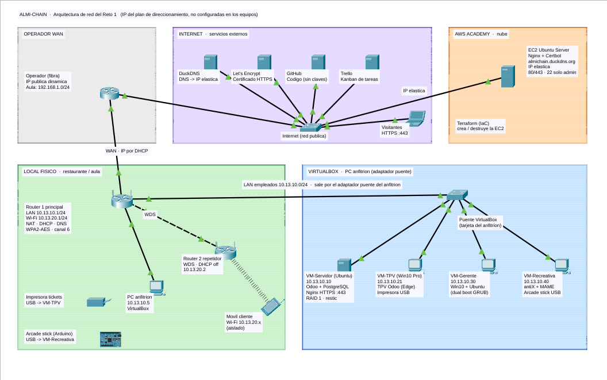
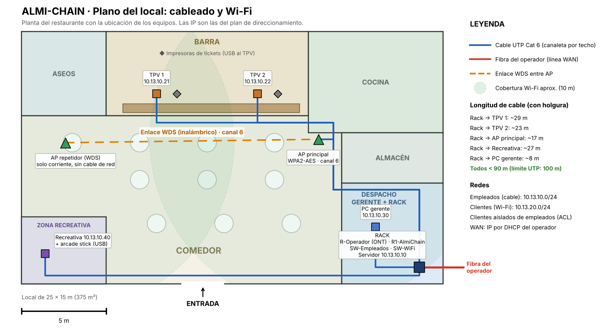

# Redes

Contratación de la línea WAN, esquema de conectividad, plano de red y cableado, Wi-Fi seguro y ampliación de la Wi-Fi de clientes.

| Archivo | Qué es |
| --- | --- |
| [`packet-tracer/esquema_conectividad.png`](packet-tracer/esquema_conectividad.png) | Esquema de conectividad general: operador, local, VirtualBox, internet y AWS |
| `packet-tracer/almichain.pkt` | Proyecto de Packet Tracer (vista lógica + vista física), con las IP configuradas en cada equipo. **Es la versión que ha validado la profesora**; las anteriores quedan en el historial de Git |
| [`packet-tracer/plano_local.png`](packet-tracer/plano_local.png) | Plano del local: ubicación de equipos, cableado y cobertura Wi-Fi. Es la imagen de fondo de la vista física |
| [`packet-tracer/config/`](packet-tracer/config) | Configuración de cada router y switch, lista para pegar en la CLI |
| [`routers/wan/`](routers/wan) | Comparativa y elección de la línea WAN (Yeray) |
| [`routers/router-y-repetidor.md`](routers/router-y-repetidor.md) | Routers físicos del aula: red de clientes y repetidor Wi-Fi (Iñigo y Yeray) |
| [`../docs/Comparativa y contratación de la línea WAN.pdf`](<../docs/Comparativa y contratación de la línea WAN.pdf>) | Comparativa de ofertas de fibra y elección de la línea WAN (Yeray) |

## 1. Direccionamiento

| Red | Rango | Puerta de enlace | Uso |
| --- | --- | --- | --- |
| WAN | 192.168.1.0/24 (IP por DHCP del operador) | 192.168.1.1 | Enlace con el router de la fibra |
| Empleados | 10.13.10.0/24 | 10.13.10.1 | Servidor, TPV, gerente, recreativa. Cableada |
| Clientes | 10.13.20.0/24 | 10.13.20.1 | Wi-Fi para clientes, aislada de empleados |
| Internet (simulado) | 203.0.113.0/24 | 203.0.113.1 | Rango reservado para documentación. Simula los servicios externos |

En cada red, de la `.1` a la `.99` son IP fijas y de la `.100` a la `.254` las reparte el DHCP.

| Equipo | Modelo en Packet Tracer | IP | Conexión |
| --- | --- | --- | --- |
| R-Operador | Router 1941 | Gi0/0 192.168.1.1 · Gi0/1 203.0.113.1 | Gi0/0 → R1 Gi0/0/0 · Gi0/1 → switch de Internet |
| R1-AlmiChain | Router ISR4331 | Gi0/0/0 por DHCP · Gi0/0/1 10.13.10.1 · Gi0/0/2 10.13.20.1 | Gi0/0/1 → SW-Empleados Gig0/1 · Gi0/0/2 → SW-WiFi Gig0/1 |
| SW-Empleados | Switch 2960 | 10.13.10.2 | Equipos en Fa0/1 a Fa0/9 |
| SW-WiFi | Switch 2960 | 10.13.20.5 | AP-Principal en Fa0/1 · AP-Repetidor en Fa0/2 |
| AP-Principal | AccessPoint-PT-N | — | Fa0/1 de SW-WiFi |
| AP-Repetidor | AccessPoint-PT-N | — (en la realidad, 10.13.20.2) | Ver apartado 4 (WDS) |
| PC anfitrión | PC | 10.13.10.5 | Fa0/1 de SW-Empleados |
| Servidor (Odoo) | Server | 10.13.10.10 | Fa0/2 |
| TPV 1 | PC | 10.13.10.21 | Fa0/3 |
| TPV 2 | PC | 10.13.10.22 | Fa0/4 |
| PC gerente | PC | 10.13.10.30 | Fa0/5 |
| Recreativa | PC | 10.13.10.40 | Fa0/6 |
| Móvil cliente | Smartphone | DHCP 10.13.20.x | Wi-Fi |
| Portátil cliente | Laptop con tarjeta inalámbrica | DHCP 10.13.20.x | Wi-Fi |
| EC2 (web) | Server | 203.0.113.10 | Switch de Internet. Servicio HTTP activado |

Todos los equipos de la red de empleados llevan máscara `255.255.255.0`, puerta de enlace `10.13.10.1` y DNS `1.1.1.1`.

Las impresoras de tickets y el arcade stick van por USB a su equipo, así que en Packet Tracer aparecen solo como nota.

## 2. Montaje en Packet Tracer

1. Coloca los equipos de la tabla y únelos con cable de cobre directo (*Copper Straight-Through*), siguiendo la columna «Conexión».
2. Configura los routers y los switches. Para cada uno: abre la pestaña **CLI**, pulsa Enter, escribe `enable` y `configure terminal`, y pega su archivo de [`packet-tracer/config/`](packet-tracer/config). Antes de pegar, cambia las claves `CLAVE_…` por las tuyas.
3. Configura los dos AP en *Config → Port 1* con los mismos valores:
   - SSID `AlmiChain-Clientes`, canal **6**.
   - Autenticación **WPA2-PSK**, cifrado **AES** y una clave de al menos 12 caracteres.
4. En el móvil y el portátil de cliente, abre *Config → Wireless0*. Pon el mismo SSID, WPA2-PSK y la misma clave. En IP, marca **DHCP**.
5. A los equipos de la red de empleados ponles en *Config → FastEthernet0* la IP fija de la tabla, la puerta de enlace `10.13.10.1` y el DNS `1.1.1.1`.
6. Guarda el proyecto como `packet-tracer/almichain.pkt`.

## 3. Seguridad aplicada

| Medida | Dónde |
| --- | --- |
| La Wi-Fi de clientes no llega a la red de empleados. Solo tiene salida a internet | ACL `WIFI-CLIENTES` en R1 Gi0/0/2 |
| Wi-Fi con WPA2-PSK y cifrado AES, y la misma configuración en los dos AP | AP-Principal y AP-Repetidor |
| El router solo se administra por **SSH v2**, con usuario y contraseña, y solo desde la red de empleados | R1: `transport input ssh` y `access-class 10` |
| Contraseñas cifradas, `enable secret` y mensaje de acceso restringido | R1 y los switches |
| Los switches no se administran en remoto, solo por consola | `line vty … transport input none` |
| Puertos libres apagados. En la red de empleados, como máximo 2 equipos por puerto | SW-Empleados y SW-WiFi |
| NAT: desde internet no se ve ninguna IP interna | R1 |
| Sesiones que se cierran solas tras 5 minutos sin uso | `exec-timeout 5 0` |

## 4. Ampliación de la Wi-Fi con WDS

> **En los routers físicos del aula se usa un repetidor y no WDS.** El segundo router (TP-Link TL-WR841N v14) no tiene la opción WDS en su firmware, y el profesor indicó que hiciera de repetidor (*Range Extender*). La configuración real, las capturas y las pruebas están en [`routers/router-y-repetidor.md`](routers/router-y-repetidor.md). Este apartado describe el diseño en Packet Tracer.

El segundo router se coloca al fondo del comedor (ver el plano). Solo lleva corriente, y su conexión con el principal es inalámbrica, por WDS. Para que el WDS funcione:
- Los dos tienen que estar en el **mismo canal** (6).
- Cada uno tiene que tener dado de alta el MAC del otro.
- Se usa el mismo SSID y la misma clave, para que el móvil pase de uno a otro sin reconectarse.
- El segundo router lleva el **DHCP desactivado**: las IP las sigue dando R1.

**Limitación de Packet Tracer:** Packet Tracer no tiene WDS entre puntos de acceso. Por eso el AP-Repetidor va unido a SW-WiFi con un cable con la etiqueta «Enlace WDS (simulado)». La cobertura y el aislamiento sí se pueden comprobar en el simulador. La ampliación real se comprueba con los routers físicos del aula, en modo repetidor (prueba 8).

## 5. Vista física (plano)

1. Pulsa **Physical** en la barra superior.
2. Entra en el edificio donde están los equipos y ponle de fondo `plano_local.png`, con el botón de imagen de fondo de la barra de la vista física.
3. Arrastra cada equipo a su sitio según el plano: el rack en el despacho, los TPV en la barra, la recreativa en su zona y los AP en el techo del comedor.
4. Comprueba que en la vista lógica el móvil sigue conectado al AP más cercano.

## 6. Pruebas

La profesora solo pide el esquema en Packet Tracer, y ya lo ha validado (prueba 9). Las pruebas 1 a 7 son **comprobaciones opcionales**: sirven para enseñar en la defensa que la configuración funciona en el simulador, pero no forman parte de lo que se entrega.

| # | Prueba | Resultado esperado | Captura |
| --- | --- | --- | --- |
| 1 | `ipconfig` en el móvil, cerca del AP-Repetidor | IP `10.13.20.1xx` y puerta de enlace `10.13.20.1` | Opcional |
| 2 | Desde el móvil, `ping 203.0.113.10` y abrir `http://203.0.113.10` en el navegador | Responde y carga la web: hay salida a internet | Opcional |
| 3 | Desde el móvil, `ping 10.13.10.10` | **Falla**: la Wi-Fi de clientes está aislada | ✅ 05/11 · 4 enviados, 0 recibidos (`100% loss`): el móvil de clientes no llega al servidor · [captura](packet-tracer/capturas/pt_03_movil_no_llega_al_servidor.png) |
| 4 | Desde el TPV 1, `ping 10.13.10.10` y `ping 203.0.113.10` | Responden los dos | Opcional |
| 5 | Desde el PC anfitrión, `ssh -l admin 10.13.10.1` | Pide la contraseña y entra | Opcional |
| 6 | Desde el portátil del cliente, `ssh -l admin 10.13.20.1` | **Rechazado** | Opcional |
| 7 | En R1: `show ip nat translations`, `show ip dhcp binding` y `show access-lists` | Aparecen las traducciones, las IP repartidas y los bloqueos de la ACL | Opcional |
| 8 | Routers físicos del aula: un cliente de la Wi-Fi navega y no llega a la red del aula | Navega y el ping al servidor (`192.168.1.50`) falla | ✅ 12/11 · Access Control en el router: internet responde (0 % de pérdida) y el servidor no (100 %, y HTTPS sin conexión). Validado por la profesora · ver [`router-y-repetidor.md`](routers/router-y-repetidor.md#6-prueba-de-aislamiento) |
| 9 | **Revisión de la profesora:** proyecto de Packet Tracer (`almichain.pkt`), esquema, plano y configuración | Le parece correcto | ✅ 26/10: validado por la profesora |
