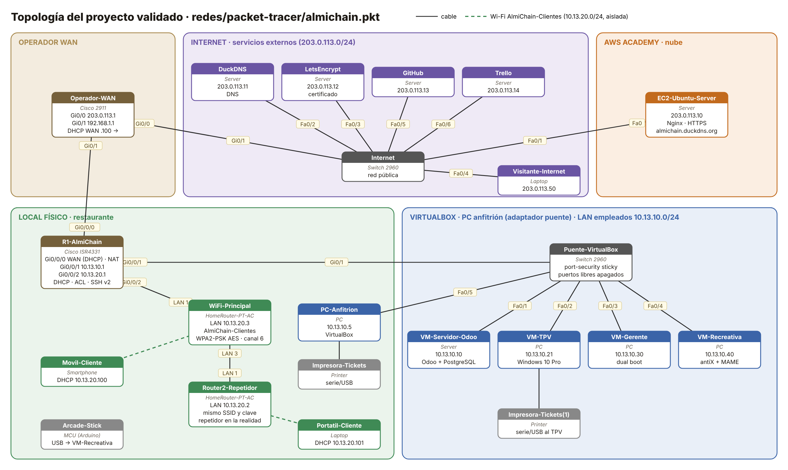

# Redes

Contratación de la línea WAN, esquema de conectividad en Packet Tracer, plano del local, Wi-Fi segura y ampliación de la Wi-Fi de clientes con un segundo router.

| Archivo | Qué es |
| --- | --- |
| [`packet-tracer/almichain.pkt`](packet-tracer/almichain.pkt) | Proyecto de Packet Tracer (vista lógica + vista física) con las IP configuradas en cada equipo. **Es la versión que ha validado la profesora**; las anteriores quedan en el historial de Git |
| [`packet-tracer/topologia_validada.png`](packet-tracer/topologia_validada.png) | Topología del proyecto validado: equipos, modelos, IP y puertos de cada cable |
| [`packet-tracer/plano_local.png`](packet-tracer/plano_local.png) | Plano del local: ubicación de equipos, cableado y cobertura Wi-Fi. Es la imagen de fondo de la vista física |
| [`packet-tracer/config/`](packet-tracer/config) | Configuración de los dos routers Cisco y del switch, sacada del proyecto validado y lista para pegar en la CLI |
| [`packet-tracer/capturas/`](packet-tracer/capturas) | Capturas de las pruebas en el simulador |
| [`routers/wan/`](routers/wan) | Comparativa y elección de la línea WAN (Yeray) |
| [`routers/router-y-repetidor.md`](routers/router-y-repetidor.md) | Routers físicos del aula: red de clientes y repetidor Wi-Fi (Iñigo y Yeray) |
| [`../docs/Comparativa y contratación de la línea WAN.pdf`](<../docs/Comparativa y contratación de la línea WAN.pdf>) | Comparativa de ofertas de fibra y elección de la línea WAN (Yeray) |

## 1. Qué representa el proyecto

El proyecto tiene cinco zonas, las mismas que el [esquema general del reto](../docs/diagramas/esquema_definitivo.png):

- **Operador WAN:** el router de la fibra (`Operador-WAN`). Da a R1 su IP de WAN por DHCP y le da salida a internet.
- **Internet:** un switch (`Internet`) con los servicios externos que usa el reto: DuckDNS (DNS), Let's Encrypt (certificado), GitHub, Trello y un visitante de la web.
- **AWS Academy:** el servidor EC2 con la web pública (`203.0.113.10`, que hace el papel de la IP elástica).
- **Local físico:** el router propio del restaurante (`R1-AlmiChain`), los dos routers Wi-Fi de clientes, los clientes Wi-Fi, el PC anfitrión, la impresora de tickets y el arcade stick.
- **VirtualBox:** las cuatro máquinas virtuales del reto, unidas por el adaptador puente del PC anfitrión, que en el simulador es el switch `Puente-VirtualBox`.

Como las IP públicas reales cambian, internet se simula con el rango `203.0.113.0/24`, reservado para documentación.

## 2. Direccionamiento

| Red | Rango | Puerta de enlace | Uso |
| --- | --- | --- | --- |
| Internet (simulado) | 203.0.113.0/24 | 203.0.113.1 | Servicios externos y web en AWS |
| WAN | 192.168.1.0/24 | 192.168.1.1 | Enlace entre el operador y R1. R1 recibe `192.168.1.100` por DHCP |
| Empleados | 10.13.10.0/24 | 10.13.10.1 | Servidor de Odoo, TPV, gerente, recreativa y PC anfitrión. Por cable |
| Clientes | 10.13.20.0/24 | 10.13.20.1 | Wi-Fi `AlmiChain-Clientes`, **aislada** de la red de empleados |

En las dos redes del local, las IP de la `.1` a la `.99` y de la `.200` a la `.254` son fijas, y el DHCP de R1 reparte de la `.100` a la `.199`. El DNS que reparte es el de DuckDNS (`203.0.113.11`).

### 2.1 Equipos, IP y cables

| Equipo | Modelo en Packet Tracer | IP | Conectado a |
| --- | --- | --- | --- |
| Operador-WAN | Router Cisco 2911 | Gi0/0 `203.0.113.1` · Gi0/1 `192.168.1.1` | Gi0/0 → Internet Gi0/1 · Gi0/1 → R1 Gi0/0/0 (cruzado) |
| Internet | Switch 2960 | — | Servidores externos en Fa0/1 a Fa0/6 |
| EC2-Ubuntu-Server | Server | `203.0.113.10` | Internet Fa0/1 |
| DuckDNS | Server | `203.0.113.11` | Internet Fa0/2 |
| LetsEncrypt | Server | `203.0.113.12` | Internet Fa0/3 |
| Visitante-Internet | Laptop | `203.0.113.50` | Internet Fa0/4 |
| GitHub | Server | `203.0.113.13` | Internet Fa0/5 |
| Trello | Server | `203.0.113.14` | Internet Fa0/6 |
| **R1-AlmiChain** | Router Cisco ISR4331 | Gi0/0/0 por DHCP · Gi0/0/1 `10.13.10.1` · Gi0/0/2 `10.13.20.1` | Gi0/0/1 → Puente-VirtualBox Gi0/1 · Gi0/0/2 → WiFi-Principal (puerto LAN 1) |
| Puente-VirtualBox | Switch 2960 | — | VM en Fa0/1 a Fa0/4 y PC anfitrión en Fa0/5 |
| VM-Servidor-Odoo | Server | `10.13.10.10` | Puente Fa0/1 |
| VM-TPV | PC | `10.13.10.21` | Puente Fa0/2 |
| VM-Gerente | PC | `10.13.10.30` | Puente Fa0/3 |
| VM-Recreativa | PC | `10.13.10.40` | Puente Fa0/4 |
| PC-Anfitrion | PC | `10.13.10.5` | Puente Fa0/5 |
| WiFi-Principal | HomeRouter-PT-AC | LAN `10.13.20.3` | R1 Gi0/0/2 (LAN 1) · Router2-Repetidor (LAN 3, cruzado) |
| Router2-Repetidor | HomeRouter-PT-AC | LAN `10.13.20.2` | WiFi-Principal (LAN 1) |
| Movil-Cliente | Smartphone | DHCP (`10.13.20.100`) | Wi-Fi |
| Portatil-Cliente | Laptop | DHCP (`10.13.20.101`) | Wi-Fi |
| Impresora-Tickets e Impresora-Tickets(1) | Printer | — | Cable serie al PC anfitrión y a la VM-TPV (en la realidad, USB) |
| Arcade-Stick | MCU-PT | — | Nota: va por USB a la VM-Recreativa |

Los equipos de la red de empleados llevan máscara `255.255.255.0` y puerta de enlace `10.13.10.1`.

## 3. Configuración de cada equipo

### 3.1 R1-AlmiChain (router del restaurante)

Archivo: [`packet-tracer/config/R1-AlmiChain.txt`](packet-tracer/config/R1-AlmiChain.txt)

- **Tres interfaces:** WAN por DHCP (`ip nat outside`), LAN de empleados y LAN de clientes (las dos `ip nat inside`).
- **DHCP:** pools `EMPLEADOS` y `CLIENTES`, con las IP fijas excluidas.
- **NAT con sobrecarga (PAT):** las dos LAN salen a internet con la IP de la WAN (ACL `NAT-LAN`). Desde fuera no se ve ninguna IP interna.
- **ACL `CLIENTES-AISLADOS`**, de entrada en Gi0/0/2:
  1. Deja pasar el DHCP (`bootps`), para que los clientes reciban IP.
  2. Bloquea todo lo que va de `10.13.20.0/24` a `10.13.10.0/24`.
  3. Bloquea el puerto 22: los clientes no pueden intentar administrar el router.
  4. Deja pasar el resto, es decir, internet.
- **Administración:** solo SSH v2, con usuario local y solo desde la red de empleados (ACL `SSH-ADMIN` en las líneas vty). Consola y vty se cierran tras 5 minutos sin uso.
- **Contraseñas:** `enable secret`, `service password-encryption` y longitud mínima de 10 caracteres (`security passwords min-length 10`). Mensaje de acceso restringido.

### 3.2 Operador-WAN

Archivo: [`packet-tracer/config/Operador-WAN.txt`](packet-tracer/config/Operador-WAN.txt). Es la puerta de enlace de internet (`203.0.113.1`) y da por DHCP la IP de WAN a R1 (pool `WAN`, desde la `.100`).

### 3.3 Puente-VirtualBox (switch de empleados)

Archivo: [`packet-tracer/config/Puente-VirtualBox.txt`](packet-tracer/config/Puente-VirtualBox.txt)

- **Port-security *sticky*** en Fa0/1 a Fa0/5: cada puerto aprende la MAC de su equipo. Si se conecta otro, su tráfico se descarta y queda registrado (`violation restrict`).
- **PortFast y BPDU Guard** en esos puertos: el equipo tiene red al momento y, si alguien conecta otro switch, el puerto se bloquea.
- **Puertos libres apagados** (Fa0/6 a Fa0/24 y Gi0/2), con la descripción «Sin uso».
- **Sin administración remota:** `transport input none` en las vty. Solo se entra por consola, con usuario local y cierre a los 5 minutos.

### 3.4 Routers Wi-Fi (WiFi-Principal y Router2-Repetidor)

Se configuran en la pestaña **GUI** de cada HomeRouter:

| Ajuste | WiFi-Principal | Router2-Repetidor |
| --- | --- | --- |
| IP de LAN | `10.13.20.3` | `10.13.20.2` |
| Conexión | Puerto LAN 1 a R1 Gi0/0/2 | Puerto LAN 1 al LAN 3 del principal |
| SSID | `AlmiChain-Clientes` | `AlmiChain-Clientes` |
| Seguridad | WPA2-PSK, cifrado AES | WPA2-PSK, cifrado AES, misma clave |
| Canal (2,4 GHz) | 6 | 6 |
| DHCP | Lo da R1 (`10.13.20.1`) | Lo da R1 (`10.13.20.1`) |

Los dos routers van conectados por sus puertos LAN, así que funcionan como **puntos de acceso**: los clientes reciben la IP del DHCP de R1 y pasan por la ACL de aislamiento. Con el mismo SSID, la misma clave y el mismo canal, un móvil pasa de uno a otro sin reconectarse.

**WDS y repetidor.** Packet Tracer no tiene WDS ni modo repetidor entre estos routers, así que el enlace entre los dos se simula con un cable (nota «WDS en la realidad» en el proyecto). En el aula, el segundo router (TP-Link TL-WR841N v14) tampoco tiene WDS en su firmware, y el profesor indicó configurarlo como **repetidor** (*Range Extender*). La configuración real, las capturas y las pruebas están en [`routers/router-y-repetidor.md`](routers/router-y-repetidor.md).

## 4. Montaje en Packet Tracer, paso a paso

1. Coloca los equipos de la tabla 2.1 y únelos según la columna «Conectado a». Usa cable directo, salvo Operador-WAN ↔ R1 y WiFi-Principal ↔ Router2-Repetidor, que van con cable cruzado.
2. En **Operador-WAN**, **R1-AlmiChain** y **Puente-VirtualBox**: pestaña **CLI**, pulsa Enter, escribe `enable` y `configure terminal`, y pega su archivo de [`packet-tracer/config/`](packet-tracer/config). Antes, cambia `CLAVE_ENABLE` y `CLAVE_ADMIN` por tus claves (en R1, de 10 caracteres o más).
3. Configura los dos HomeRouter en la pestaña **GUI** con la tabla 3.4.
4. En el móvil y el portátil: *Config → Wireless0*, el SSID `AlmiChain-Clientes`, WPA2-PSK y la misma clave. En IP, marca **DHCP**.
5. En los equipos de empleados y de internet: *Config → FastEthernet0*, la IP fija de la tabla y su puerta de enlace (`10.13.10.1` o `203.0.113.1`).
6. En el servidor EC2, activa el servicio **HTTP** para poder abrir la web desde el navegador de los clientes.
7. Guarda el proyecto como `packet-tracer/almichain.pkt`.

## 5. Vista física (plano)

1. Pulsa **Physical** en la barra superior.
2. Entra en el edificio del local y ponle de fondo `plano_local.png`, con el botón de imagen de fondo.
3. Arrastra cada equipo a su sitio según el plano: el rack en el despacho, los TPV en la barra, la recreativa en su zona y los dos routers Wi-Fi en el comedor.
4. Comprueba en la vista lógica que el móvil sigue conectado a la Wi-Fi.

## 6. Seguridad aplicada

| Medida | Dónde |
| --- | --- |
| La Wi-Fi de clientes no llega a la red de empleados; solo sale a internet | ACL `CLIENTES-AISLADOS` en R1 Gi0/0/2 |
| Wi-Fi con WPA2-PSK y cifrado AES, igual en los dos routers | WiFi-Principal y Router2-Repetidor |
| El router solo se administra por **SSH v2**, con usuario y contraseña, y solo desde la red de empleados | R1: `transport input ssh` y `access-class SSH-ADMIN in` |
| Los clientes ni siquiera pueden intentar el SSH | R1: `deny tcp any any eq 22` en la ACL de clientes |
| Contraseñas cifradas, `enable secret`, mínimo 10 caracteres y mensaje de acceso restringido | R1 y Puente-VirtualBox |
| El switch no se administra en remoto, solo por consola | Puente-VirtualBox: `transport input none` |
| Cada puerto solo acepta su equipo; puertos libres apagados; BPDU Guard | Puente-VirtualBox |
| NAT: desde internet no se ve ninguna IP interna | R1 |
| Sesiones que se cierran solas tras 5 minutos sin uso | `exec-timeout 5 0` |

## 7. Pruebas

La profesora pide el esquema en Packet Tracer y ya lo ha validado (prueba 9). Las pruebas 1 a 7 sirven para enseñar en la defensa que la configuración funciona en el simulador.

| # | Prueba | Resultado esperado | Estado |
| --- | --- | --- | --- |
| 1 | `ipconfig` en el móvil | IP `10.13.20.1xx` dada por R1 | Opcional |
| 2 | Desde el móvil, `ping 203.0.113.10` y abrir `http://203.0.113.10` | Responde y carga la web: hay salida a internet | Opcional |
| 3 | Desde el móvil, `ping 10.13.10.10` | **Falla**: la Wi-Fi de clientes está aislada | ✅ 05/11 · 4 enviados, 0 recibidos (`100% loss`) · [captura](packet-tracer/capturas/pt_03_movil_no_llega_al_servidor.png) |
| 4 | Desde la VM-TPV, `ping 10.13.10.10` y `ping 203.0.113.10` | Responden los dos | Opcional |
| 5 | Desde el PC anfitrión, `ssh -l admin 10.13.10.1` | Pide la contraseña y entra | Opcional |
| 6 | Desde el portátil del cliente, `ssh -l admin 10.13.20.1` | **Rechazado** | Opcional |
| 7 | En R1: `show ip nat translations`, `show ip dhcp binding` y `show access-lists` | Traducciones, IP repartidas y bloqueos de la ACL | Opcional |
| 8 | Routers físicos del aula: un cliente de la Wi-Fi navega y no llega a la red del aula | Navega y el ping al servidor (`192.168.1.50`) falla | ✅ 12/11 · internet responde (0 % de pérdida) y el servidor no (100 %, y HTTPS sin conexión). Validado por la profesora · [`router-y-repetidor.md`](routers/router-y-repetidor.md#6-prueba-de-aislamiento) |
| 9 | **Revisión de la profesora:** proyecto de Packet Tracer, esquema, plano y configuración | Le parece correcto | ✅ Validado por la profesora (primera revisión 26/10; versión final con las IP configuradas, 12/11) |
