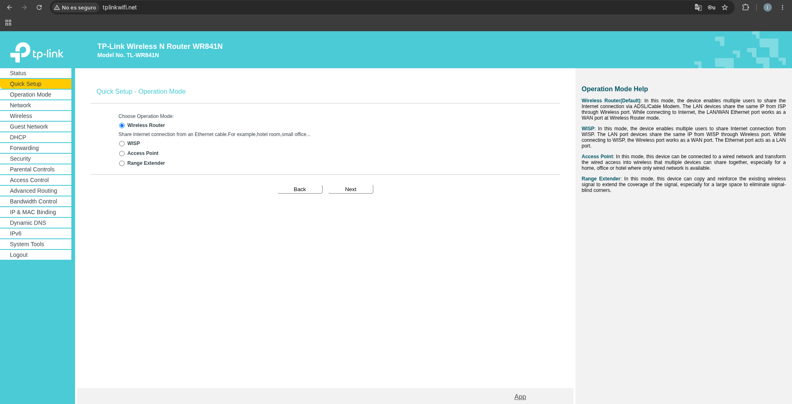
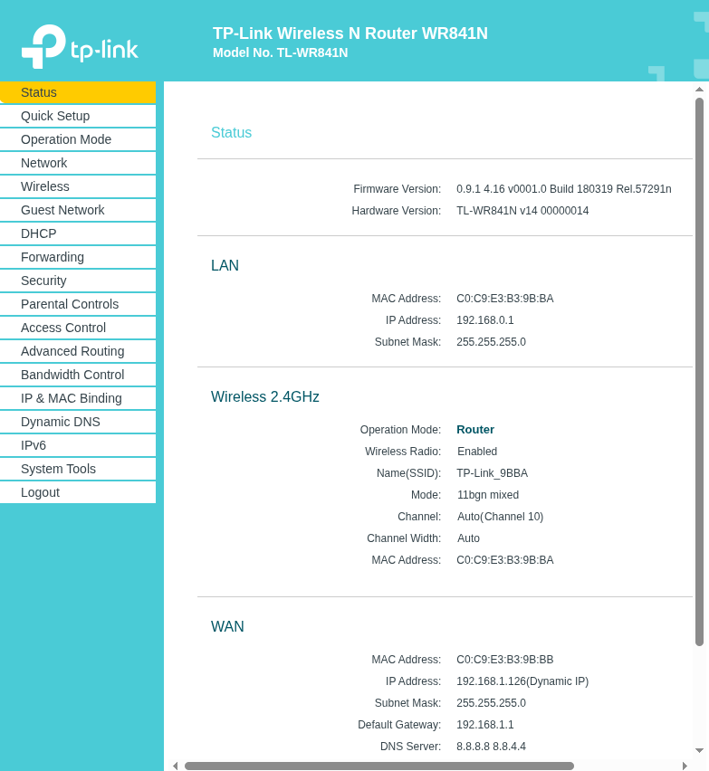
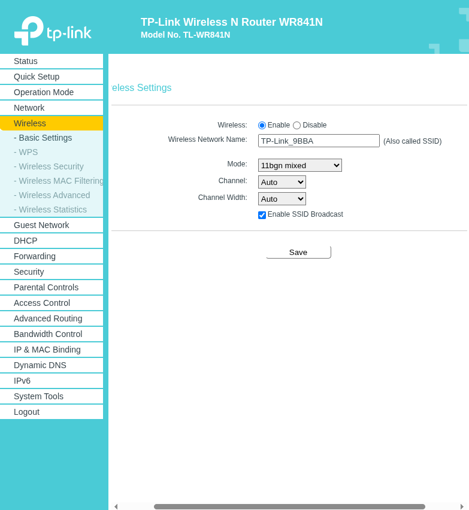
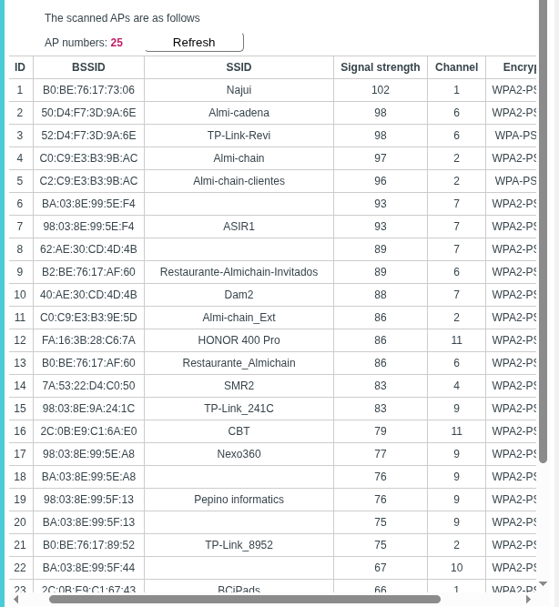
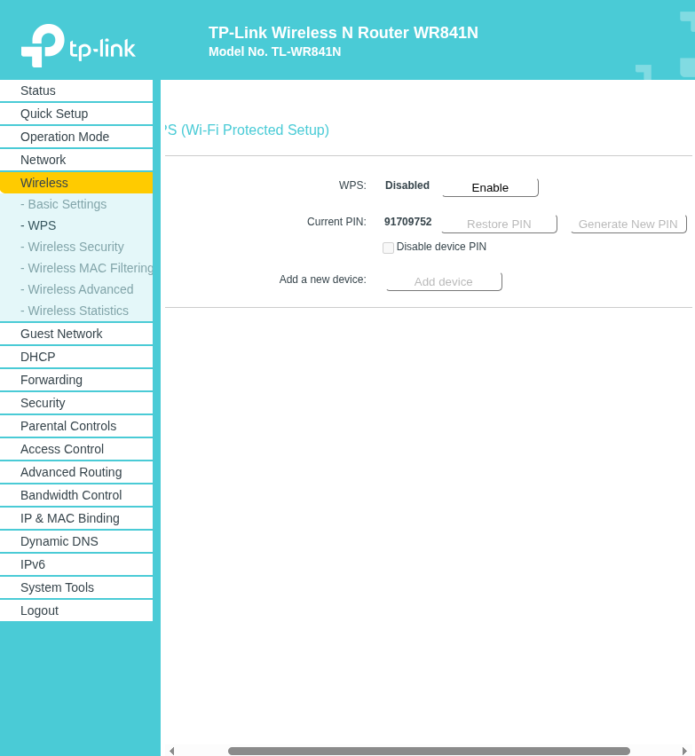

# Router y repetidor Wi-Fi

Responsables: Iñigo y Yeray. Estado: repetidor conectado y con salida a internet. Pruebas hechas; el aislamiento no se cumple con estos routers (ver el apartado 7).

## 1. Objetivo

Ampliar la Wi-Fi de clientes del local con un segundo aparato, manteniendo a los clientes aislados de los equipos de la empresa.

## 2. Decisión: repetidor en lugar de WDS

El reto pedía un segundo router enlazado por WDS. El segundo aparato es un TP-Link TL-WR841N v14 (firmware 0.9.1 4.16 v0001.0 Build 180319) y su panel no tiene WDS: ofrece los modos Wireless Router, WISP, Access Point y Range Extender, y en Wireless solo hay Basic Settings, WPS, Wireless Security, MAC Filtering, Wireless Advanced y Wireless Statistics. Se consultó al profesor, que indicó que el aparato hiciera de repetidor.

## 3. Router: red de clientes

El router es otro TL-WR841N con la Wi-Fi principal `Almi-cadena`, en el canal 6 fijo y modo 11bgn mixed. Su red de clientes (Guest Network) estaba desactivada, con el nombre de fábrica y sin cifrado. Se activó con el nombre `TP-Link-Revi` y una clave generada en KeePassXC, que no se escribe aquí. Antes de activarla, la opción "Allow Guests To Access My Local Network" estaba en Disable, que es el valor que aísla a los clientes de la red local, y se mantuvo.

## 4. Repetidor

Se configuró con Quick Setup, Range Extender: el repetidor escanea las redes, se conecta a `TP-Link-Revi` con su clave y repite la señal. Al escanear salen muchas redes de otros grupos con nombres parecidos, así que se comprobó que la elegida es la del router: su BSSID empieza por `50:D4:F7:3D:9A`, que es la MAC de la etiqueta del router. Para un técnico nuevo: no elegir nunca una red solo por el nombre.

Estado final: modo Range Extender, radio activada, canal 6 (el mismo que el router), MAC LAN C0:C9:E3:B3:9B:BA e IP 192.168.1.136 recibida por DHCP.

## 5. Seguridad

- WPS desactivado en el repetidor.
- La clave de la red de clientes está solo en KeePassXC.

## 6. Incidencias

- **Error 80002 (Unknown error)** al guardar la red de clientes desde el móvil: al guardar, la Wi-Fi se reinicia y se corta la conexión con el panel. El cambio sí se aplicó. Solución: volver a entrar y comprobar. Recomendación: configurar por cable.
- Conectar el móvil al repetidor falló al principio por escribir mal la clave. La clave de la Wi-Fi no es la de administrador del panel.

## 7. Pruebas

| # | Prueba | Resultado | Captura |
| --- | --- | --- | --- |
| 1 | Conectar un móvil a la Wi-Fi a través del repetidor | ✅ Conectado a `TP-Link-Revi` | [07](capturas/07-movil-conectado-repetidor.jpg) |
| 2 | Navegar a internet desde ese móvil | ✅ Carga `es.wikipedia.org` | [09](capturas/09-internet-desde-repetidor.jpg) |
| 3 | Aislamiento: desde ese móvil, llegar a un equipo de la red del aula (`192.168.1.175`) | ❌ **No está aislado:** el ping responde (3/3, 0 % de pérdida, 4 ms). Los puertos 80 y 443 no responden, pero es porque ese equipo no ofrece web, no por el aislamiento | [08](capturas/08-ping-desde-repetidor.jpg) |

**Por qué falla el aislamiento.** La opción *Allow Guests To Access My Local Network = Disable* solo separa a los invitados de los equipos conectados **dentro** de la LAN del router. Los equipos del reto (el servidor de Odoo, `192.168.1.50`, y el resto) están en la red del aula, no en la LAN propia del router, y el aislamiento de invitados de este router no filtra el tráfico hacia esa red. Con estos routers domésticos y esta conexión no se puede aislar.

**Cómo se resuelve en el diseño.** En el local real, empleados y clientes van en redes distintas y una ACL en el router principal bloquea el paso de clientes a empleados. Está comprobado en Packet Tracer: el móvil de la Wi-Fi de clientes no llega al servidor, con un 100 % de pérdida ([prueba 3 de `redes/README.md`](../../README.md#6-pruebas)). Para montarlo con equipos físicos haría falta un router con VLAN y ACL, como el TP-Link ER605 del [presupuesto](../../../docs/presupuesto/fichas_hw_sw.md).

## 8. Riesgos y desviaciones

- No hay WDS: se usa repetidor.
- El repetidor tiene firmware de 2018, sin parches de seguridad.
- El nombre de la red de clientes no es el del plano (`AlmiChain-Clientes`).
- El repetidor tiene una IP del rango 192.168.1.x, distinto del plano (10.13.10.x).
- Canal 6 compartido con redes de otros grupos, lo que puede bajar la velocidad.
- **El aislamiento no se cumple con estos routers** (prueba 3): el móvil del repetidor llega a los equipos de la red del aula. Queda como desviación, y la solución es la del diseño (redes separadas con ACL, ver el apartado 7).

## 9. Cómo repetirlo

1. En el router, activar la red de clientes con cifrado WPA2, clave generada y acceso a la red local desactivado. Configurar por cable.
2. En el repetidor, Quick Setup, Range Extender, elegir esa red comprobando que el BSSID es el del router, y escribir su clave.
3. Cambiar la contraseña de administrador del repetidor y desactivar WPS.
4. Hacer las pruebas y guardar las capturas.

Las capturas de las pruebas (apartado 7):

| Captura | Qué muestra |
| --- | --- |
| [07-movil-conectado-repetidor](capturas/07-movil-conectado-repetidor.jpg) | Móvil conectado a `TP-Link-Revi` |
| [08-ping-desde-repetidor](capturas/08-ping-desde-repetidor.jpg) | Pruebas de conexión desde el móvil a `192.168.1.175` |
| [09-internet-desde-repetidor](capturas/09-internet-desde-repetidor.jpg) | Navegación a internet desde el repetidor |

