# Router y repetidor Wi-Fi

Responsables: Iñigo y Yeray.

## 1. Objetivo y diseño

Dar Wi-Fi a los clientes del local, aislada de los equipos de la empresa, y ampliar su cobertura con un segundo aparato.

| Elemento | Valor |
|---|---|
| Red del aula (WAN del router) | 192.168.1.0/24, IP por DHCP |
| Red de clientes (LAN del router) | 192.168.0.0/24, puerta de enlace 192.168.0.1 |
| DHCP del router | 192.168.0.100 a 192.168.0.199 |
| Wi-Fi | AlmiChain-Clientes, canal 6 fijo, WPA2-PSK con AES |
| Aislamiento | Regla de Access Control: clientes (192.168.0.100-199) hacia la red del aula (192.168.1.1-254) |

Las claves y contraseñas están solo en KeePassXC. No se escriben aquí.

## 2. Aparatos

Los dos son TP-Link TL-WR841N v14 (firmware 0.9.1 4.16 Build 180319).

| Aparato | MAC | Papel |
|---|---|---|
| Router | LAN C0:C9:E3:B3:9B:BA | NAT, DHCP y Wi-Fi de clientes |
| Repetidor | Etiqueta 50:D4:F7:3D:9A:6E | Amplía la Wi-Fi del router |

Los papeles se intercambiaron respecto a la primera configuración: el aparato que antes hacía de router pasó a ser el repetidor.

## 3. Decisión: repetidor en lugar de WDS

El reto pedía un segundo router enlazado por WDS. El panel de este modelo no tiene WDS: ofrece los modos Wireless Router, WISP, Access Point y Range Extender, y el menú Wireless solo tiene Basic Settings, WPS, Wireless Security, MAC Filtering, Wireless Advanced y Wireless Statistics. Se consultó al profesor, que indicó que el aparato hiciera de repetidor.

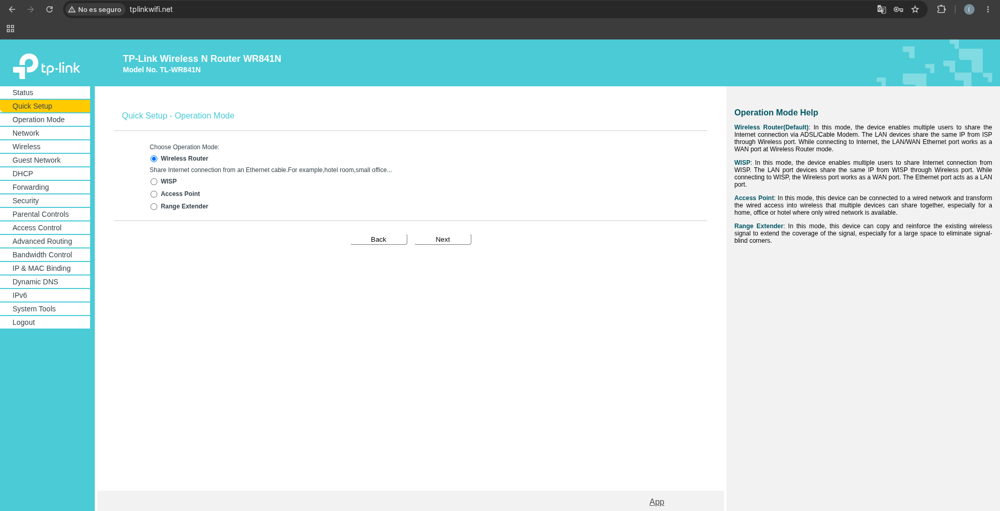
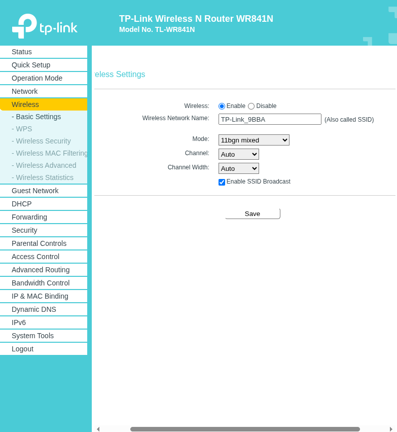

## 4. Router

Todo se configura por cable.

1. Reset de fábrica (RESET 10 segundos con el router encendido). El cable del aula va al puerto WAN y el PC a un puerto LAN.
2. Contraseña de administración generada en KeePassXC.
3. Operation Mode: Wireless Router. Network, WAN: Dynamic IP. El router cogió una IP de la red del aula.

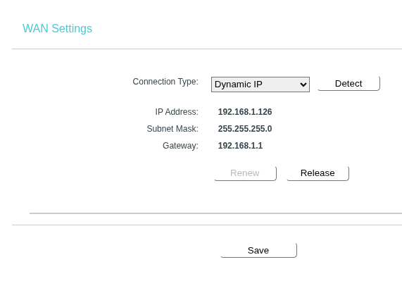
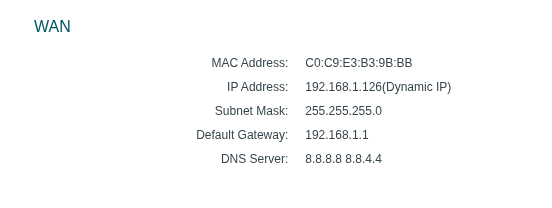

4. Wi-Fi: SSID AlmiChain-Clientes, modo 11bgn mixed, canal 6 fijo, seguridad WPA2-PSK con AES y clave generada en KeePassXC.

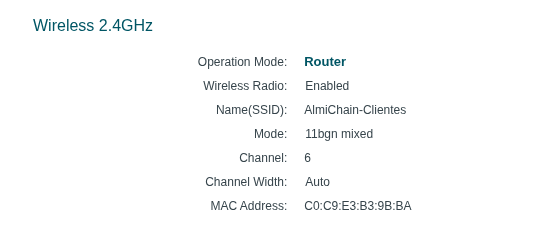

5. WPS desactivado, gestión remota cerrada (IP 0.0.0.0) y red de invitados desactivada, porque toda la Wi-Fi del router es de clientes.

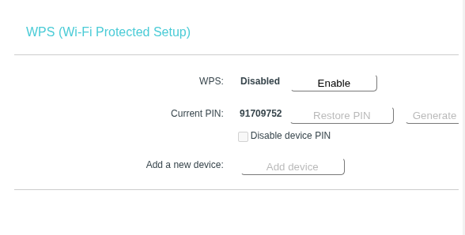
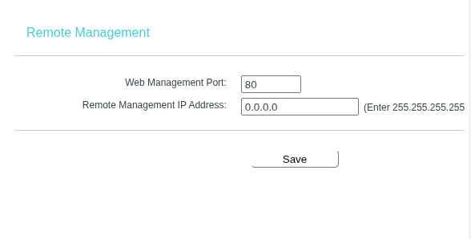
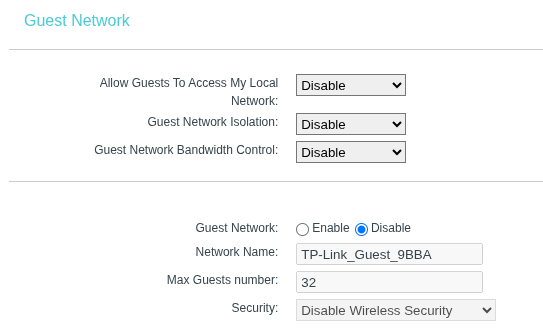

6. DHCP activado, de 192.168.0.100 a 192.168.0.199.

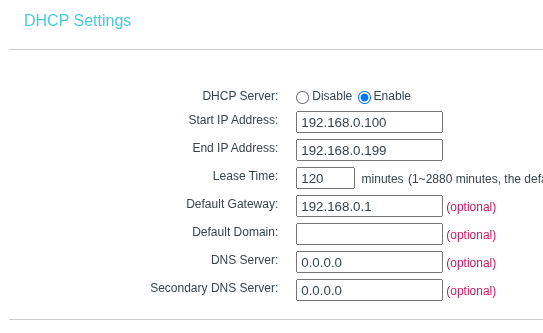

7. Aislamiento con Access Control: un host "Clientes" (192.168.0.100-199), un destino "Red aula" (192.168.1.1-254, todos los puertos) y una regla "Bloquear aula" siempre activa. Internet sigue funcionando porque las páginas web no tienen IP 192.168.1.x, pero los paquetes de un cliente hacia un equipo del aula deben bloquearse.

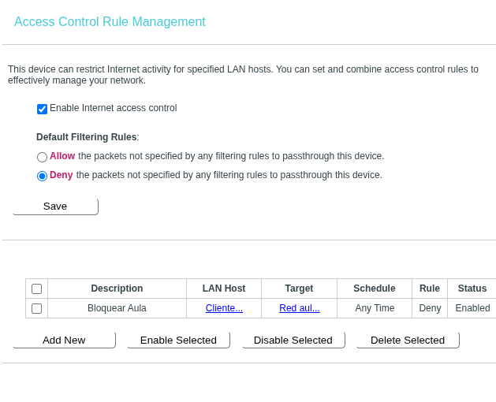
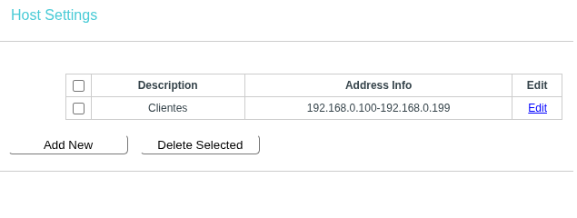
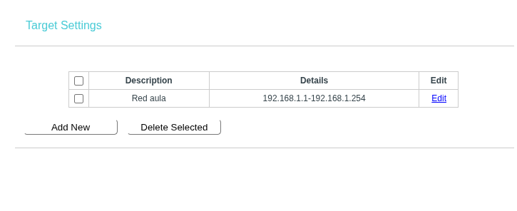

## 5. Repetidor

1. Reset de fábrica y contraseña de administración generada, distinta de la del router.
2. WPS desactivado antes de pasar a modo repetidor. En modo Range Extender el menú de Wireless no muestra la opción WPS, así que no se puede volver a comprobar desde el panel.
3. Quick Setup, Range Extender. En el escaneo salen muchas redes de otros grupos con nombres casi iguales, así que se elige la red comprobando que su BSSID es el del router (C0:C9:E3:B3:9B:BA, entero, hasta el último byte) y no solo por el nombre.
4. Se escribe la clave de la Wi-Fi del router (la misma, no una nueva) pegándola desde KeePassXC, y se deja el mismo nombre de red.
5. Tras reiniciar, se comprueba en Status el modo Range Extender, el canal 6 y la conexión con el router.

## 6. Prueba de aislamiento

Con el PC por cable al router, como cliente de la red 192.168.0.x, se lanzan estos comandos contra el servidor de Odoo (192.168.1.50):

ping -c 3 192.168.1.50
curl -k -m 5 -o /dev/null -w “%{http_code}\n” https://192.168.1.50

Con la regla activa, el servidor no debe ser accesible: el ping debe perder todos los paquetes y la petición web debe terminar por tiempo de espera. La captura recoge el resultado obtenido.

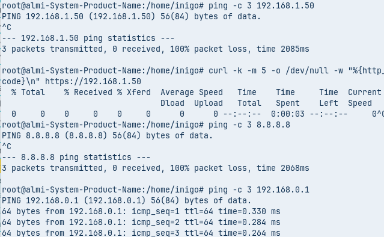

## 7. Incidencias

- Error 80002 (Unknown error) al guardar cambios de Wi-Fi desde el móvil: la Wi-Fi se reinicia al guardar y se corta la conexión con el panel. Solución: configurar siempre por cable.
- El reset de fábrica reactiva el WPS y vuelve a la contraseña de fábrica: hay que desactivarlo y cambiarla.
- En la primera configuración, el servidor seguía siendo accesible desde la red de clientes (respondían el ping y la web). Se corrigió la regla de Access Control y se repitió la prueba.
- Una contraseña inicial débil llegó a escribirse en un chat. Se cambió tras el reset y no se reutiliza.

## 8. Riesgos y desviaciones

- No hay WDS: se usa repetidor, por indicación del profesor.
- No hay red de empleados y red de clientes separadas en el router: toda su Wi-Fi es de clientes, y los equipos y el servidor siguen en la red del aula (192.168.1.x). El plano preveía 10.13.10.x y 10.13.20.x.
- La regla solo protege al rango del DHCP del router. Un equipo con IP fija fuera de ese rango no cae en ella.
- Solo se prueba el ping y HTTPS al servidor. Otros puertos no se han comprobado.
- Firmware de 2018 sin parches de seguridad en los dos aparatos.
- El nombre AlmiChain-Clientes se parece al de redes de otros grupos, por eso se compara la MAC y no el nombre.
- Canal 6 compartido con otras redes del aula, lo que puede bajar la velocidad.

## 9. Cómo repetirlo

1. Reset de los dos aparatos. Contraseña de administración distinta en cada uno, generadas en KeePassXC.
2. Router: modo Wireless Router, WAN Dynamic IP, Wi-Fi con WPA2-PSK y AES en canal 6 fijo, WPS desactivado, gestión remota cerrada y DHCP 192.168.0.100-199.
3. Router: regla de Access Control (host, destino y regla) para bloquear la red del aula, y probarla con ping y curl.
4. Repetidor: WPS desactivado, Quick Setup, Range Extender, red elegida por su BSSID y la misma clave.
5. Guardar las capturas y los backups de los aparatos en KeePassXC (nunca en GitHub).
