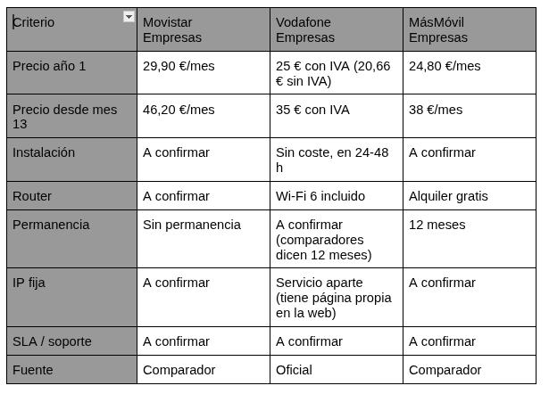

# Línea WAN: comparativa y elección

Responsable: Yeray. Comparativa de ofertas de fibra para empresa y elección de la línea del local. El documento completo está en [`Comparativa y contratación de la línea WAN.pdf`](<../../../docs/Comparativa y contratación de la línea WAN.pdf>), y el diseño de la red en [`../../README.md`](../../README.md).

## Elección

**Vodafone Empresas, fibra 1 Gb simétrica**, según la propuesta de Yeray al equipo ([captura](capturas/17_wan_mensaje_jose.png)):

| Concepto | Valor |
| --- | --- |
| Cuota | 20,66 €/mes sin IVA los 12 primeros meses; después, 28,93 €/mes sin IVA |
| Instalación | Sin coste |
| Router | Wi-Fi 6 incluido |
| Permanencia | Pendiente de confirmar |
| IP fija | Pendiente de confirmar el coste con el operador |

## Comparativa

| Captura | Qué muestra |
| --- | --- |
| [13_wan_movistar](capturas/13_wan_movistar.png) | Oferta de Movistar Empresas |
| [14_wan_vodafone](capturas/14_wan_vodafone.png) | Oferta de Vodafone Empresas |
| [15_wan_masmovil](capturas/15_wan_masmovil.png) | Oferta de MásMóvil Empresas |
| [16_wan_tabla](capturas/16_wan_tabla.png) | Tabla comparativa de las tres |
| [17_wan_mensaje_jose](capturas/17_wan_mensaje_jose.png) | Elección comunicada al equipo para el presupuesto |

## Pendiente

- Completar los «A confirmar» de la tabla (instalación, permanencia, IP fija y SLA) y justificar por qué Vodafone encaja con las necesidades del restaurante: TPV, servidor, Wi-Fi de clientes y copia remota en la nube.

Nunca se suben contraseñas ni la copia de configuración del router (`.bin`, `.cfg`): llevan la contraseña de administración y la clave del Wi-Fi.
