# Equipo del gerente · Dual boot

Equipo del gerente con **Windows 11 Pro** y **Ubuntu 26.04.1 LTS** en el mismo disco, con GRUB para elegir el sistema al arrancar. Los dos sistemas están cifrados y en cada uno el gerente trabaja con un usuario sin permisos de administrador.

Responsable: Sendoa · Fecha: 22–26 de octubre de 2026 · Montado en una VM de VirtualBox en el PC del aula.

> 🔐 En este documento no hay contraseñas ni claves. Todas están en el gestor KeePassXC del equipo (`almi-chain.kdbx`, grupo *Gerente – Dual boot*).

## Índice

1. [Por qué Windows 11 y no Windows 10](#1-por-qué-windows-11-y-no-windows-10)
2. [Máquina virtual](#2-máquina-virtual)
3. [ISOs y verificación](#3-isos-y-verificación)
4. [Instalación de Windows 11](#4-instalación-de-windows-11)
5. [Preparar Windows para el dual boot](#5-preparar-windows-para-el-dual-boot)
6. [Instalación de Ubuntu](#6-instalación-de-ubuntu)
7. [Configuración de Ubuntu](#7-configuración-de-ubuntu)
8. [Cifrado de Windows con BitLocker](#8-cifrado-de-windows-con-bitlocker)
9. [Resultado final](#9-resultado-final)
10. [Incidencias y cómo se resolvieron](#10-incidencias-y-cómo-se-resolvieron)
11. [Seguridad aplicada](#11-seguridad-aplicada)
12. [Lista de capturas](#12-lista-de-capturas)

---

## 1. Por qué Windows 11 y no Windows 10

El enunciado pide Windows 10, pero **Windows 10 dejó de tener soporte el 14 de octubre de 2025**: ya no recibe parches de seguridad. En una empresa real no se instalaría un sistema sin soporte en el equipo del gerente, que maneja datos económicos. Por eso se usa Windows 11 Pro, que además permite BitLocker y directivas de grupo (`gpedit.msc`).

> ✅ **Validado por el profesor (26/10/2026):** Windows 11 en lugar de Windows 10 es válido para el reto.

## 2. Máquina virtual

| Parámetro | Valor | Motivo |
|---|---|---|
| Software | VirtualBox 7.2 | Anfitrión Linux del aula |
| Nombre | `gerente-dualboot` | |
| Firmware | **EFI** | Windows 11 lo exige; arranque UEFI como un PC actual |
| TPM | **2.0** | Requisito de Windows 11 |
| Arranque seguro | Activado | Requisito de Windows 11 |
| RAM | 6192 MB (~6 GB) | Windows 11 pide 4 GB como mínimo; con 6 va fluido |
| CPU | 2 núcleos | |
| Vídeo | 128 MB | |
| Disco | 120 GB VDI dinámico | ~70 GB Windows + ~50 GB Ubuntu |
| Controlador | SATA (AHCI), **caché de E/S del anfitrión activada** | Ver [incidencia 3](#incidencia-3-errores-de-lectura-de-la-iso-durante-la-instalación) |
| Red | Adaptador puente | La VM recibe IP de la red como un equipo más |

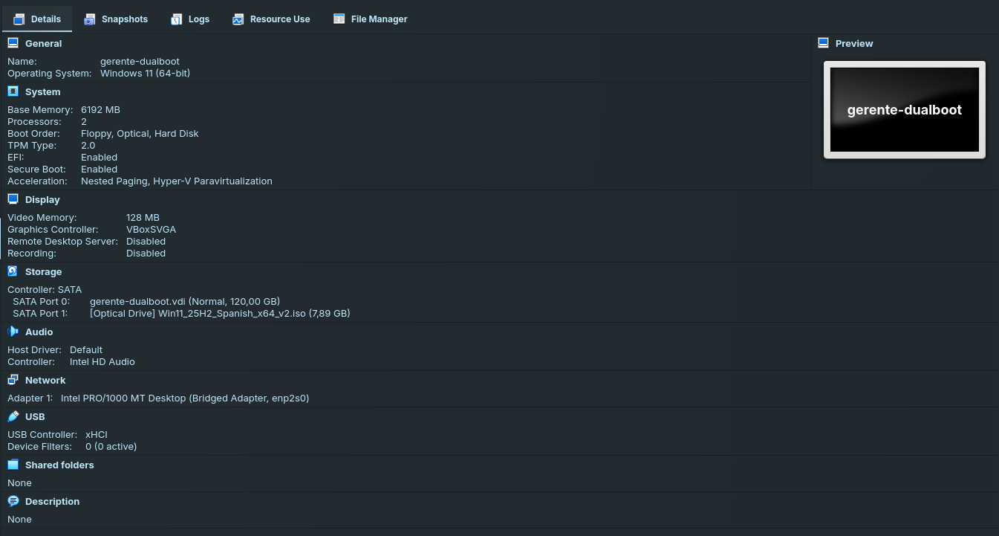

## 3. ISOs y verificación

| Sistema | ISO | Origen |
|---|---|---|
| Windows 11 Pro 25H2 | ISO multiedición x64, español | microsoft.com/es-es/software-download/windows11 |
| Ubuntu 26.04.1 LTS | `ubuntu-26.04.1-desktop-amd64.iso` | ubuntu.com |

Antes de instalar hay que comprobar el hash SHA-256 de cada ISO contra el oficial, para asegurar que no está corrupta ni manipulada.

```bash
sha256sum ubuntu-26.04.1-desktop-amd64.iso
# 601e30fbf5d97759367c632e2c33630665039b7e2158fd068403da3ccf1bda1f
```

El resultado coincide con el publicado en `https://releases.ubuntu.com/26.04/SHA256SUMS`.


La ISO de Windows se descargó directamente de la web oficial de Microsoft, pero su hash no se llegó a comprobar. Queda como mejora para la próxima vez (ver *Lecciones aprendidas*).

## 4. Instalación de Windows 11

1. Arrancar desde la ISO e instalar **Windows 11 Pro**.
2. En el disco vacío de 120 GB, crear una partición de **71 680 MB** (70 GB) con el botón *Crear partición*. El instalador añade solo la EFI (200 MB), la reservada de Microsoft (16 MB) y la de recuperación. El resto se deja **sin asignar** para Ubuntu.
3. Cuenta **local**, sin cuenta de Microsoft: en la pantalla de conexión, `Shift + F10` y `start ms-cxh:localonly`. Se crea el usuario **`tecnico`** (administrador).
4. Privacidad: todas las opciones de telemetría y publicidad **desactivadas**.
5. Instalar las **Guest Additions** de VirtualBox (portapapeles compartido solo *Host To Guest*).
6. **Windows Update** hasta que no quede nada pendiente.
7. Desinstalar las aplicaciones preinstaladas que no se usan (juegos, noticias...).

| Disco vacío | Particiones creadas |
|---|---|
| 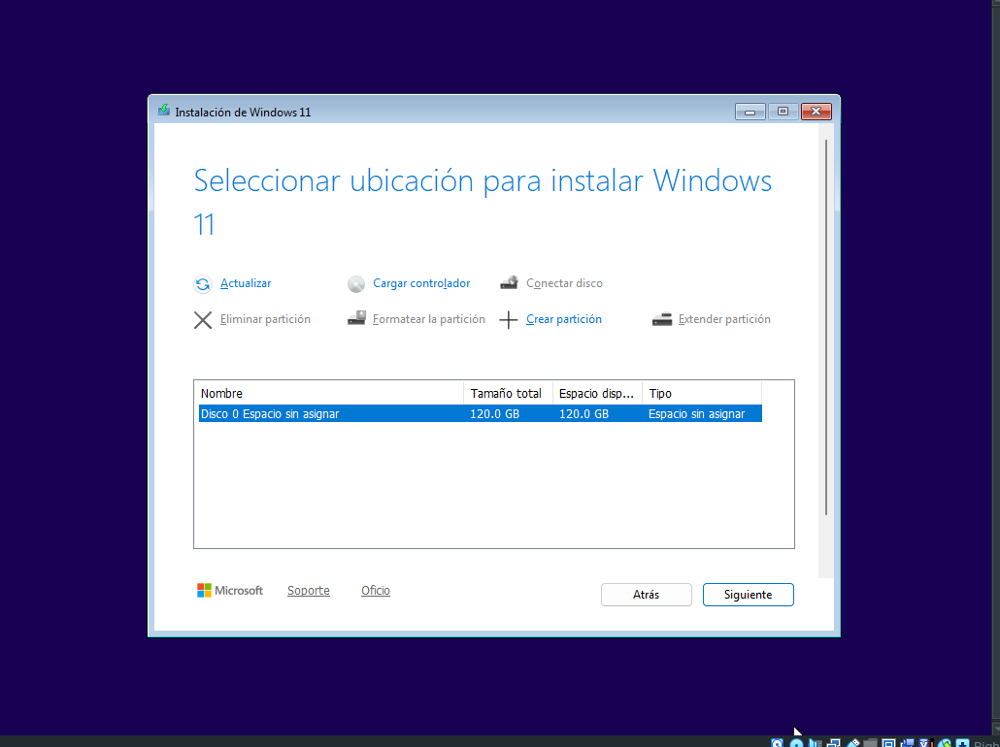 | 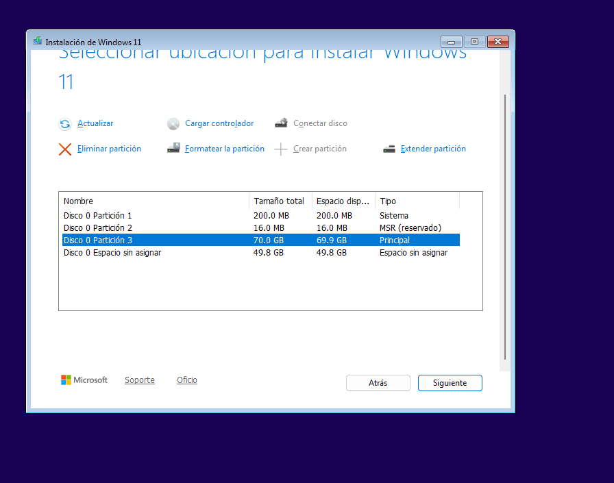 |

| Cuenta local con `ms-cxh:localonly` | Usuario local `tecnico` |
|---|---|
| 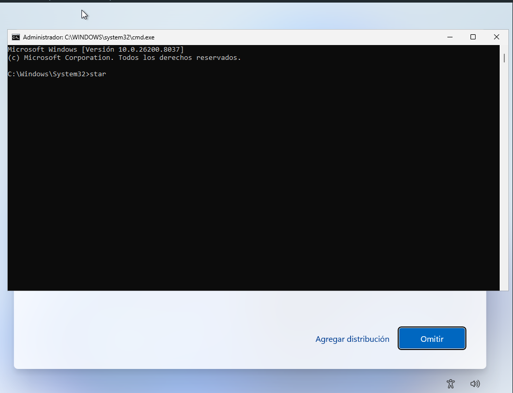 | 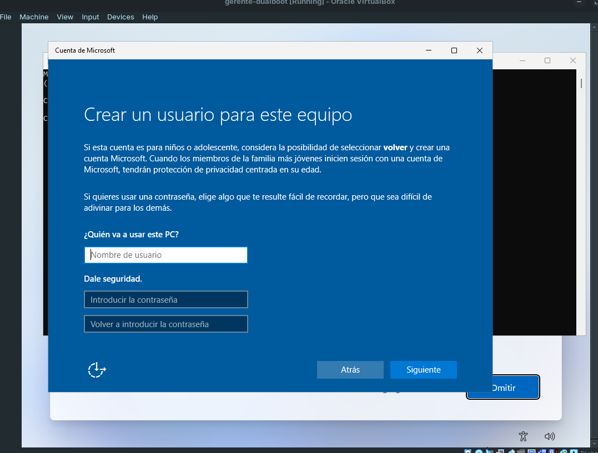 |

La contraseña de `tecnico` se genera y se guarda en KeePassXC (en la captura sale oculta):

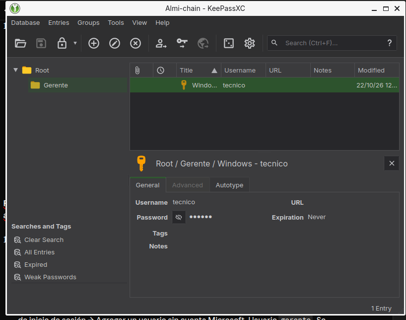

| Escritorio recién instalado | Red conectada (adaptador puente) |
|---|---|
| 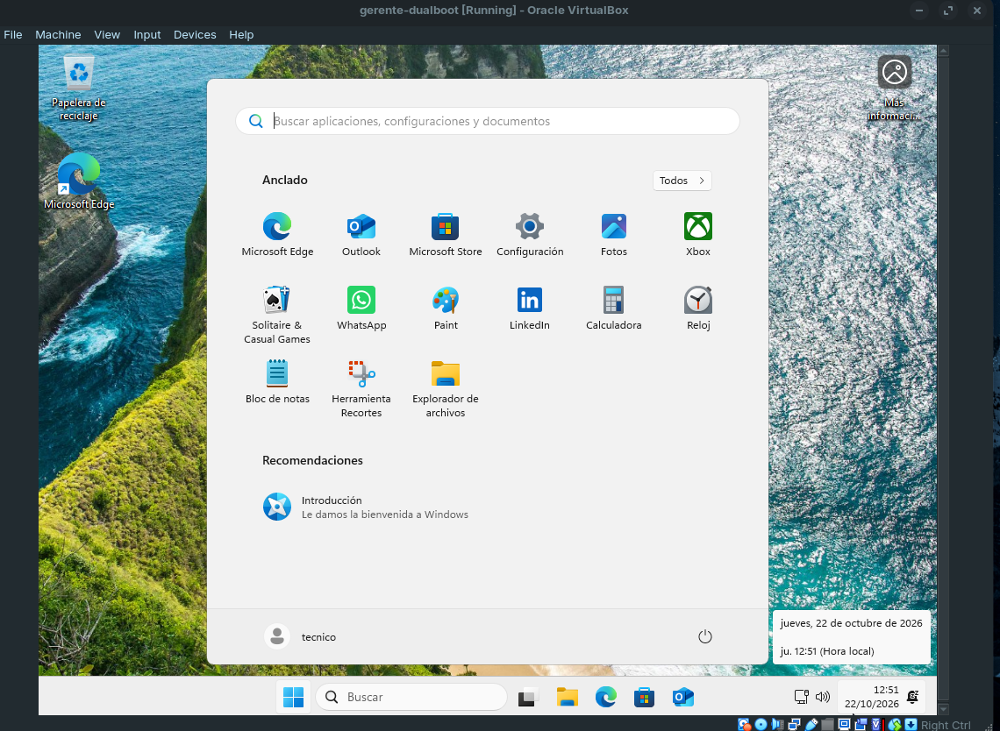 | 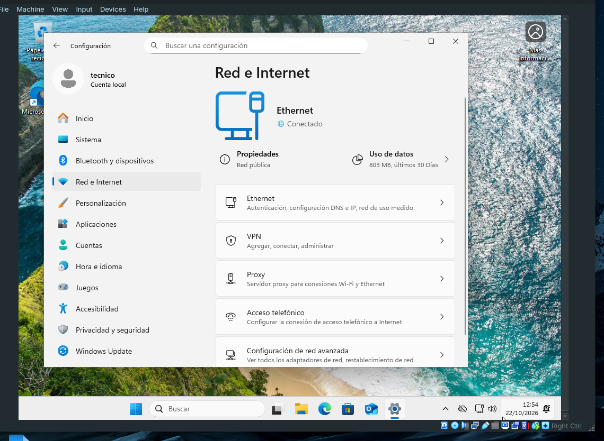 |

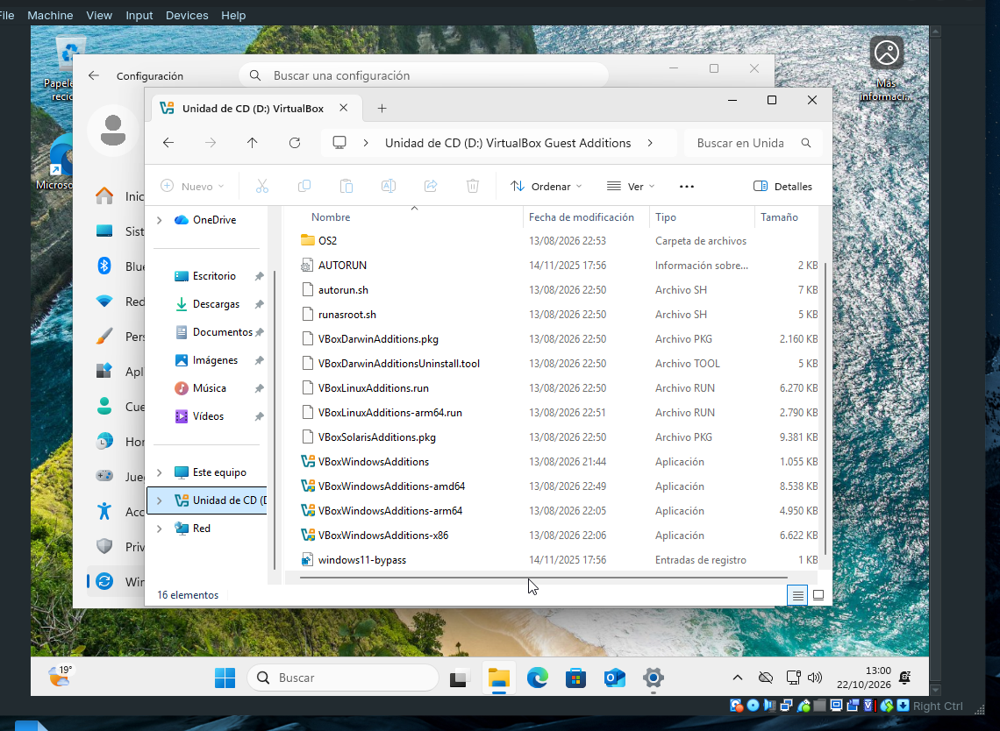

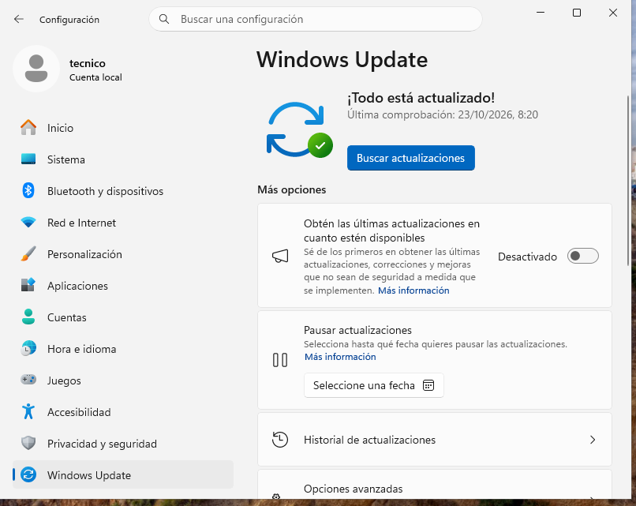

| Menú Inicio sin aplicaciones sobrantes | Escritorio limpio |
|---|---|
| 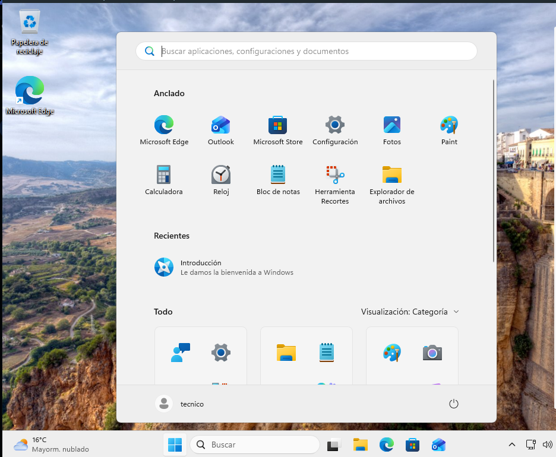 | 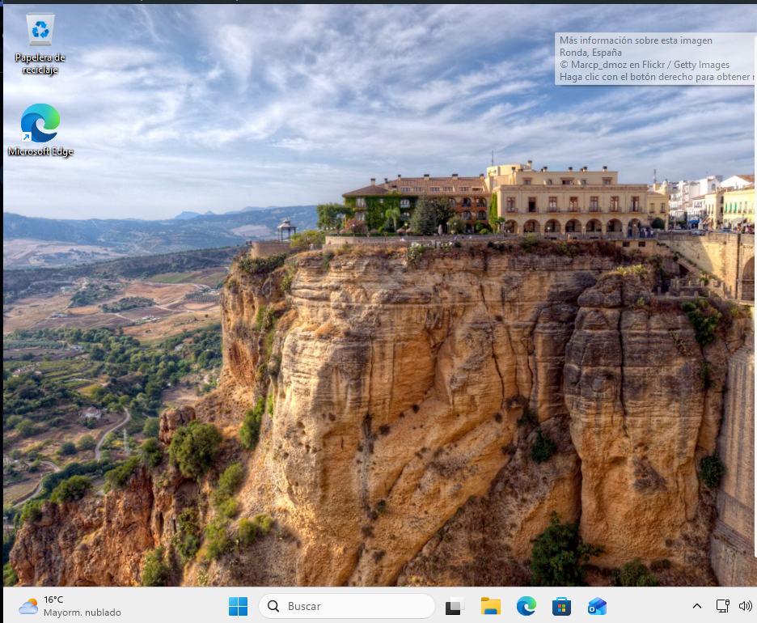 |

## 5. Preparar Windows para el dual boot

### 5.1 Desactivar el inicio rápido

El inicio rápido deja Windows medio hibernado al apagar. En un dual boot, eso hace que el disco de Windows quede "en uso" y que Linux pueda corromperlo si lo monta. En la VM no aparecía la casilla en Opciones de energía, así que se desactivó la hibernación (y con ella el inicio rápido) desde la terminal de administrador:

```powershell
powercfg /h off
powercfg /a    # "Inicio rápido: la hibernación no está disponible"
```


### 5.2 Usuario gerente estándar

```powershell
net user gerente * /add   # el * pide la contraseña sin mostrarla ni guardarla en el historial
net user gerente          # comprobar: solo grupo *Usuarios
```


La contraseña del gerente debe ser distinta de la del técnico. Al principio se puso la misma por error y se corrige con `net user gerente *` (desde una consola de administrador), poniéndole una contraseña propia.

### 5.3 Control de cuentas de usuario (UAC) al máximo

Nivel **"Notificarme siempre"**: si el gerente intenta instalar algo, Windows pide las credenciales del técnico.

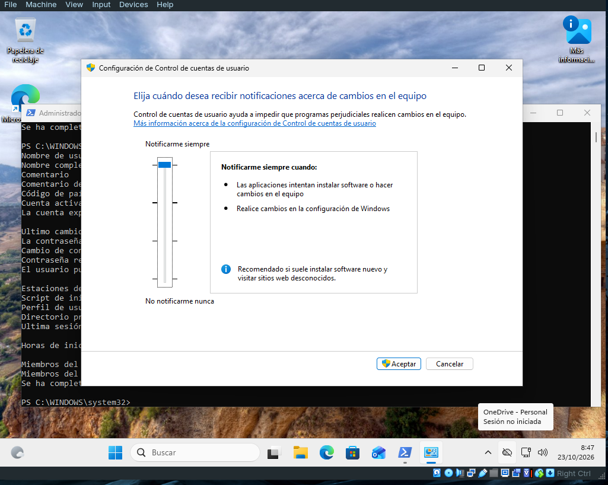

### 5.4 Comprobar el espacio libre

`diskmgmt.msc`: quedan **49,79 GB sin asignar** al final del disco.


### 5.5 BitLocker antes de instalar Ubuntu

Windows 11 cifra el disco automáticamente al detectar el TPM ("esperando activación", sin protectores). El instalador de Ubuntu **no permite instalar al lado** de una partición con BitLocker, así que se descifró antes de instalar Ubuntu y se volvió a cifrar al final (ver [apartado 8](#8-cifrado-de-windows-con-bitlocker)).

```powershell
manage-bde -status C:
manage-bde -off C:     # descifrar; repetir -status hasta "Descifrado completo, 0,0%"
```


## 6. Instalación de Ubuntu

1. Antes de nada, **instantánea de la VM** (`Windows listo - antes de Ubuntu`) para poder volver atrás si algo falla.
2. Montar la ISO de Ubuntu y arrancarla desde el menú UEFI (`Esc` al arrancar → *Boot Manager* → *UEFI VBOX CD-ROM*), porque Windows Boot Manager arranca primero.

   

3. Idioma y teclado español, instalación interactiva, selección de aplicaciones **por defecto** (menos software, menos superficie de ataque), sin software de terceros.
4. Tipo de instalación: **"Instalar Ubuntu junto a Windows Boot Manager"**. Usa el espacio sin asignar y no toca Windows.
5. Cifrado: **"Cifrado con frase contraseña"** (LUKS + LVM). No se usa el cifrado con TPM porque en Ubuntu es experimental y da problemas con el dual boot.

   

6. Usuario **`tecnico`** (administrador con `sudo`), equipo **`gerente-ubuntu`**, pedir contraseña al iniciar sesión.
7. Al terminar, quitar la ISO y reiniciar.

## 7. Configuración de Ubuntu

### 7.1 Actualizar

```bash
sudo apt update && sudo apt full-upgrade -y
sudo snap refresh
```


### 7.2 Usuario gerente sin sudo

```bash
sudo adduser gerente
groups gerente        # sin el grupo sudo
su - gerente
sudo ls /root         # "gerente no está en el archivo sudoers"
exit
```

`groups gerente` muestra solo `gerente users`, y al intentar `sudo` responde *"I'm sorry gerente. I'm afraid I can't do that"*:

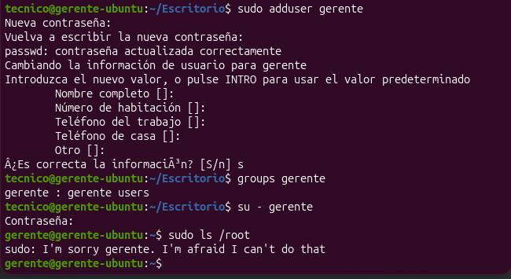

### 7.3 Orden de arranque

Ubuntu queda el primero en el firmware UEFI (`Boot0006 Ubuntu`), así que siempre aparece GRUB:

```bash
sudo efibootmgr
```


## 8. Cifrado de Windows con BitLocker

Al intentar proteger C: con el TPM apareció este error:

```
ERROR 0xc0310116: Los valores PCR de TPM no coinciden con lo que se calculó a partir del registro de TCG.
```

El TPM mide toda la cadena de arranque. Ahora Windows arranca a través de shim/GRUB y el TPM virtual de VirtualBox no acepta esas medidas. En un PC real con TPM físico esto suele funcionar, pero aquí no. La solución fue usar una **contraseña de arranque**, igual que en Ubuntu, de forma que los dos sistemas piden una frase antes de arrancar.

1. `gpedit.msc` → *Configuración del equipo → Plantillas administrativas → Componentes de Windows → Cifrado de unidad BitLocker → Unidades del sistema operativo* → **"Requerir autenticación adicional al iniciar"** → *Habilitada* → marcar **"Permitir BitLocker sin un TPM compatible"**.
2. Aplicar y añadir los protectores:

   ```powershell
   gpupdate /force
   manage-bde -protectors -add C: -RecoveryPassword   # clave de recuperación de 48 dígitos → KeePassXC
   manage-bde -protectors -add C: -Password           # contraseña de arranque (solo minúsculas y números)
   manage-bde -on C: -UsedSpaceOnly
   ```

3. Reiniciar, elegir Windows en GRUB e introducir la contraseña de BitLocker.
4. `manage-bde -status C:` hasta **100 %, "Protección activada"**.

La contraseña de arranque usa solo minúsculas y números porque en la pantalla previa al arranque el teclado puede estar en inglés.

> ⚠️ Si Ubuntu actualiza GRUB, Windows puede pedir la clave de recuperación al arrancar. Es el comportamiento esperado de BitLocker ante un cambio en el arranque, y por eso la clave está guardada en KeePassXC.

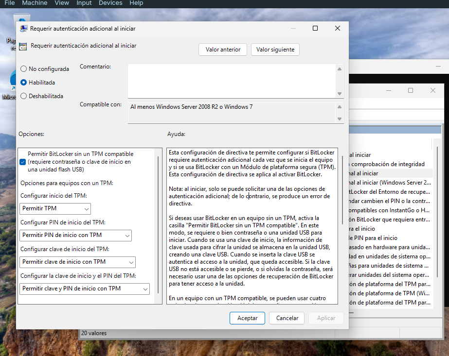

Al arrancar Windows, BitLocker pide la contraseña:

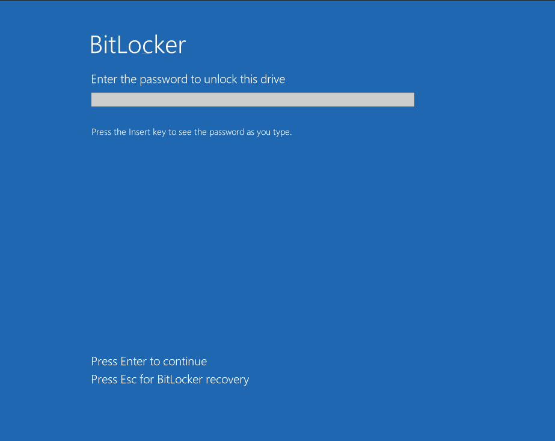


## 9. Resultado final

### Menú de arranque


### Particiones

```bash
lsblk -f
sudo fdisk -l /dev/sda
```

| Partición | Tamaño | Sistema de archivos | Uso |
|---|---|---|---|
| sda1 | 200 MB | FAT32 | **EFI**, compartida por Windows Boot Manager y GRUB |
| sda2 | 16 MB | — | Reservada de Microsoft |
| sda3 | 69,1 GB | NTFS + BitLocker | **Windows 11** (C:) |
| sda4 | 928 MB | NTFS | Recuperación de Windows |
| sda5 | 2 GB | ext4 | `/boot` de Ubuntu (sin cifrar, para poder pedir la frase al arrancar) |
| sda6 | 47,8 GB | LUKS2 → LVM → ext4 | **Ubuntu** (`/`) cifrado |


### Usuarios

| Sistema | Usuario | Permisos |
|---|---|---|
| Windows 11 | `tecnico` | Administrador |
| Windows 11 | `gerente` | Usuario estándar (UAC pide credenciales del técnico) |
| Ubuntu | `tecnico` | Grupo `sudo` |
| Ubuntu | `gerente` | Sin `sudo` |

Cada usuario y cada cifrado tiene una contraseña distinta, todas en KeePassXC.

### Demostración

Un arranque normal del equipo del gerente queda así:

1. Se enciende la VM y aparece **GRUB** (5 segundos para elegir; por defecto, Ubuntu).
2. **Windows:** GRUB → *Windows Boot Manager* → BitLocker pide su contraseña de arranque → inicio de sesión con el usuario *gerente*.
3. **Ubuntu:** GRUB → *Ubuntu* → se pide la frase de LUKS para descifrar el disco → inicio de sesión con el usuario *gerente*.

En los dos sistemas el disco está cifrado antes de llegar al inicio de sesión, y el gerente entra siempre sin permisos de administrador.

## 10. Incidencias y cómo se resolvieron

### Incidencia 1: la instalación de Ubuntu se quedó colgada

**Qué pasó:** el primer intento de instalación se quedó más de una hora parado en el paso `curtin command in-target`, sin escribir nada nuevo en el registro.


**Qué se hizo:** apagado forzado de la VM. Al reintentar, el instalador avisó de que Windows tenía BitLocker y pidió reiniciar Windows.

### Incidencia 2: Windows dejó de arrancar

**Qué pasó:** al arrancar Windows apareció *"El dispositivo tuvo un problema y no se pudo reparar"*. La reparación automática falló.


**Diagnóstico y solución** desde *Solucionar problemas → Opciones avanzadas → Símbolo del sistema*:

```
diskpart
list vol                       # C: sigue ahí, NTFS 69 GB, Correcto
select vol 2                   # partición EFI (FAT32, 200 MB)
assign letter=S
exit
chkdsk C: /f                   # sin errores, 0 KB en sectores defectuosos
bcdboot C:\Windows /s S: /f UEFI   # "Archivos de arranque creados correctamente"
```

| | |
|---|---|
|  |  |
|  |  |

Los datos de Windows estaban intactos y solo se había roto el arranque. `bcdboot` lo volvió a crear y Windows arrancó. Después se descifró C: (`manage-bde -off C:`) y se borraron desde `diskmgmt.msc` las dos particiones que el intento fallido había dejado a medias (2 GB y 47,79 GB), hasta volver a tener los ~49,8 GB sin asignar.


### Incidencia 3: errores de lectura de la ISO durante la instalación

**Qué pasó:** en el segundo intento apareció `rsync: read errors mapping ".../firefox_8763.snap": Input/output error (5)`.


**Diagnóstico:** se comprobó el hash de la ISO en el anfitrión y **coincidía con el oficial**, así que el archivo estaba bien. El fallo venía de la lectura del CD virtual: el disco del PC del aula es lento (extraer el sistema tardó unos 7 minutos) y VirtualBox daba errores de E/S. Seguramente era también la causa del cuelgue de la incidencia 1.

Al principio la opción estaba desactivada:

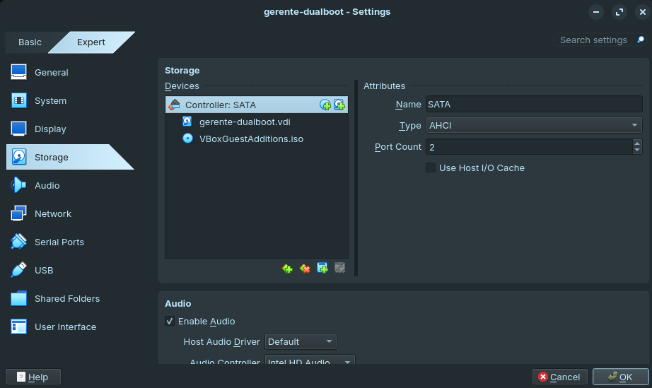

**Solución:** la instalación terminó correctamente. Para que no vuelva a pasar, se recomienda activar **"Use Host I/O Cache"** en el controlador SATA de la VM, que hace los accesos a disco más rápidos en un PC con disco lento. Al terminar, se comprobó que Firefox estaba instalado y que el sistema se actualizaba sin errores.

### Incidencia 4: la VM arrancaba directamente en Windows

**Qué pasó:** tras instalar Ubuntu, la VM entraba en Windows sin mostrar GRUB, porque `bcdboot` había puesto Windows Boot Manager el primero. Además, la ISO seguía montada.

**Solución:** quitar la ISO de la unidad óptica y comprobar con `efibootmgr` que la entrada *Ubuntu* estaba la primera en `BootOrder`. Desde entonces aparece GRUB en cada arranque.

### Incidencia 5: Ubuntu desapareció del arranque (26 de octubre)

**Qué pasó:** al encender la VM salía directamente la contraseña de BitLocker y arrancaba Windows, sin menú GRUB. En el menú de la UEFI (tecla **Esc** → *Boot Manager*) ya no aparecía la entrada *ubuntu*.

**Causa:** las entradas de arranque UEFI no se guardan en el disco, sino en la NVRAM de la VM (el archivo `.nvram` de VirtualBox). La entrada *ubuntu* se perdió de ahí, así que el firmware pasó a arrancar el primero que quedaba: *Windows Boot Manager*. Los archivos de GRUB seguían intactos en la partición EFI (`\EFI\ubuntu\`).

**Solución:**

1. Arrancar Ubuntu a mano: **Esc** → *Boot Maintenance Manager* → *Boot From File* → partición EFI → `EFI\ubuntu\shimx64.efi`.
2. Comprobar el orden con `sudo efibootmgr`: el `BootOrder` empezaba por `0003` (Windows) y no había entrada *ubuntu* permanente.

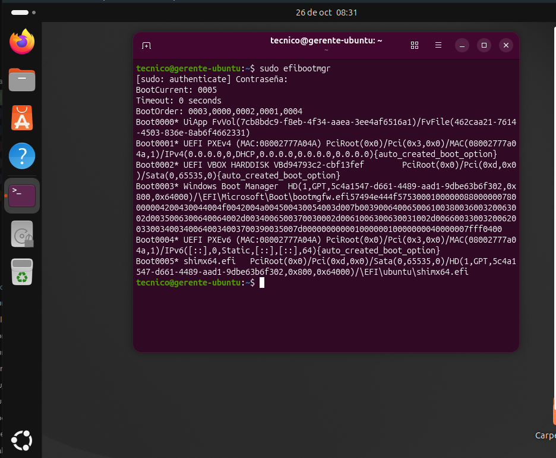

3. Volver a crear la entrada. Se arranca `shimx64.efi` (y no `grubx64.efi` directamente) para que siga funcionando con el arranque seguro:

```bash
sudo efibootmgr -c -d /dev/sda -p 1 -L ubuntu -l '\EFI\ubuntu\shimx64.efi'
```

La nueva entrada `0006 ubuntu` queda la primera (`BootOrder: 0006,0003,...`).

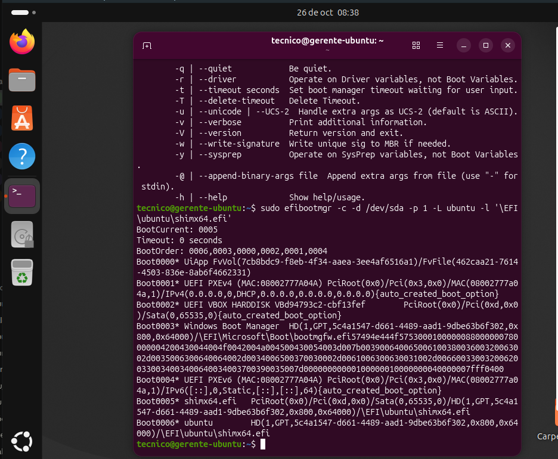

4. Borrar la entrada temporal que creó *Boot From File*: `sudo efibootmgr -b 0005 -B`.
5. Reiniciar: vuelve a aparecer GRUB con Ubuntu y Windows Boot Manager.

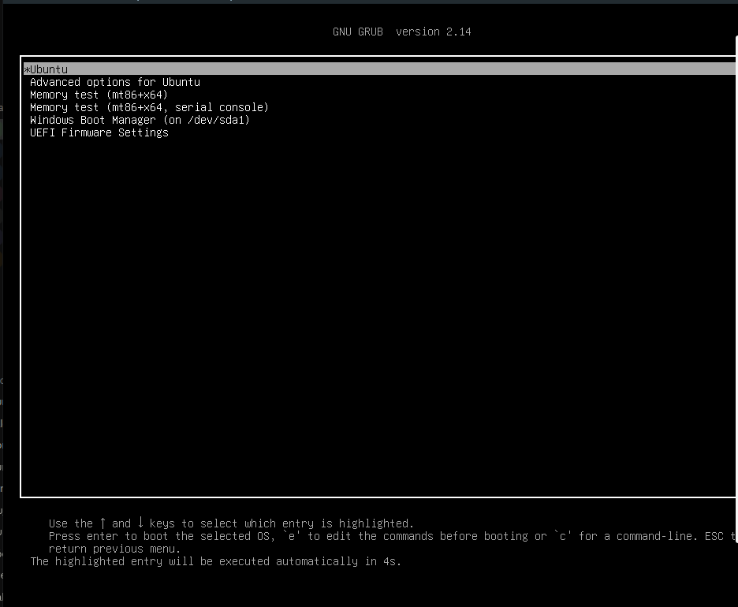

**Cómo evitarlo:** no borrar ni separar el archivo `.nvram` de la carpeta de la VM, y copiar o exportar siempre la carpeta completa de la máquina. Si vuelve a pasar, los pasos de arriba lo arreglan en dos minutos y sin tocar los datos.

### Lecciones aprendidas

- **Verificar el hash de las ISOs antes de instalar**, no después. Así se descarta enseguida que el archivo esté corrupto.
- **Quitar BitLocker antes de instalar otro sistema** al lado de Windows.
- **Hacer una instantánea antes de cada cambio arriesgado**: volver atrás lleva segundos en vez de horas reparando.
- Las entradas de arranque UEFI viven en la NVRAM de la VM, no en el disco: si desaparece GRUB, el sistema no se ha borrado y se recupera con `efibootmgr`.
- Si una instalación se para, revisar los indicadores de disco y red de VirtualBox antes de esperar más.

## 11. Seguridad aplicada

- Sistema operativo **con soporte** (Windows 11) y los dos sistemas **actualizados**.
- **Mínimo privilegio:** el gerente no es administrador en ninguno de los dos sistemas. El técnico solo se usa para administrar.
- **Cifrado completo** en los dos sistemas: BitLocker (XTS-AES 128) con contraseña de arranque en Windows, y LUKS2 en Ubuntu.
- **Contraseñas distintas** por usuario, sistema y cifrado, generadas y guardadas en KeePassXC. Nunca se suben al repositorio.
- **Clave de recuperación de BitLocker** solo en KeePassXC. La primera quedó visible en una captura, así que se regenera (`manage-bde -protectors -delete` + `-add -RecoveryPassword`) y la nueva se guarda solo en KeePassXC.
- **UAC al máximo**, inicio de sesión con contraseña (sin inicio automático) y telemetría de Windows desactivada.
- Portapapeles de VirtualBox solo del anfitrión al invitado.
- **Servicios reducidos y cortafuegos** en los dos sistemas: solo quedan los servicios que el gerente usa y no hay ningún servicio accesible desde la red. Detalle en el [apartado 11.1](#111-servicios-reducidos-y-cortafuegos-04112026).

### 11.1 Servicios reducidos y cortafuegos (04/11/2026)

Objetivo: que el equipo del gerente no ofrezca nada a la red. El gerente solo navega, imprime y se actualiza, y todo eso es tráfico de **salida**. Por eso en los dos sistemas se desactivan los servicios que no usa y el cortafuegos bloquea todo lo que entra.

Antes de empezar se hizo la instantánea `antes-servicios-reducidos`, para poder volver atrás.

#### Ubuntu

| Servicio desactivado | Para qué sirve | Por qué se quita |
|---|---|---|
| `avahi-daemon` (+ socket, **enmascarado**) | Anuncia el equipo en la red local (mDNS) | Era el único servicio escuchando en la red (`0.0.0.0:5353`) |
| `cups-browsed` | Busca impresoras de red automáticamente | La impresora la instala el técnico a mano |
| `openvpn` | VPN | No se usa |
| `sssd` | Unirse a un dominio/LDAP | No hay dominio |
| `bluetooth` | Bluetooth | La VM no tiene bluetooth |
| `ModemManager` | Módems 3G/4G | No hay módem |

Se mantienen `cups` (imprimir, solo escucha en `127.0.0.1`), `snapd` (Firefox es un snap), `NetworkManager`, `wpa_supplicant` y `unattended-upgrades` (actualizaciones de seguridad automáticas).

```bash
# Con el usuario tecnico
for s in avahi-daemon.service avahi-daemon.socket cups-browsed.service openvpn.service sssd.service bluetooth.service ModemManager.service; do sudo systemctl disable --now "$s"; done
sudo systemctl mask avahi-daemon.service avahi-daemon.socket   # que nadie lo vuelva a arrancar

# Cortafuegos: bloquear lo que entra, permitir lo que sale
sudo ufw default deny incoming
sudo ufw default allow outgoing
sudo ufw logging low
sudo ufw enable

# Comprobación
systemctl is-enabled avahi-daemon cups-browsed openvpn sssd bluetooth ModemManager   # masked + disabled
sudo ufw status verbose                                                             # activo, deny (entrantes)
sudo ss -tulpn                                                                      # solo 127.0.0.x y ::1
```

| | Antes | Después |
|---|---|---|
| Puertos escuchando hacia la red | 1 (`5353/udp`, avahi) | **0** (todo en `127.0.0.x` / `::1`) |
| Cortafuegos (ufw) | Inactivo | Activo: `deny` entrantes, `allow` salientes, registro `low` |
| Tras reiniciar | — | Igual: ufw activo, avahi `inactive`, sin puertos hacia la red |

| Antes | Servicios desactivados | Cortafuegos | Tras reiniciar | Internet y actualizaciones automáticas |
|---|---|---|---|---|
| 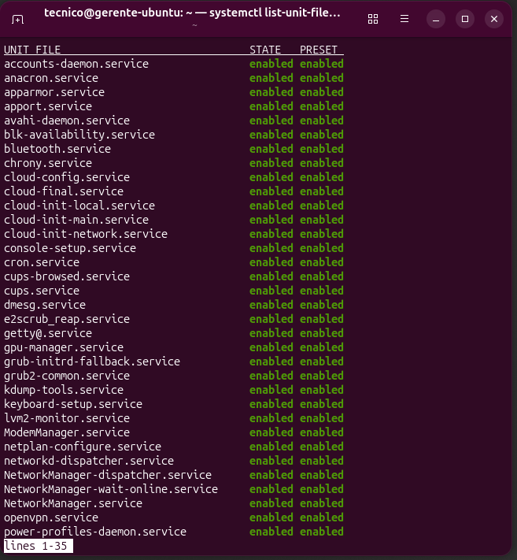 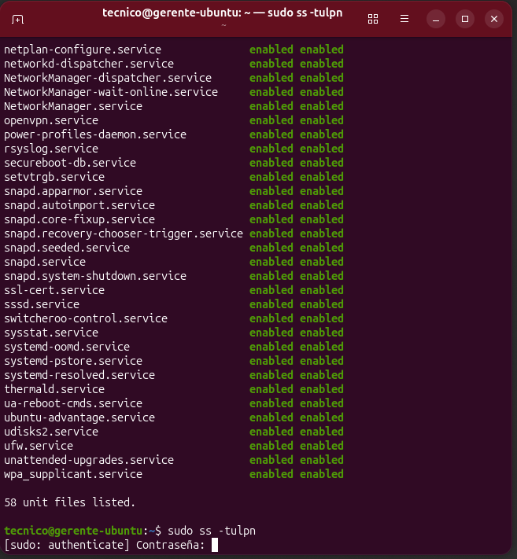 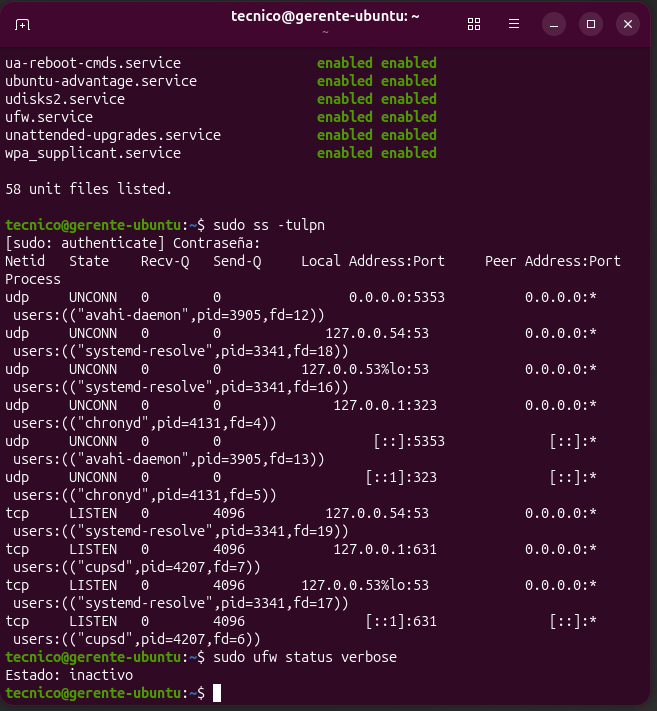 | 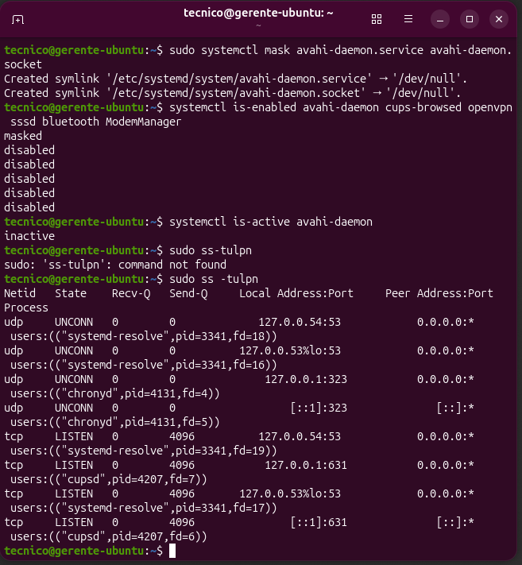 | 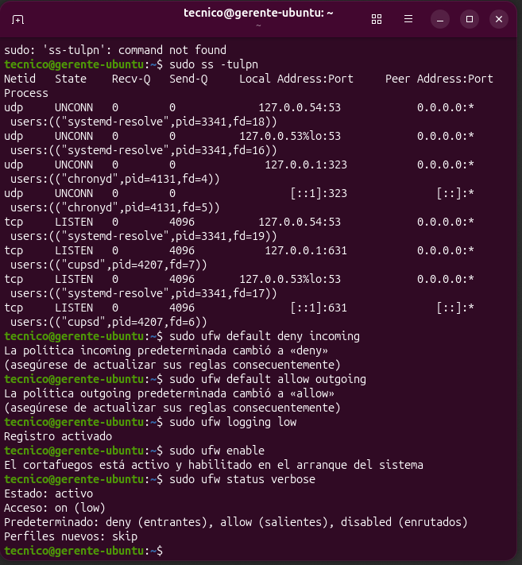 | 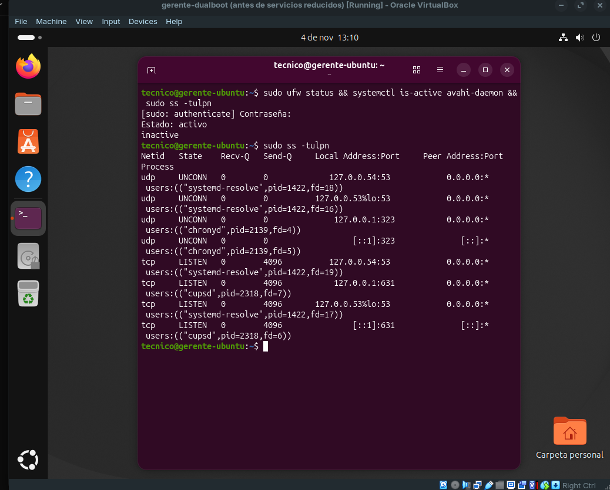 | 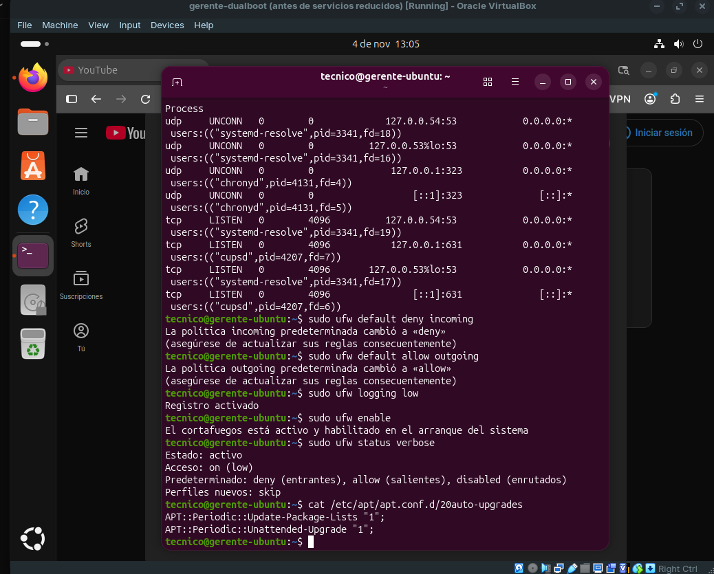 |

#### Windows 11

| Servicio desactivado | Para qué sirve | Por qué se quita |
|---|---|---|
| `LanmanServer` (Servidor) | Compartir carpetas (SMB, puerto **445**) | El gerente no comparte nada; es la vía de gusanos como WannaCry |
| NetBIOS sobre TCP/IP | Nombres NetBIOS (puerto **139**) | Protocolo antiguo, innecesario |
| `SSDPSRV`, `upnphost` | Descubrimiento UPnP (puerto **2869**) | No se publican dispositivos en la red |
| `TermService` + reglas del cortafuegos | **Escritorio remoto** | Nadie debe entrar en remoto al equipo del gerente |
| `lfsvc`, `MapsBroker` | Ubicación y mapas | No se usan; privacidad |
| `XblAuthManager`, `XblGameSave`, `XboxNetApiSvc`, `XboxGipSvc` | Xbox | Equipo de trabajo |
| `RetailDemo`, `WMPNetworkSvc`, `SharedAccess`, `bthserv` | Demo de tienda, compartir multimedia, ICS, bluetooth | No se usan |
| Optimización de distribución (P2P) | Comparte actualizaciones con otros PC (puerto **7680**) | Se desactiva «Permitir descargas desde otros dispositivos» |

`RemoteRegistry` (Registro remoto) ya venía deshabilitado.

```powershell
# PowerShell como administrador (tecnico)
$s = 'lfsvc','MapsBroker','XblAuthManager','XblGameSave','XboxNetApiSvc','XboxGipSvc','RetailDemo','WMPNetworkSvc','SharedAccess','TermService','bthserv','LanmanServer','SSDPSRV','upnphost'
foreach ($n in $s) { Stop-Service $n -Force -ErrorAction SilentlyContinue; Set-Service $n -StartupType Disabled }

# NetBIOS desactivado en los adaptadores
Get-CimInstance Win32_NetworkAdapterConfiguration -Filter "IPEnabled=true" | Invoke-CimMethod -MethodName SetTcpipNetbios -Arguments @{TcpipNetbiosOptions=2}

# Cortafuegos explícito y con registro de bloqueos
Set-NetFirewallProfile -All -Enabled True -DefaultInboundAction Block -DefaultOutboundAction Allow -LogBlocked True

# Escritorio remoto cerrado en el sistema y en el cortafuegos
Set-ItemProperty 'HKLM:\System\CurrentControlSet\Control\Terminal Server' -Name fDenyTSConnections -Value 1
Disable-NetFirewallRule -Group "@FirewallAPI.dll,-28752"
```

Optimización de distribución: *Configuración → Windows Update → Opciones avanzadas → Optimización de distribución → Permitir descargas desde otros dispositivos: Desactivado*.

| | Antes | Después (tras reiniciar) |
|---|---|---|
| Servicios en marcha | 98 | **79** |
| Puertos abiertos a la red | 135, 139, 445, 2869, 5040, 7680, 49664–49674 | 135, 5040, 49664–49670 (RPC y plataforma de Windows, bloqueados desde fuera por el cortafuegos) |
| Cortafuegos | Activo, entrada `NotConfigured` | Activo en los 3 perfiles: entrada `Block`, salida `Allow`, registro de bloqueos |
| Escritorio remoto | Servicio en manual | Deshabilitado y sin reglas en el cortafuegos |

| Antes | Servicios desactivados | Optimización de distribución | Tras reiniciar | Internet con el cortafuegos | Escritorio remoto cerrado |
|---|---|---|---|---|---|
| 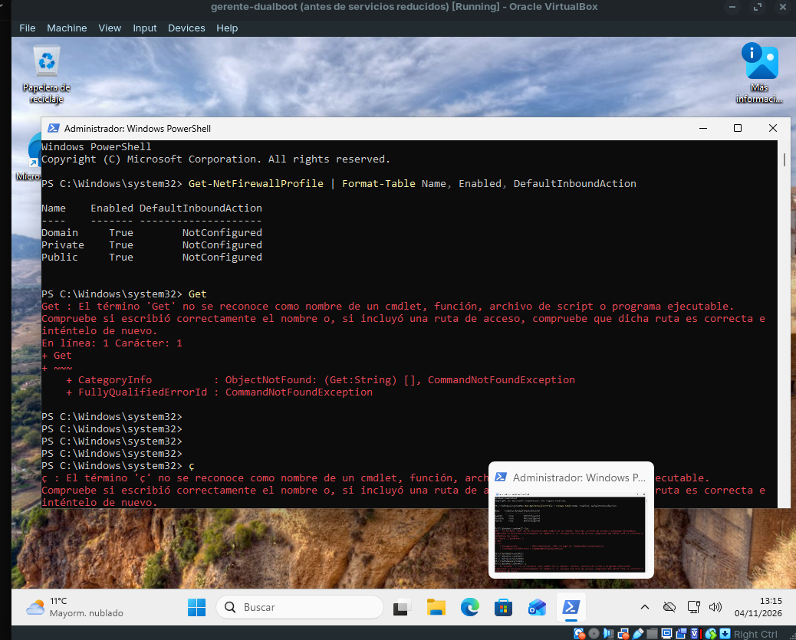 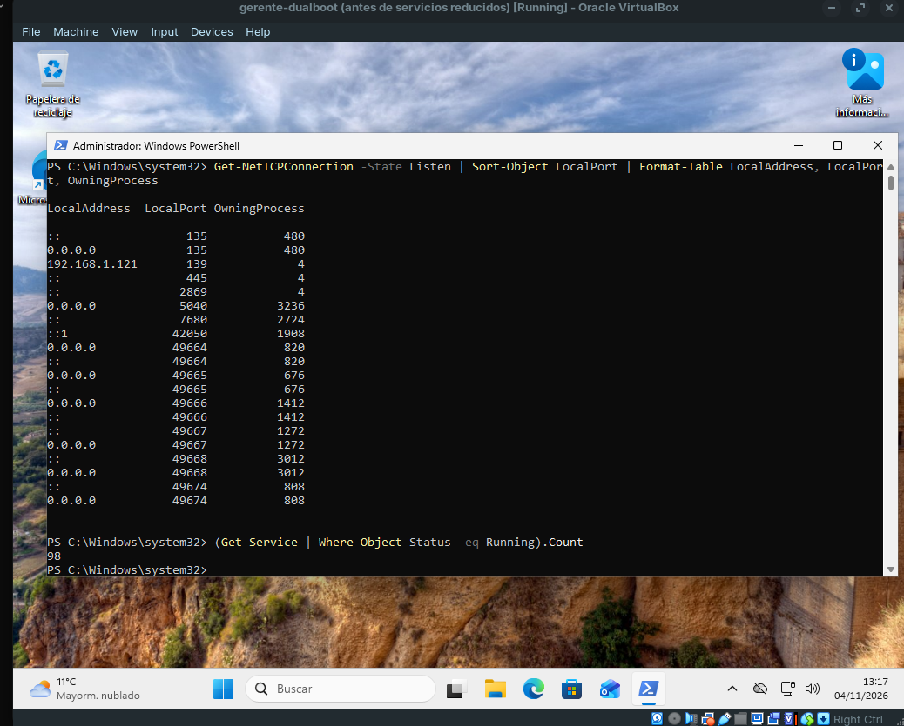 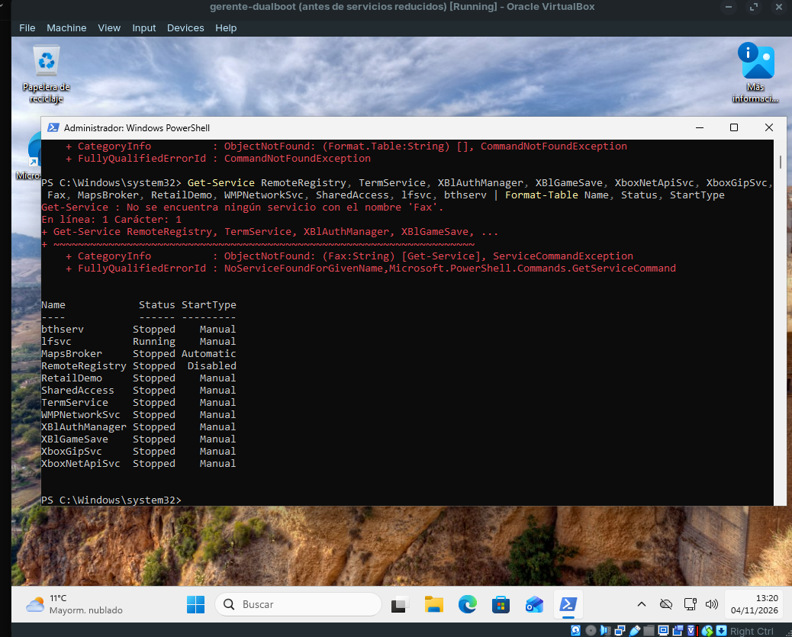 | 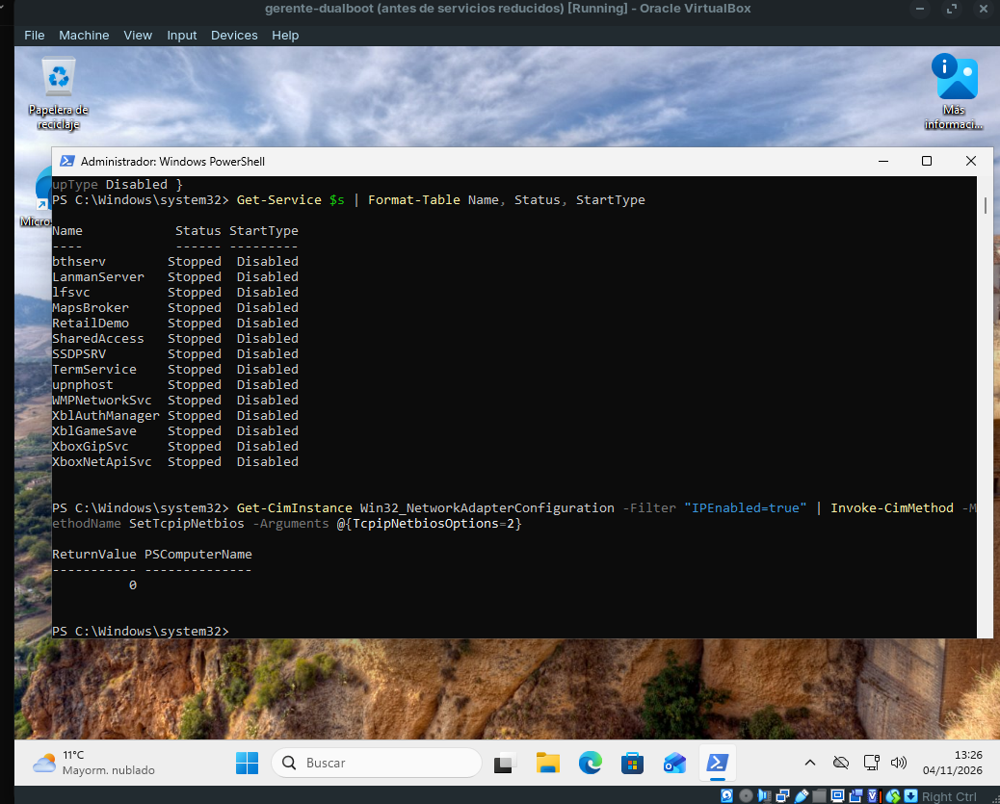 | 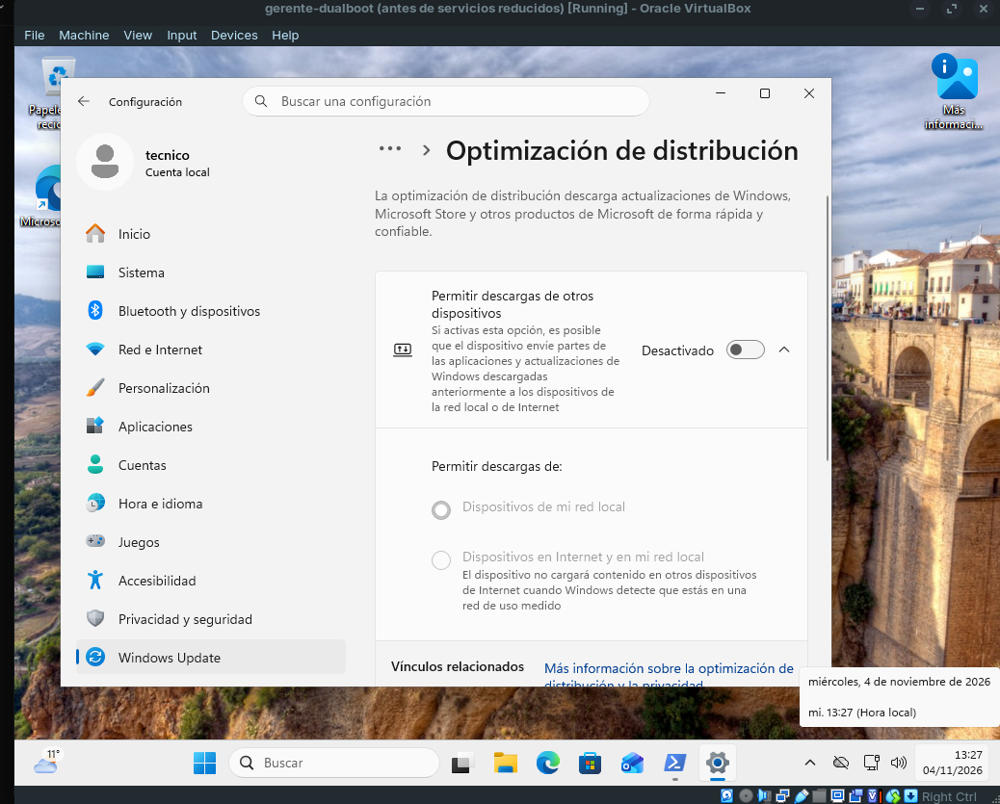 | 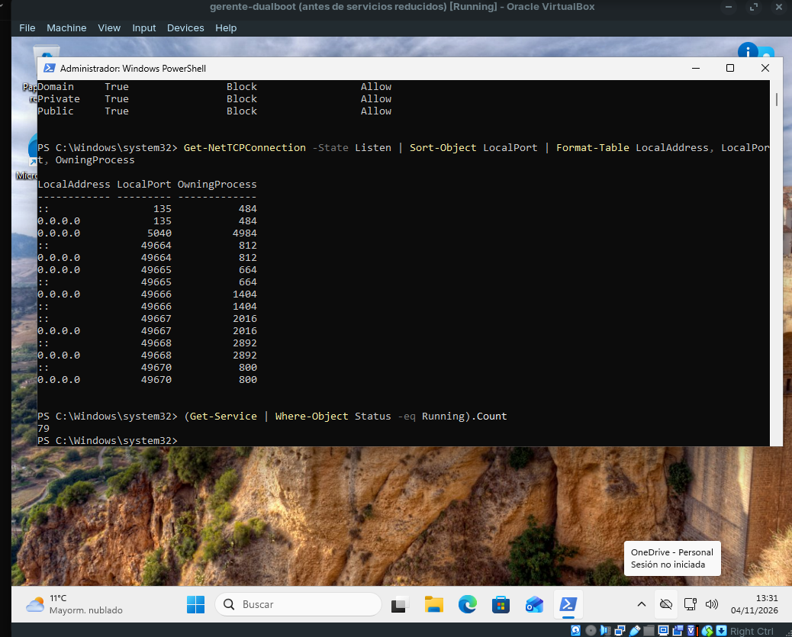 | 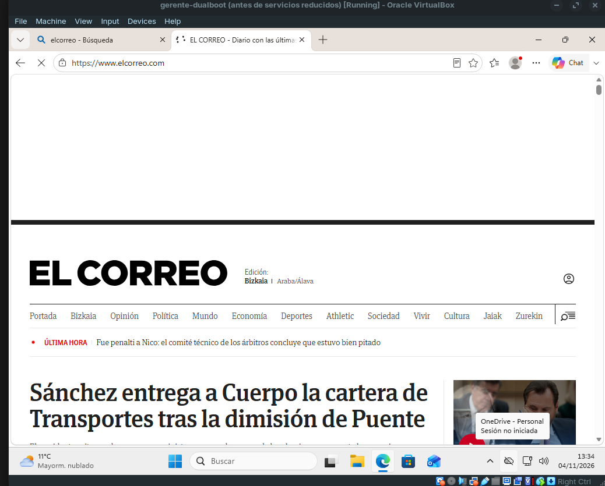 | 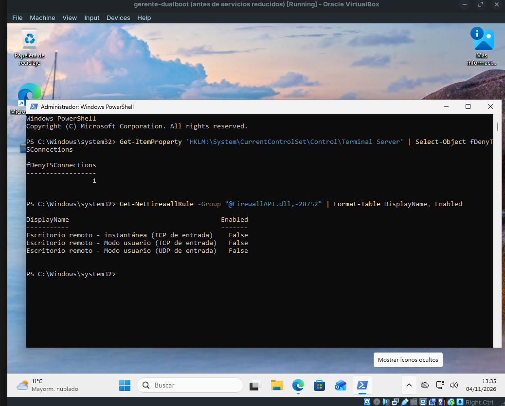 |

Al terminar se hace la instantánea `servicios-reducidos` de la VM.


## 12. Lista de capturas

| Código | Archivo | Estado |
|---|---|---|
| G01 | `G01-hash-iso-ubuntu.png` | ✅ |
| G02 | `G02-detalles-vm.png` | ✅ |
| G03 | `G03-particiones-windows.png` | ✅ |
| G03a–d | `G03a…G03d-*.png` (disco vacío, cuenta local, KeePassXC) | ✅ |
| G04 | `G04-escritorio-windows.png` | ✅ |
| G04b–c | `G04b-red-conectada.png`, `G04c-guest-additions.png` | ✅ |
| G05 | `G05-windows-update.png` | ✅ |
| G06 | `G06-menu-inicio-limpio.png`, `G06b-escritorio-limpio.png` | ✅ |
| G07 | `G07-inicio-rapido-desactivado.png` | ✅ |
| G08 | `G08-gerente-estandar-windows.png` | ✅ |
| G09 | `G09-uac-maximo.png` | ✅ |
| G10 | `G10-espacio-libre-ubuntu.png` | ✅ |
| G10b | `G10b-bitlocker-esperando-activacion.png` | ✅ |
| G11a | `G11a-boot-manager-uefi.png` | ✅ |
| G11b | `G11b-ubuntu-cifrado-frase.png` | ✅ |
| G11c | `G11c-ubuntu-actualizado.png` | ✅ |
| G12 | `G12-grub-dual-boot.png` | ✅ |
| G12b | `G12b-efibootmgr.png` | ✅ |
| G13 | `G13-gerente-sin-sudo.png` | ✅ |
| G14 | `G14-particiones-lsblk-fdisk.png` | ✅ |
| G15a | `G15a-gpedit-bitlocker.png` | ✅ |
| G15b | `G15b-bitlocker-pide-contrasena.png` | ✅ |
| G15 | `G15-bitlocker-activado.png` | ✅ |
| G16a1–a3 | `G16a1-servicios-antes.png`, `G16a2-servicios-antes.png`, `G16a3-puertos-ufw-antes.png` | ✅ |
| G16b | `G16b-servicios-desactivados.png` | ✅ |
| G16c | `G16c-ufw-activo.png` | ✅ |
| G16d | `G16d-tras-reinicio.png` | ✅ |
| G16e | `G16e-internet-y-actualizaciones.png` | ✅ |
| G17a1–a3 | `G17a1-windows-cortafuegos-antes.png`, `G17a2-windows-puertos-antes.png`, `G17a3-windows-servicios-antes.png` | ✅ |
| G17b | `G17b-windows-servicios-desactivados.png` | ✅ |
| G17c | `G17c-optimizacion-distribucion.png` | ✅ |
| G17d | `G17d-windows-tras-reinicio.png` | ✅ |
| G17e | `G17e-windows-internet-edge.png` | ✅ |
| G17f | `G17f-escritorio-remoto-cerrado.png` | ✅ |
| INC1–INC12 | `INC*-*.png` | ✅ |

> Antes de subir una captura, comprobar que no aparece ninguna contraseña ni la clave de recuperación de BitLocker.
