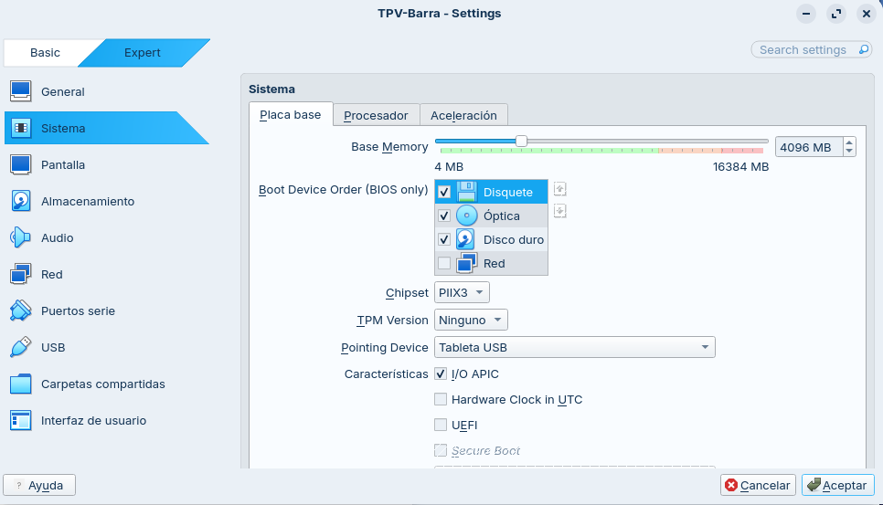
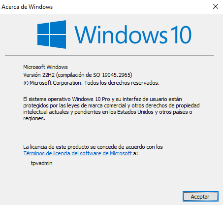
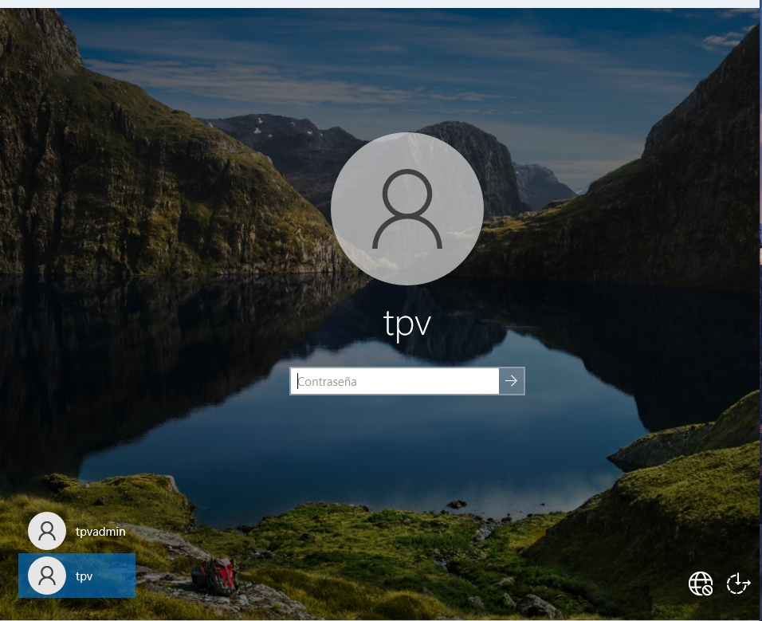
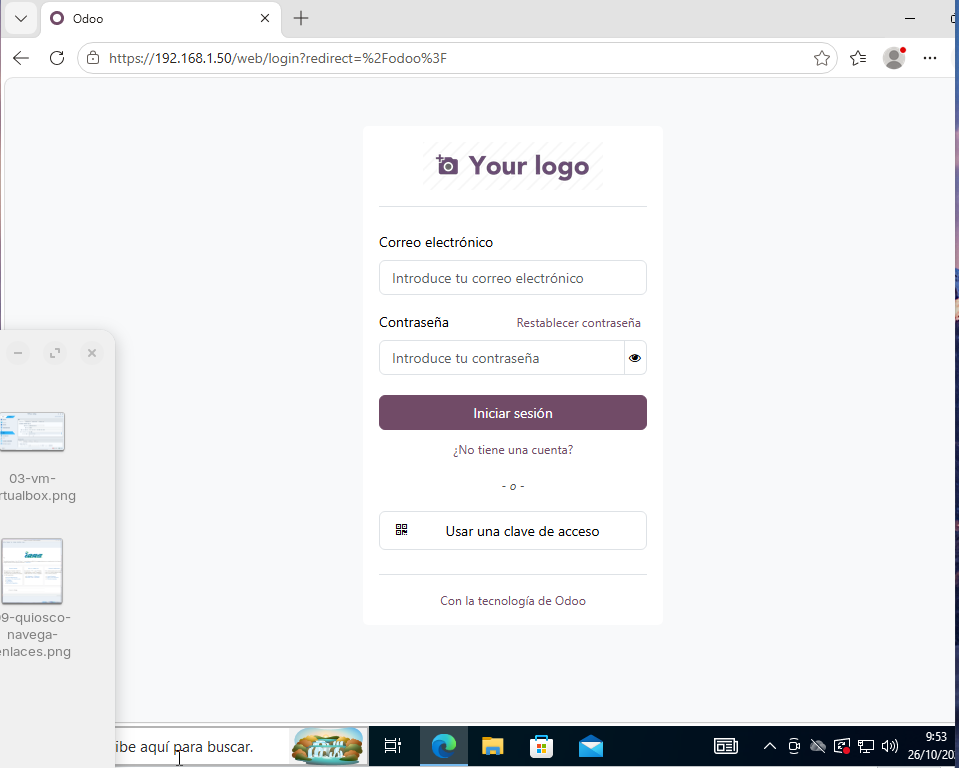
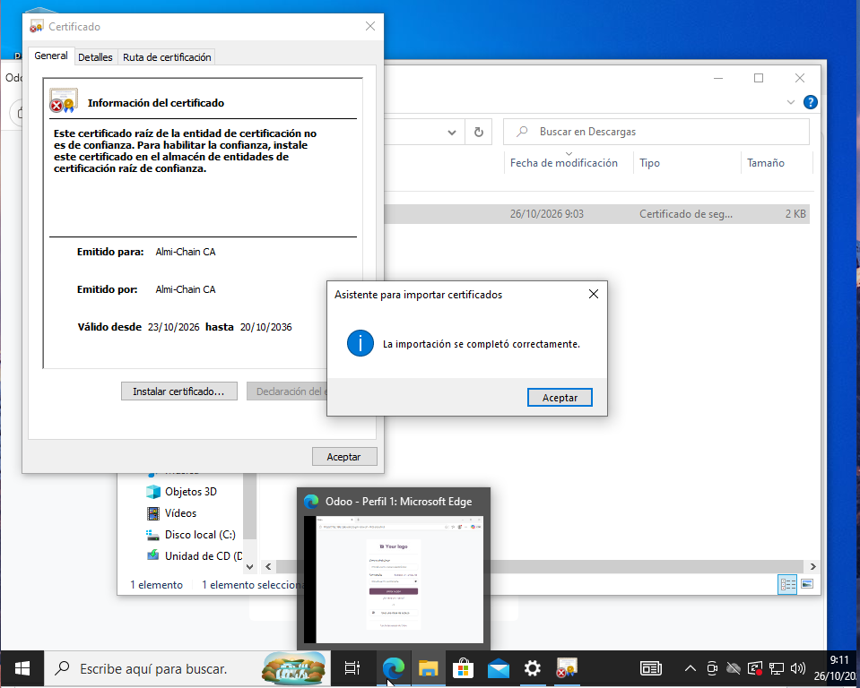
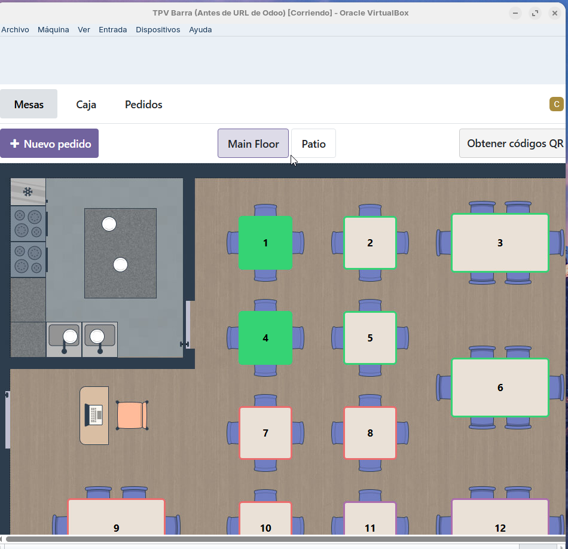
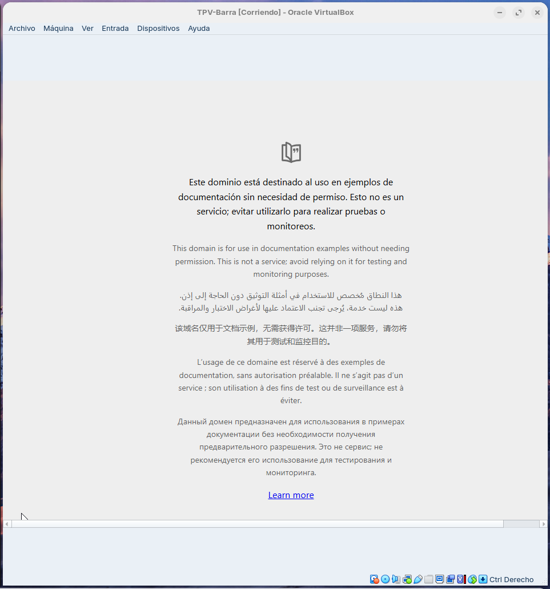
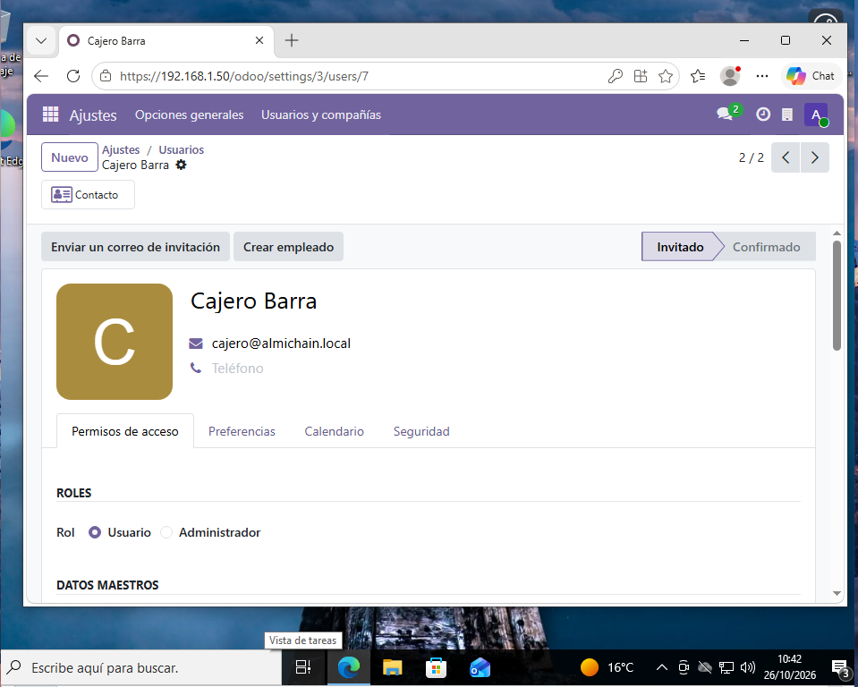

# TPV de barra (Windows 10 Pro con modo quiosco)

Responsable: Iñigo. Estado: funcionando contra el Odoo del servidor, pendiente de pasar a la red del plano.

## 1. Objetivo

Un equipo de barra que solo sirva para cobrar: Windows 10 Pro con un usuario estándar, encerrado en un quiosco de Edge que abre el punto de venta de Odoo por HTTPS, con una impresora para los tickets. Todo con el mínimo privilegio posible.

## 2. Máquina virtual

| Elemento | Valor |
|---|---|
| Hipervisor | VirtualBox 7.2.16 |
| Nombre | TPV Barra |
| Sistema | Windows 10 Pro 22H2 (64 bits), instalado con una cuenta local |
| RAM / CPU | 4096 MB / 2 núcleos |
| Disco | 50 GB, reservado dinámicamente |
| Red | Adaptador puente sobre la tarjeta por cable del anfitrión |
| USB | Controlador USB 1.1 (OHCI), ver apartado de la impresora |

Al crear la VM se marcó "Skip Unattended Installation" para que VirtualBox no creara un administrador con una contraseña elegida por él.

Después de instalar Windows se instalaron los Guest Additions, se activó el portapapeles compartido y se aplicaron las actualizaciones.

## 3. Cuentas

| Cuenta | Tipo | Para qué |
|---|---|---|
| TPV-admin | Administrador | Instalar y configurar. No se usa a diario |
| tpvadmin2 | Administrador | Segunda cuenta de seguridad durante el montaje. COMPLETAR: indicar si se creó, y quitarla al terminar |
| tpv | Estándar | El que queda encerrado en el quiosco |

Cada cuenta tiene una contraseña distinta, generada en KeePassXC. Ninguna se sube al repositorio.

El usuario `tpv` es una cuenta local estándar: para instalar programas Windows le pide la contraseña de un administrador, que no tiene.

## 4. Certificado de la CA

El servidor usa un certificado firmado por una entidad propia, **Almi-Chain CA** (RSA 4096, válida del 23/10/2026 al 20/10/2036). El certificado del servidor lleva la IP 192.168.1.50 en el campo "Nombre alternativo del firmante", que es lo que Edge comprueba. Se instala la CA y no el certificado del servidor: así, si este se renueva, no hay que repetirlo en el TPV.

Pasos:

1. Pedir a quien administra el servidor solo el certificado público de la CA, un archivo `.crt`. Nunca la clave privada (`.key`).
2. Abrirlo y comprobar en Detalles que el Asunto es `Almi-Chain CA`, que la fecha de validez es futura y que lleva la restricción "Tipo de asunto = Entidad de certificación".
3. Comparar la huella digital con la que obtiene el administrador en el servidor. Windows muestra la SHA-1, así que se usa `openssl x509 -in ca.crt -noout -fingerprint -sha1`. COMPLETAR: indicar si coincidió.
4. Con el administrador: Instalar certificado, Equipo local, y colocarlo en "Entidades de certificación raíz de confianza".
5. Cerrar Edge y abrir `https://192.168.1.50`: el aviso desaparece y sale el candado.

Antes y después:

## 5. Modo quiosco

Se configura con el administrador en Configuración, Cuentas, Familia y otros usuarios, "Configurar un quiosco" (acceso asignado):

1. Cuenta existente: `tpv`.
2. Aplicación: Microsoft Edge.
3. Modo: firma digital o pantalla interactiva (pantalla completa, sin barra de direcciones ni pestañas).
4. URL: `https://192.168.1.50/pos/ui/2`. Es la IP del certificado, para que no aparezca ningún aviso.
5. Reinicio de Edge por inactividad: COMPLETAR (valor elegido y motivo). Un valor corto cierra la sesión sola si alguien deja el TPV abierto, pero puede cortar una venta en un momento tranquilo.
6. Se pulsa Guardar, se cierra sesión y se entra con `tpv`: Edge se abre solo.

**Lección aprendida:** la primera vez que se montó el quiosco no se pudo salir de él y hubo que rehacer la VM. Por eso se trabaja con instantáneas (`Windows limpio`, `Antes del quiosco`, `Antes de impresora`) y la prueba de salida se hace nada más configurarlo. Para salir como administrador se usa Máquina, Insertar Ctrl-Alt-Supr (o Ctrl derecho + Supr), y Cerrar sesión.

## 6. Odoo: usuario del cajero

El Odoo es compartido por todo el equipo. Para el TPV se creó un usuario de Odoo con permisos solo de **Punto de venta, nivel Usuario**, y sin ningún otro permiso. Su contraseña está en KeePassXC.

Para comprobarlo, el cajero intentó crear un producto y Odoo lo denegó (error de acceso por falta del grupo "Productos/Crear"). Esa es la evidencia de que, si alguien tomara el control del quiosco, solo podría cobrar.

Los productos los crea un administrador de Odoo. Edge no debe guardar la contraseña del cajero.

## 7. Impresora

Modelo: Samsung ML-2165. Es una **láser A4 monocromo**, no una térmica de tickets, pero es la única disponible, así que se usa como sustituta.

Pasos:

1. En el anfitrión, el usuario está en el grupo `vboxusers`.
2. Con la VM apagada se añade la impresora como filtro en Configuración, USB.
3. Con el administrador se comprueba en el Administrador de dispositivos y se instala el driver (los controladores se instalan solo con el administrador, nunca con `tpv`).
4. Se pone como impresora predeterminada, desactivando que Windows la gestione, y se imprime una página de prueba.

**Problema encontrado:** con el controlador USB 3.0 (xHCI) el dispositivo "Compatibilidad con impresoras USB" daba el error "Código 10: este dispositivo no puede iniciar". **Solución:** cambiar el controlador de la VM a USB 1.1 (OHCI), que no necesita el Extension Pack y basta para una impresora. COMPLETAR: confirmar que con ese cambio quedó funcionando.

Impresión desde el TPV: COMPLETAR (qué ocurre al cobrar con el usuario `tpv`: diálogo de impresión, impresión directa o nada).

## 8. Pruebas de restricción

Se hacen con el usuario `tpv` dentro del quiosco.

| Prueba | Esperado | Resultado |
|---|---|---|
| Tecla Windows | No aparece el menú Inicio | COMPLETAR |
| Alt + Tab | No hay otra aplicación | COMPLETAR |
| Alt + F4 | No cierra, o se reabre solo | COMPLETAR |
| Ctrl + Shift + Esc | No abre el administrador de tareas | COMPLETAR |
| Ctrl + L / Ctrl + T | No hay barra ni pestañas | COMPLETAR |
| Instalar un programa | Pide credenciales de administrador | COMPLETAR |
| Cambiar de usuario o cerrar sesión desde dentro | Solo con Ctrl-Alt-Supr | COMPLETAR |

## 9. Riesgos y desviaciones

- **Windows 10 sin soporte de seguridad** desde octubre de 2025. Se reduce con usuario estándar, quiosco y una única aplicación.
- **El quiosco dejó seguir enlaces** en una prueba inicial con una página externa. Con Odoo no hay enlaces externos, pero se podría cerrar con una lista de direcciones permitidas en Edge. Queda como mejora.
- **Red:** el plano prevé servidor en 10.13.10.10 y TPV en 10.13.10.21. Ahora mismo ambos están en la red del aula (servidor 192.168.1.50), y el certificado lleva esa IP. Cuando todo cuelgue del Router 1 habrá que cambiar las IPs y regenerar el certificado del servidor.
- **Impresora:** láser A4 en lugar de térmica de tickets.
- **Cuenta tpvadmin2:** provisional. COMPLETAR: indicar si se eliminó.
- **Inicio de sesión automático** del quiosco: es aceptable porque `tpv` es estándar y está limitado a una sola aplicación.
- **Clave de la CA:** quien la tenga puede fabricar certificados que este TPV aceptaría. Se queda en el servidor y nunca se copia.

## 10. Cómo repetirlo (resumen para un técnico nuevo)

1. Crear la VM (4 GB, 2 CPU, 50 GB, adaptador puente, USB 1.1) y instalar Windows 10 Pro con cuenta local. Instalar Guest Additions y actualizar. Instantánea.
2. Crear el usuario `tpv` como estándar. Instantánea.
3. Instalar el certificado de la CA en las entidades raíz de confianza, tras comprobar su huella.
4. Configurar el quiosco con Edge y la URL del punto de venta. **Probar la salida enseguida.**
5. Crear en Odoo el usuario cajero con permisos solo de punto de venta.
6. Instalar la impresora con el administrador y dejarla como predeterminada.
7. Hacer las pruebas de restricción y guardar las capturas.
